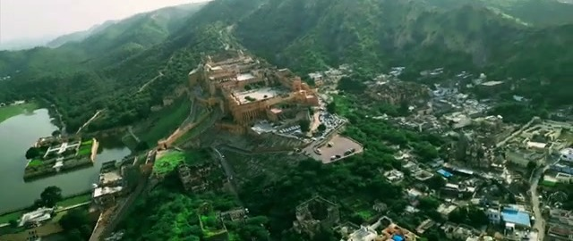
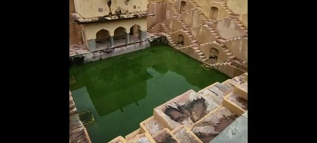
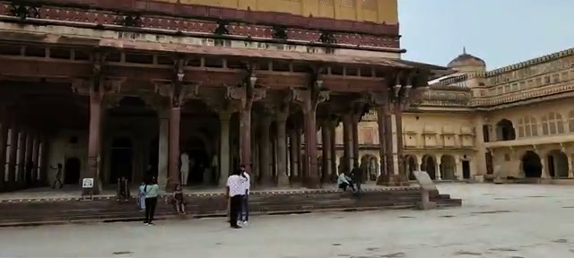
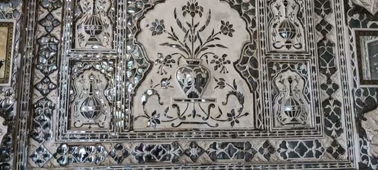
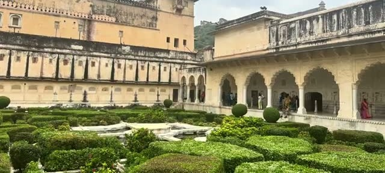
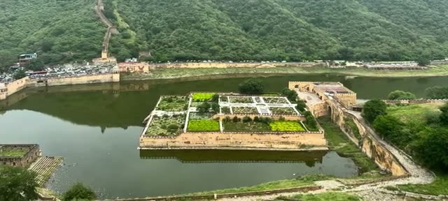
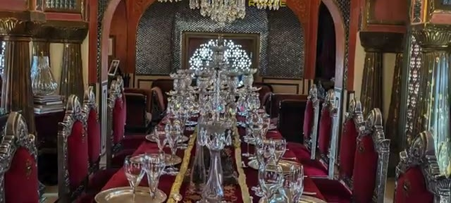
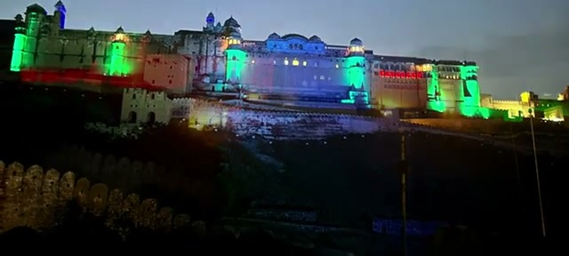
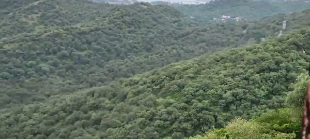
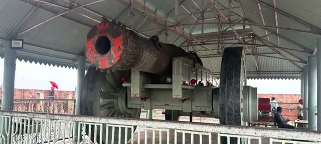



Amer Fort — also spelled Amber Fort — sits just north of Jaipur and is one of the hill forts of Rajasthan on the UNESCO World Heritage list. The video's verdict is blunt: "Amer is a must-do on a Rajasthan itinerary." We'd agree. Here's how the day goes.

## Getting there: jeep up from the market

The easiest plan, straight from the video: park at the Rajasthan Govt Market and take a jeep up to the fort for Rs 550. On the way up, stop at Panna Meena ka Kund —

— a stepwell that the video says served as the queen's private pool. And "consider hiring a guide for Rs 400 along with the jeep" — money well spent at a place with this much layered history. The jeep takes you up the cobblestone path to the entrance.

## A quick history of the fort

The video gives the capsule version: the fort was built after the Rajputs' victory over the Meenas, and "the fort was expanded over the decades." There's plenty of fusion between Rajput and Mughal architecture throughout. Eventually the capital was moved from Amer to Jaipur — and Sawai Jai Singh II later built Jaigarh Fort on the hill overlooking Amer, which we'll get to at the end.

## Inside: courtyards, Diwan-i-Khaas, Sheesh Mahal

Have the guide get your tickets from the courtyard, then head in to see the splendor. First stop: the Diwan-i-Khaas.

From there it's on to the main palace entrance and the Sheesh Mahal — the Hall of Mirrors — with its "carved Belgian mirrors."

The mirror inlay work is astonishing up close — thousands of tiny pieces set into plaster, throwing light around even the dimmest rooms.

## The gardens and Maota Lake below

Outside, the Man Singh Palace courtyard has a manicured charbagh-style garden worth a slow walk.

And from the palace's colonnaded terraces you get the views of the lake below — Maota Lake, with the Kesar Kyari (saffron garden) laid out in its neat geometric beds at the foot of the hill.

## Lunch at 1135 AD

For lunch there's a fancy restaurant called 1135 AD, set inside the fort complex — the video says it's often booked by VIPs and celebrities, and there are lots of options, traditional Rajasthani included.

The order suggestion from the video: "try the gatte ka saag and ker saangri."

## The evening sound and light show

Stay into the evening and get tickets to the sound and light show at the fort. There are English and Hindi versions available, and they narrate the history over the years as the fort walls are lit up in shifting colors.

## Jaigarh Fort and the Jaivana cannon

Don't skip the second half of the day: there's a road going up to Jaigarh Fort, and you can drive all the way inside to the top. The marvelous Aravalli views alone justify it —

— and from this vantage point you can see Jal Mahal, Jaipur city, and Amer all in one sweep.

The Jaivana cannon on display at Jaigarh is the star exhibit up here — a massive old cannon under its shelter, a reminder that Jaigarh was the military stronghold watching over Amer.

Practical wrap-up: jeep for Rs 550 from the Rajasthan Govt Market, guide for Rs 400, tickets from the courtyard, lunch at 1135 AD, and the sound and light show in the evening if you can stay. Two forts, one lake, and a stepwell — it's a full day, and worth every minute.
