*Visited August 2026 • Apukka Resort, Rovaniemi, Lapland, Finland*

You can watch our full stay here:



Our night at Apukka Resort in Lapland, Finland, was spent in a glass igloo on the shores of a lake — a **Lakeside Aurora Cabin Family** at Apukka Glass Igloo Hotel, booked for the lakeside sauna, the Arctic bath, and the chance to sleep under the stars from bed.

Here is our honest look at the cabin, the sauna, the food, and whether it lives up to the dream.

---

## Getting There: Rovaniemi by Train

We arrived in **Rovaniemi by train**, and made a stop at the Santa Village first — a visit to Santa and lunch there before heading to Apukka.

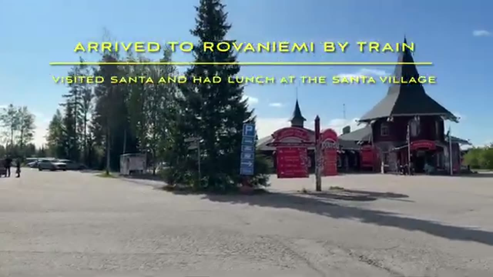

Apukka sits **on the shores of Lake Olkkajärvi**, a short drive from Rovaniemi, with the cabins spread along the lakeside among the pines.

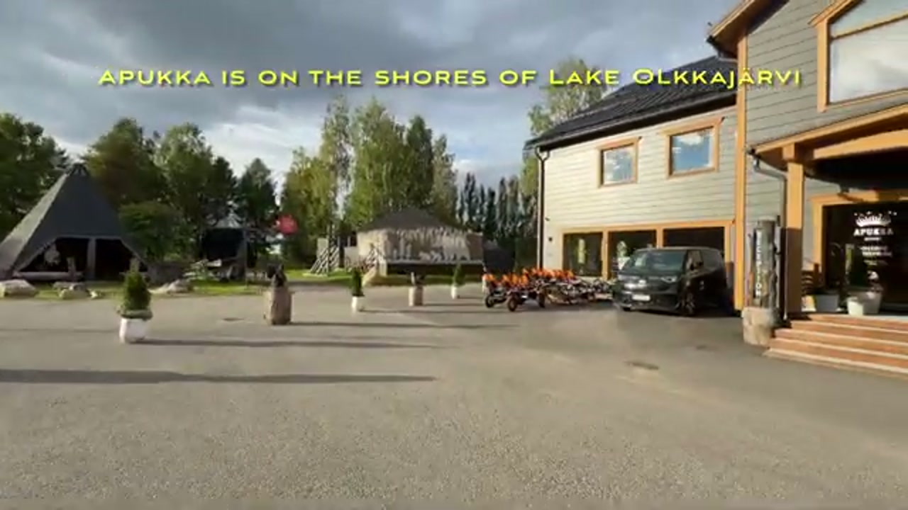

Check-in, happily, was a breeze.

---

## The Lakeside Aurora Cabin Family

We booked the **Lakeside Aurora Cabin Family** — and the first impression is that the entire cabin feels like high-end glamping: warm wood, a compact but clever layout, and glass where it matters most.

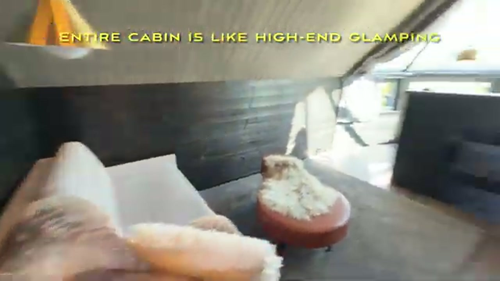

The standout feature is the bed setup. The main king bed sits directly under the glass roof, so the sky is the ceiling — the whole point of a glass igloo, and the reason you book one.

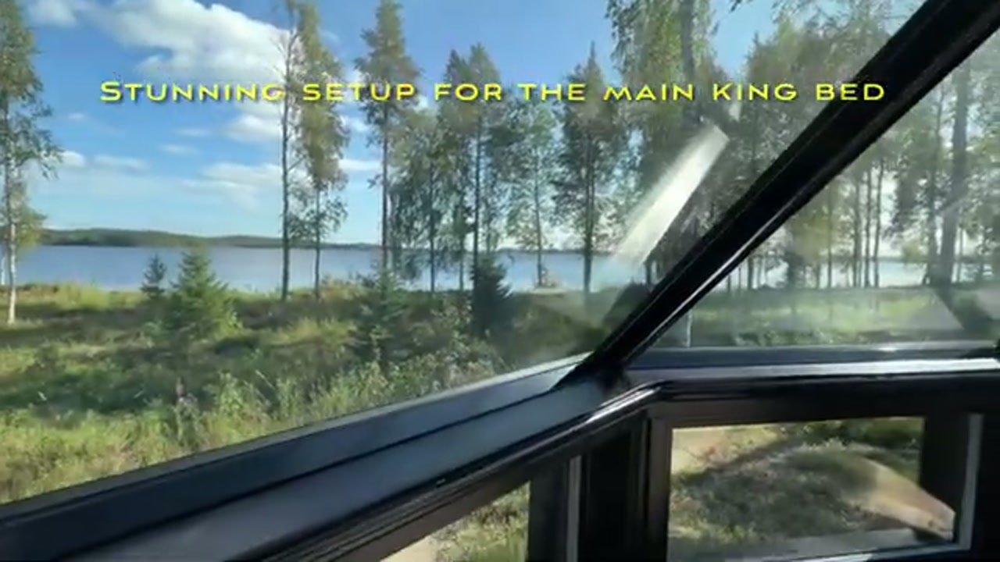

Families are clearly thought of, too: the kids' nook is like a little wooden cave of its own, a den the younger ones claimed immediately.

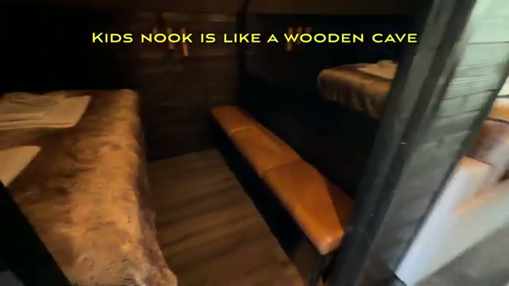

The bathroom keeps the same modern Scandinavian design language, with a rain shower, slippers provided, and everything well stocked.

---

## The Lakeside Sauna and Arctic Bath

This is the experience the trip was built around, and it needs a little planning: **we pre-booked a slot for the lakeside sauna and Arctic bath**, so if you want it, book ahead rather than hoping for a walk-in.

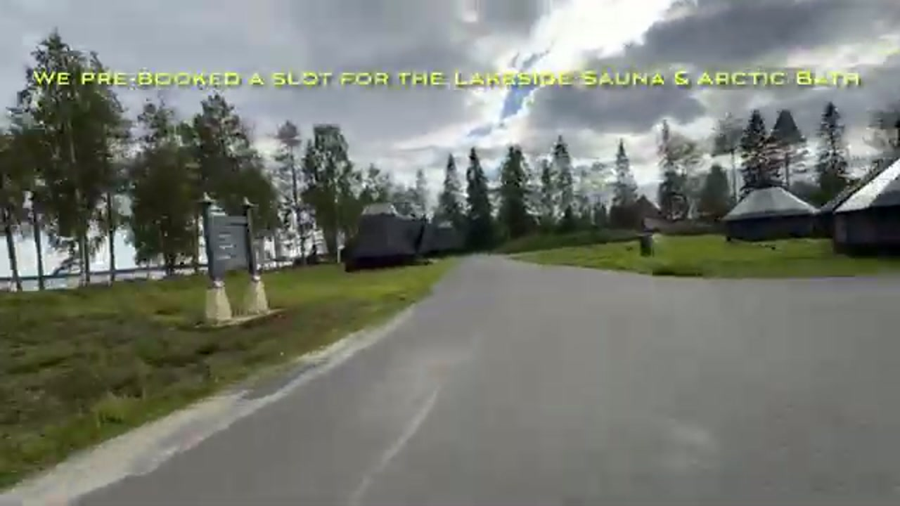

Each sauna cabin is very well stocked — towels, robes, water, shampoo and body wash are all provided, so you don't need to bring much beyond yourselves.

Inside, it's a **proper traditional wooden Finnish sauna**, with a real stove and that dry, enveloping heat that only a wood sauna delivers.

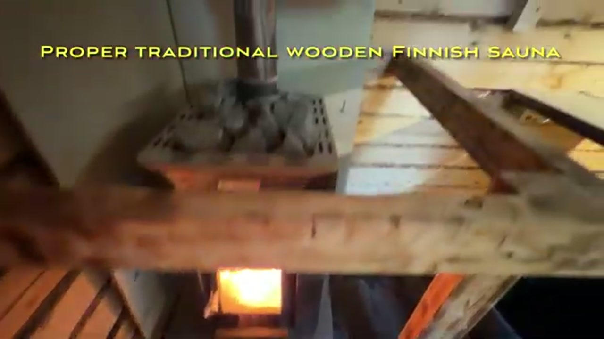

And then there's the view: the sauna has a window looking straight out over the lake, so you can sit in the heat and watch the water.

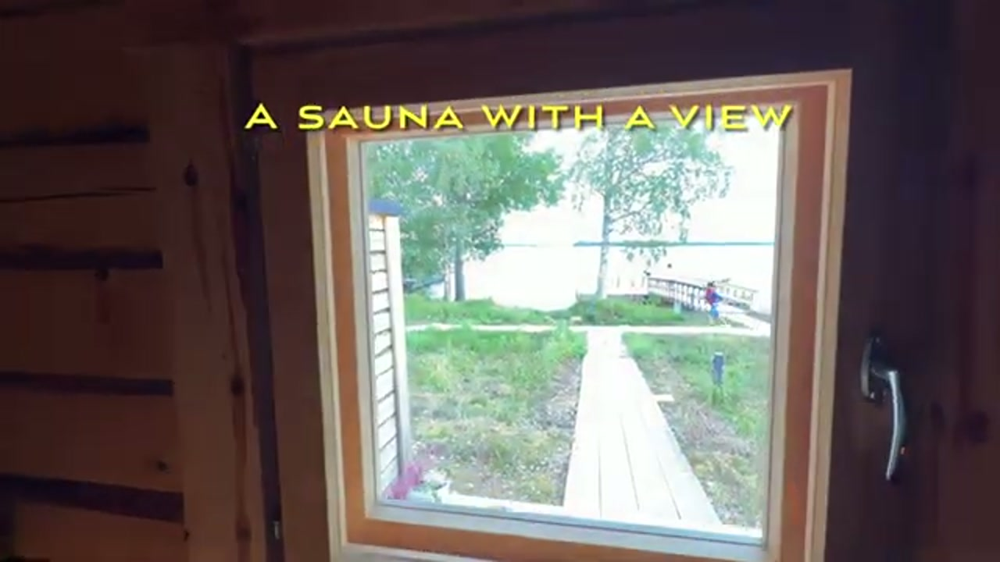

The ritual is the thing — sauna, then out to the Arctic bath in the lake, then back for more heat. It is, as the video puts it, a truly unique experience to run back and forth between the two.

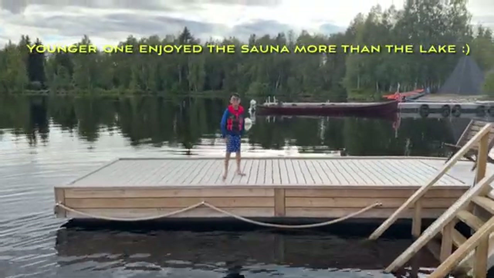

Our younger one, tellingly, enjoyed the sauna more than the lake — the cold plunge is not for everyone, and that's part of the fun.

---

## Dining: Curry Masala and Breakfast

For dinner we drove into **Rovaniemi town for curry at Curry Masala** — a genuinely nice meal, and a welcome change of pace after a day of sauna and lake air.

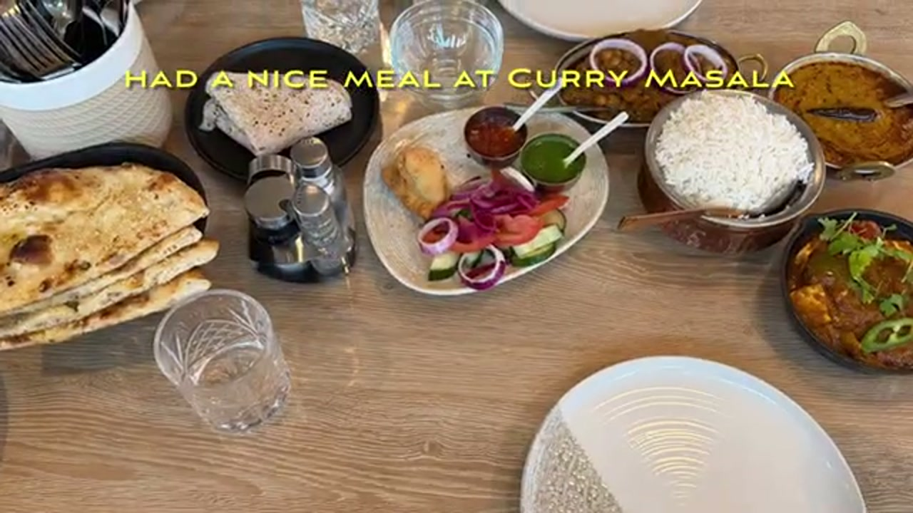

Breakfast the next morning was a generous buffet spread — plenty of fruit, pastries, breads and yogurt to set you up for the day.

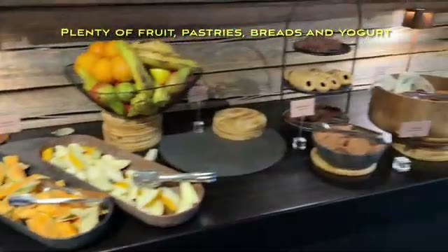

---

## Reindeer, Campfire, and a Night Under the Stars

One of the resort's charms is that it's a working Lapland property, not just a row of cabins: we went back to check out the **on-property reindeer**, and there's a campfire hut just down from reception for an evening by the fire.

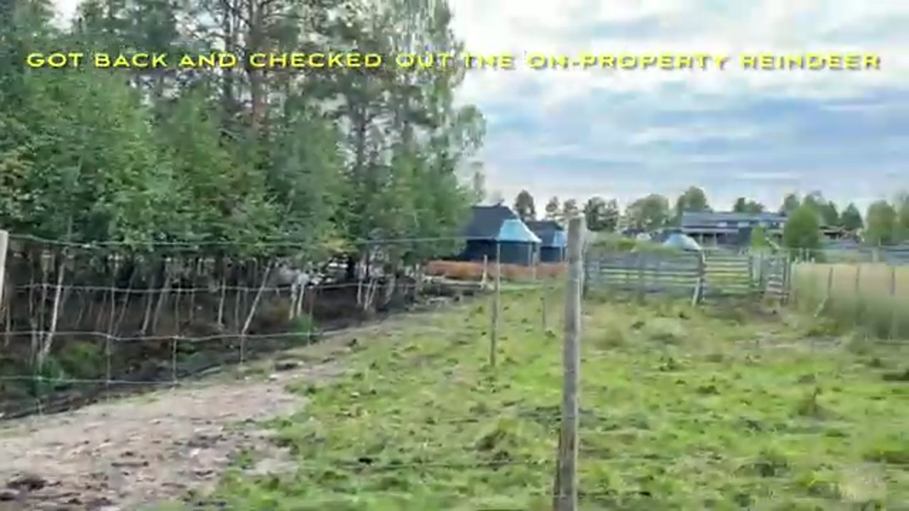

After dinner, the evening's real highlight was a walk through the forest — a flat 2km boardwalk trail that ends at the lake. The reward was a stunning, prolonged sunset over still water, the almost-midnight sun hanging low and the lake like glass.

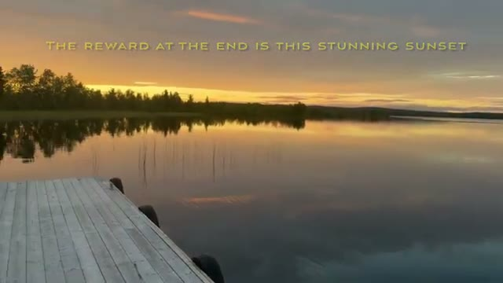

Back at the campfire hut, marshmallows from the front desk rounded off the walk — a fun reward for the 2km.

Late August isn't aurora season, and we knew that when booking — the draw that night was sleeping under the stars, not the lights. The resort does have an app with a 7-day aurora forecast and notifications, handy when the season is right.

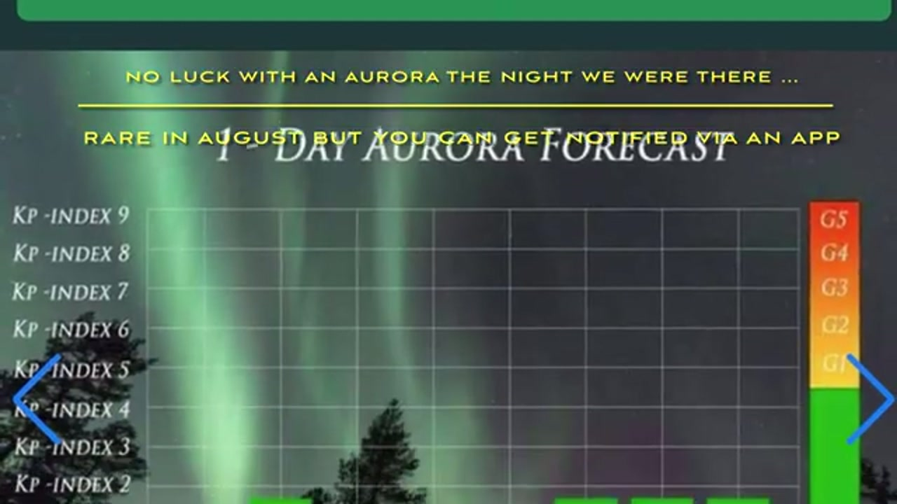

That's a summer visit here in a nutshell: long golden evenings, a warm lake ritual, and a sky full of stars above the glass roof.

---

## Practical Tips

- **Book the sauna slot in advance.** The lakeside sauna and Arctic bath run on pre-booked slots — don't leave it to chance.
- **A note on the aurora.** Late August isn't aurora season — we knew that when booking. If the lights are the reason you're coming, plan for the dark season; if it's the stars, the sauna, and the lake, summer delivers.
- **The aurora forecast app.** A 7-day forecast with notifications, handy in season so you won't sleep through a display on the nights it does appear.
- **Families: the Family cabin works.** The kids' nook and the well-stocked sauna cabins make this an easy family stay, not just a couples' bucket-list trip.
- **Getting home is easy.** Rovaniemi airport (RVN) is small but rapidly expanding, and the resort is a short drive away.

---

## Final Thoughts

Apukka is one of those places that delivers exactly what it promises — a glass roof over your bed, a proper Finnish sauna on the water, and a lake to plunge into between rounds of heat.

**Pros**

- The **glass roof over the king bed** — the defining feature, and it works
- A **proper traditional wooden sauna** with a lake view, well stocked
- The **sauna-and-Arctic-bath ritual** is genuinely unique
- **Family-friendly** in practice, not just in the brochure — kids' nook, reindeer, campfire hut

**Cons**

- The **sauna needs pre-booking**, so spontaneity is limited

Overall, a one-of-a-kind, magical experience we'll always cherish — and one we'd happily repeat, for the stars, the sauna, and the lake.
