

The BAPS Swaminarayan Akshardham temple complex in Robbinsville, NJ has been under construction for over a decade — and in late 2023 its main Mahamandir, the Great Temple, finally opened. We drove down to see it, and it's genuinely magnificent: a must-see attraction within easy reach of both New York City and Philadelphia.

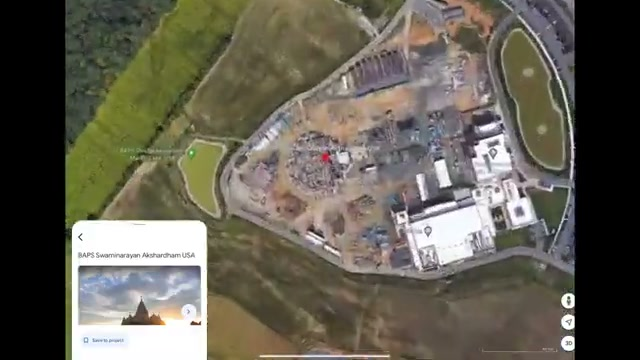

## Arrival: parking, walkways, and a giant yogi

The complex is built for big crowds — the parking lot is massive, and the video's own caption calls it out: "massive parking lot to accommodate all the visitors."

From the lot, visitors walk along a fenced path toward the complex —

— and are greeted on arrival by a huge golden statue of a yogi, arms raised, in the courtyard plaza.

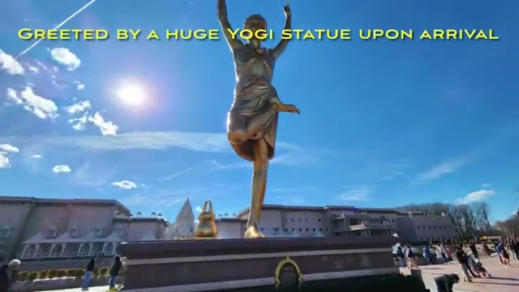

The grounds include stone chhatri pavilions (domed kiosks) where visitors gather,

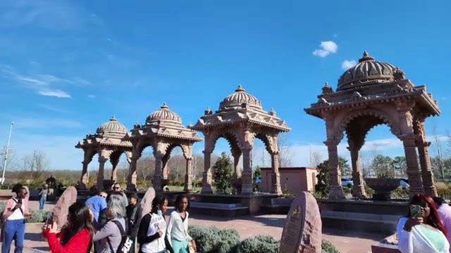

and a large bronze relief map of India — labeled "INDIA" and "INDIAN OCEAN" — studded with golden temple markers.

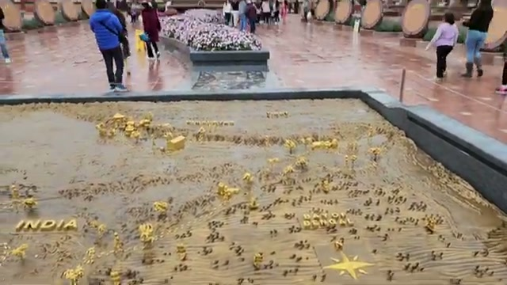

Heads-up from the video: on good-weather weekends there can be crowds — but "don't let that deter you, well worth the trip."

## The first temple

Before the Mahamandir, the complex's first temple opened at this site several years ago, pre-COVID — an intricately carved white-marble temple. It's the one that put Robbinsville on the map for temple visitors long before the main opening.

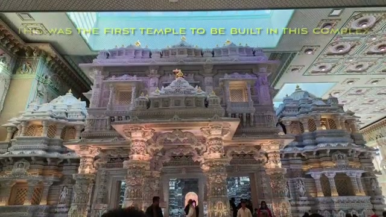

## The Mahamandir: the Great Temple is done

Now the Mahamandir — the Great Temple — is done too, and it dominates the complex: a soaring carved shikhara (spire) ringed by smaller spires and flying flags, built, as the video notes, by the labor of tens of thousands of volunteers and workers.

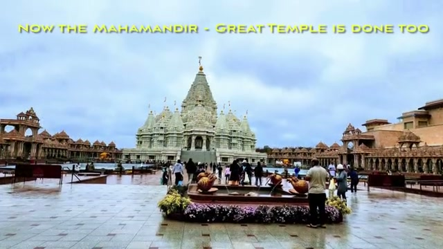

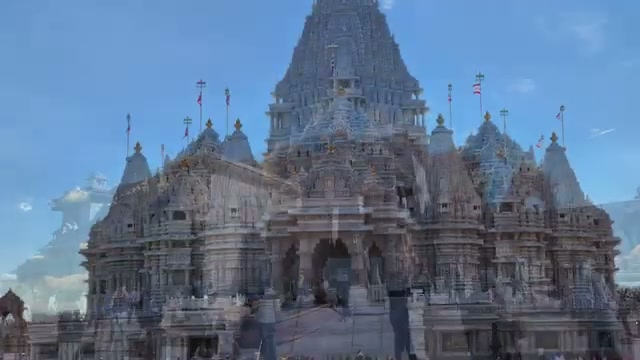

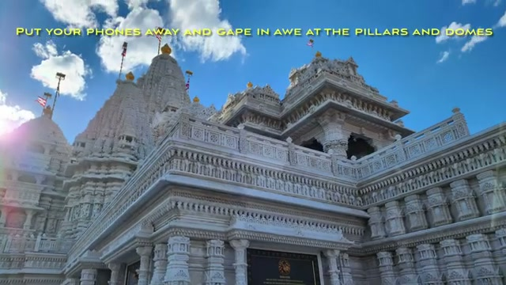

Two things to know before you go inside. First, the entrance hall has orientation theaters, and the carved, painted interiors — pillars, domes, and intricate ceilings — are the highlight, so put your phone away and just gape in awe. Second: no photography is allowed inside the main temple, so the interiors are something you have to see in person.

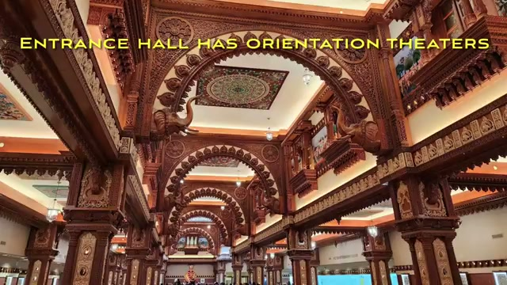

## The one-way route exits through a café

The visit follows a one-way route — and, true to form, it exits through a café. The Shayona Café is a slick Indian food court with many counters: sweets and snack display cases, self checkout, and a roomy seating area.

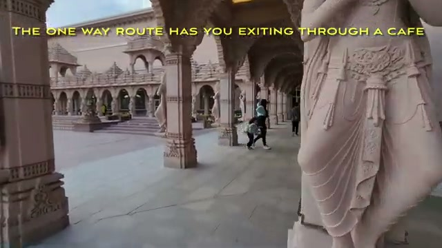

And the sweet ending to your visit: soft-serve ice cream and milkshakes at the dessert counter.

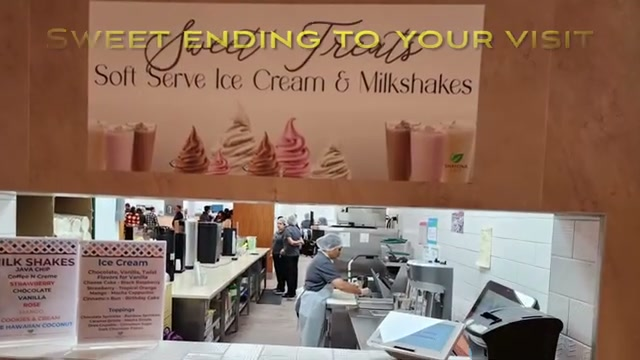

## Wrapping up

A decade-plus in the making, the Akshardham complex is one of the most spectacular things we've seen anywhere near NYC or Philly. Arrive early on a good-weather weekend to beat the crowds, leave the camera in your pocket for the inner sanctum, and save room for ice cream.

## How to plan your visit

Treat this as a full half-day outing, not a quick stop. The complex is built for crowds — the parking lot alone is enormous — and there's more ground to cover than you'd expect: the arrival plaza with the golden yogi statue, the stone chhatri pavilions, the bronze relief map of India studded with golden temple markers, the first white-marble temple, and then the Mahamandir itself, which has its own plaza, colonnaded courtyard, and orientation theaters in the entrance hall. The visit follows a one-way route, so you're committing to the whole walk once you start; there's no casual backtracking. Give yourself unhurried time to actually look at the carving, because the interiors — carved and painted pillars, domes, intricate ceilings — are the whole point, and you can't photograph them to study later. No photography is allowed inside the main temple, so the only way to keep those ceilings with you is to spend real time under them.

Timing matters more here than at most day trips. The post's own caption is honest about it: on good-weather weekends there can be crowds. That's when we went, and we'd do it again, because a bright day makes the carved stone glow — but we'd arrive early, when the parking lot is still filling and the walkway from the lot isn't a procession. Weekday mornings are the obvious alternative if your schedule allows; a Saturday at noon in good weather is the peak, and it's exactly when the "massive parking lot" earns its name. Plan your route so the Mahamandir comes first and the food court last, which is also the complex's design — the one-way route exits through the Shayona Café. It works: you end your visit sitting down with Indian sweets or soft-serve, which is a far better note to leave on than trudging back to the car hungry.

Start at the first temple before the crowds concentrate at the Mahamandir. The white-marble temple opened several years before the Mahamandir — it's the one that put Robbinsville on the map — and it still gets walked past by visitors who sprint for the big new building. Don't be those visitors. Then take the orientation theater in the Mahamandir's entrance hall seriously rather than skipping it on your way in: it frames everything you're about to see, including the fact that the temple was raised by tens of thousands of volunteers and workers, and once you know that, the carving reads differently.

## What we'd change next time

We'd arrive earlier. We'd also plan for the no-photography rule better — not just knowing about it, but mentally preparing the kids for it, because the one place they'll most want a photo (the painted interiors of the Mahamandir) is the one place they can't have one. We told ourselves we'd remember it all; we'd do a better job of slowing down in the entrance hall and actually looking at the ceilings instead of moving through to the next thing.

We'd eat a real meal at the Shayona Café, not just ice cream. The café is a proper Indian food court — sweets and snack display cases, multiple counters, self checkout, a roomy seating area — and we underused it. If your kids have never had a real dosa or chaat outside a restaurant at home, this is a low-stakes place to try, with the roomy seating and self checkout making it easier than a sit-down restaurant with a tired family. Next time we'd plan lunch there rather than snacking and leaving.

And we'd spend more time outside before going in. The arrival sequence — the fenced walkway from the lot, the golden yogi statue with raised arms in the plaza, the chhatris, the bronze relief map — is genuinely interesting in its own right, and it's easy to treat as just the walk to the real thing. The relief map alone, with its golden temple markers across the subcontinent, is worth a few minutes with kids who are old enough to find India on it.

## Practical tips for families

**Expect a lot of walking.** From the massive parking lot along the fenced walkway, through the plazas and courtyards, along the one-way route to the café exit — this is a walking visit. Wear comfortable shoes, and if anyone in your group has mobility issues, plan for a slow pace rather than a short one. There's no shortcut once you're on the route.

**Prep kids for the phone rule.** No photography inside the main temple is the one rule that will genuinely disappoint kids — and adults. State it before you walk in, not after they're caught mid-photo. Our framing: the carving is the attraction, and looking at it through your eyes instead of a screen is the whole deal. It lands better when it's a family challenge than a scolding from a stranger.

**Use the one-way route to your advantage.** Because everyone flows the same direction, you won't be fighting upstream traffic or losing kids in two-way bottlenecks — it's one of the more stroller- and crowd-friendly layouts we've seen at a big attraction. The tradeoff is that you can't easily duck back for something you missed, so if a kid wants to linger at the golden yogi or the bronze map, let them linger; you're not coming back.

**Eat at the exit, not before.** The Shayona Café sits at the end of the route by design — slick food court, many counters, sweets and snack cases, self checkout, plenty of seating. Don't pre-game with a fast-food stop on the highway; save the appetite. And the dessert counter's soft-serve and milkshakes make an excellent bribe-or-reward for kids who handled the no-photos rule and the long walk with grace. On a crowded good-weather weekend, the café doubles as your decompression room before the drive back to the city.
