

Chittorgarh Fort — "an imposing structure built and ravaged over centuries," as the video puts it — sits 180 meters above Chittorgarh city, its temples, palaces, and towers spread across almost 700 acres. The video sums up its past in one line: "the history is dominated by battles between Rajputs and generations of Mughals." But it's not a museum piece: it's a thriving, active fort, and a must-visit on a tour to Rajasthan.

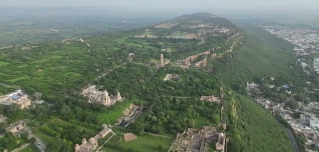

## Getting there: leave the car, take a rickshaw

A roughly 1km road winds its way up from town to the fort. We left our car at the bottom and took a rickshaw up — the practical way to do it.

On the way up you pass through a series of gates until you get to Ram Pole — the fort's old defensive layers still very much intact.

Timing note from the video: they visited during the August 15th week and it was "extremely busy" — plan around Indian holiday weeks if you can.

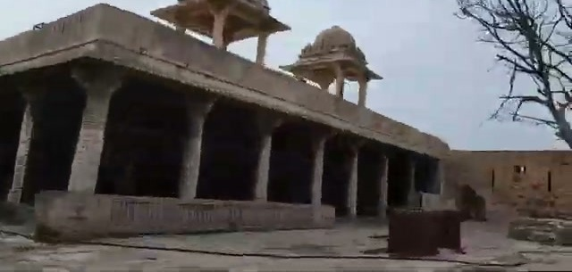

## Rana Kumbha's temples and the Vijay Stambha

Most of the fort's intact structures date from the time of Rana Kumbha — the temple plazas are busy with visitors and dense with carved stone. You'll likely arrive at the Meera Bai temple first, dedicated to Meera Bai's worship of Lord Krishna.

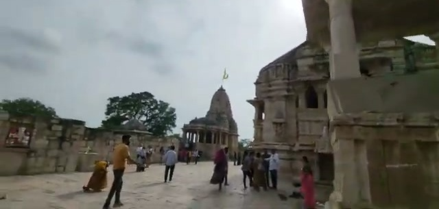

The standout is the Vijay Stambha, the Tower of Victory — "the Vijay Stambha (Tower of Victory) stands tall," nine stories of it.

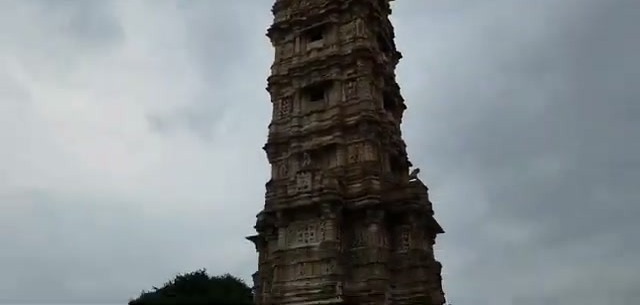

## Sight-see alongside the monkeys

Fair warning, straight from the video: "get ready to sight-see alongside monkeys!" They own the carved gateways as much as the visitors do.

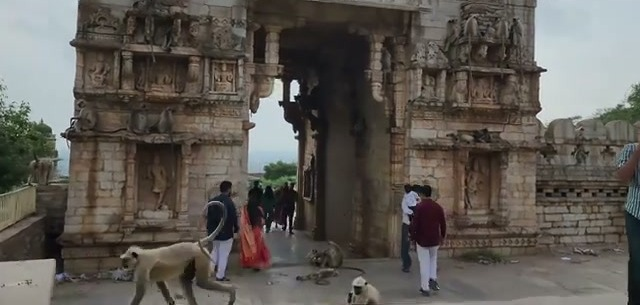

Take time with the carving work — the shikharas and walls are dense with ornament, "such gorgeous architecture — 500+ years old." And per the video, don't miss the Neelkanth Mahadev temple for more of the ornate architecture.

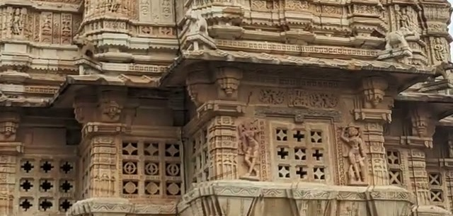

## Padmini's Palace and Bhimlat Kund

Padmini's Palace stands by the water — "a shadow of its former glory," in the video's words, but the setting by the lotus pond is lovely.

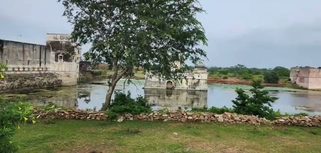

Nearby, Bhimlat Kund — the pond with a small Shiv mandir — draws some adventurous diving, right off the kund's edge.

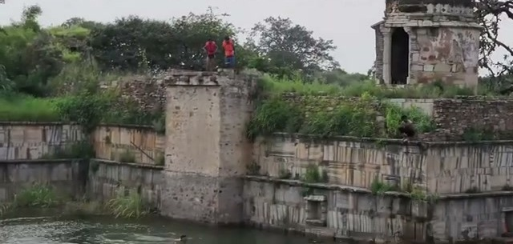

## The back side: Kirti Stambha and the views

Kirti Stambha stands on the back side of the fort — the road there runs green and quiet, a contrast to the busy temple plazas.

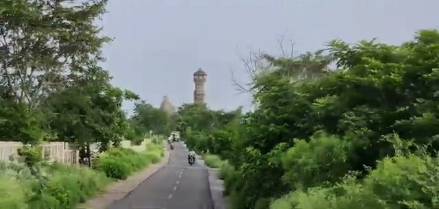

The fort rewards its viewpoints: it overlooks the city — "the rains make the city views more appealing" — and from the other side, Suraj Pole faces the valley, with Fateh Prakash Palace in view and scenic farmland stretching till the eyes can see.

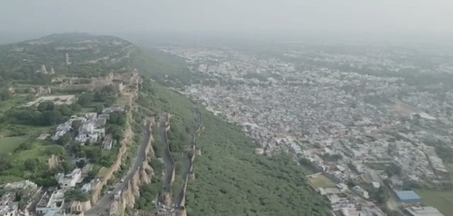

## Wrapping up

A lush green fort complex full of temples and palaces overlooking the city — a thriving, active fort, and a must-visit on a tour to Rajasthan. Bonus find: Udaipur's Maharana Pratap Smarak has a scale replica of the whole fort — a nice way to grasp the full 700-acre sprawl in one look.

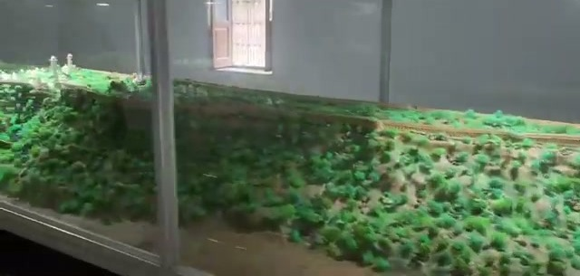
