

The Cowshed Boutique Bunkhouse in Uig sits somewhere between a campsite, a hostel, and a hotel — the video's own description of the experience. Set on the Isle of Skye within striking distance of the Quiraing, it's a pod-style stay: arched glamping pods set into a grassy hilltop above Uig bay. This video covers a family stay in an ensuite pod.

## Location: Uig, on the Isle of Skye

The bunkhouse is in Uig, on the west coast of the Trotternish peninsula — the ferry village at the head of Uig Bay. The video's map puts the pin right above the town, and the Fairy Glen sits just down the road.

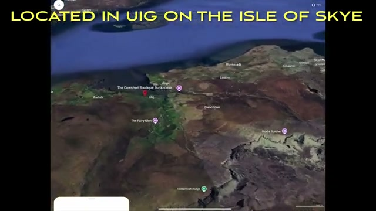

## The pods: "a bunch of sheds built into the hilltop facing the bay"

That's the video's phrase, and it's fair — arched wooden pods are set into the grassy hilltop above the village, all facing the water. The approach is up past the houses of Uig, and once you're on the hill the view opens over rooftops, the bay, and the misty Trotternish hills beyond.

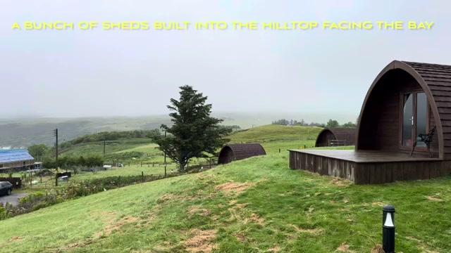

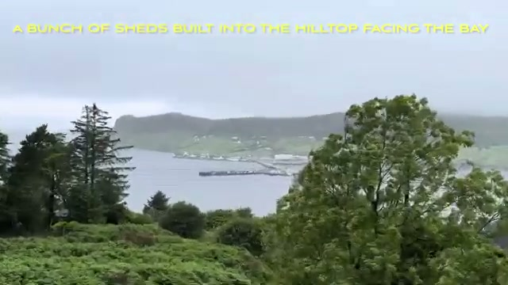

## Shared cooking facilities in the reception building

Self-catering is part of the deal here: shared cooking facilities are housed in the reception building, down the path from the pods. That's the campsite side of the campsite/hostel/hotel mix.

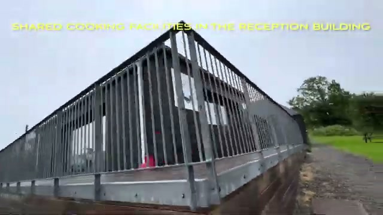

## Inside: the ensuite pod for a family

The video's stay was in the ensuite pod for a family — a wood-clad interior with a double bed dressed in white linens and folded towels, a small window, and a bathroom tucked into the corner (the sink is visible just through the doorway). The video's caption calls the bathroom a "tiny RV-style bathroom," which is about right: compact, functional, and very much part of the pod experience.

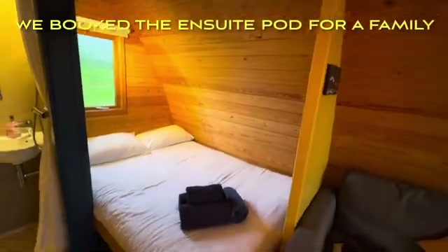

## The pod's sitting area

The other end of the pod is a lounge corner — a grey couch with yellow cushions facing back toward the bed. It's small, but there's a clear divide between sleeping and sitting, which matters in a pod this size.

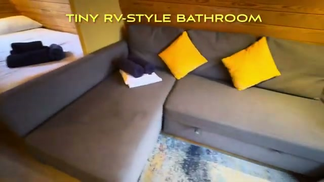

## A cute patio overlooking the bay — often windy

Each pod opens onto a wooden deck with a railing, looking straight over Uig and the bay. The video calls it a "cute patio" and adds the honest Skye caveat: it's often windy up here. On a clear spell it's a lovely spot; on a blustery one, you'll be drinking your tea inside.

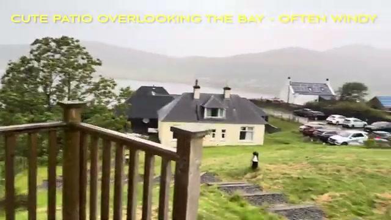

## A friendly patio visitor

One of the video's best moments: a hen wandering the deck and peering through the pod's glass door. The free-range locals clearly know the drill.

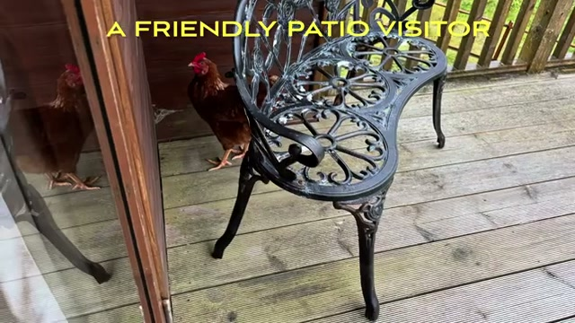

## Breakfast: The Anchorage Cafe in town

Breakfast isn't served at the bunkhouse, so the video heads down into Uig to The Anchorage Cafe — the blue-fronted cafe on the main street, which also does fish and chips.

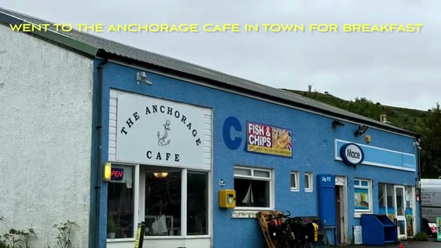

## Nearby: the Quiraing

The reason to base yourself here: the Quiraing, which the video calls the "most popular hike/viewpoint on Skye." The footage shows the classic Trotternish drama — mist hanging off the basalt cliffs, green ridges folding down to still lochs. It's the big-ticket Skye outing, and it's a short drive from Uig.

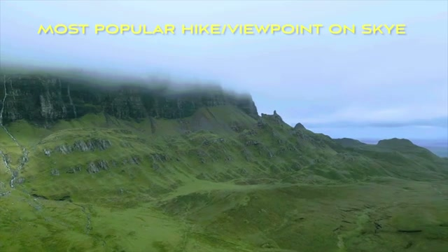

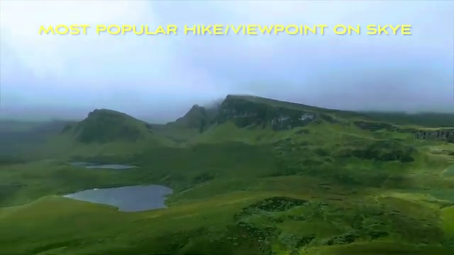

## Verdict

The Cowshed Boutique Bunkhouse is a fun, unfussy base for the north of Skye — a proper glamping pod with an ensuite bathroom, set on a hilltop with big views over Uig bay, and shared cooking facilities if you'd rather self-cater. It isn't a hotel-hotel, and it doesn't pretend to be: that's the charm. If the Quiraing is on your Skye list, this puts you close to it — just pack for wind, because the patio earns its "often windy" warning.
