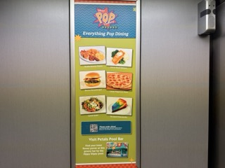
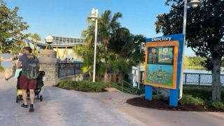
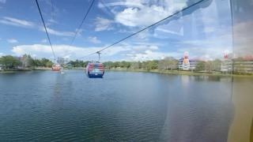
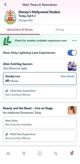
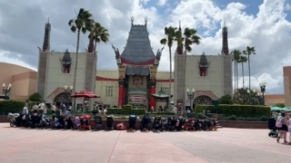

Planning a Disney World trip can feel overwhelming — especially with all the new systems, reservations, and add-ons. After our recent trip to Orlando, I put together a structured approach to minimize stress, maximize ride time, and keep costs reasonable.

This guide breaks everything down by **when you need to book it**.

---

## 🗓️ 91+ Days Before Your Trip

### 🏨 Book Your Disney Hotel (<$300/night)

We chose **Disney Pop Century Resort**, part of Disney’s value category.

You *can* splurge on deluxe resorts, but we spend very little time in the room — so value made more sense.

**Why Pop Century worked for us:**
- Early park entry perks
- Access to Lightning Lane booking advantages
- Can accomodate familes of 4 with a queen and a murphy bed - beds were very comfortable
- Bus service to Magic Kingdom

- 🚠 **Skyliner access to Hollywood Studios** (huge for Star Wars fans)

We booked on **Priceline** via **TopCashback** which was the best deal I could find at the time (better than booking direct with Disney.

We were able to link the priceline reservation to the MyDisneyExperience app easily.

---

### 🎟️ Buy Theme Park Tickets

In our case (your mileage may vary):

- **2 days, 1 park per day**
- 💰 ~$318 per person

Keeping it to 1 park per day simplifies logistics and reduces stress.

---

### Install MyDisneyExperience
You'll need this app. Install it and set up an account if you don't already have one (e.g. via Disney+)

You can then link your theme park tickets and hotel booking to your account.

## 🗓️ 90 Days Before

### 🍽️ Dining Reservations

Use the Disney website and **link your hotel reservation** to unlock booking.

**What we booked:**

- **Oga’s Cantina (Hollywood Studios)**
  - ~$120 for a family
  - Drinks + snacks (not a full meal)
  - Totally worth it for the Star Wars atmosphere

- **Magic Kingdom Fireworks Dessert Party**
  - $100/adult, $50/child
  - Expensive — but worth it
  - 🎆 Reserved viewing area = no crowds, no stress

---

## 🗓️ 10 Days Before

### 🎯 VIP Concierge Service (~$100/person)

For Magic Kingdom, we used a third-party concierge service.

They:
- Add themselves to your Disney account
- Manage Lightning Lane bookings
- Plan your day in real time

👉 We used: https://www.japaorlando.com (Rodrigo)

**Verdict:**
- Extremely valuable for Magic Kingdom (most rides, most chaos)
- Saves you from constantly checking your phone
- Much cheaper than Disney’s ~$350/person premium Lightning Lane option

---

## 🗓️ 7 Days Before (Critical Window)

### ⚡ Lightning Lane Passes (~$65/person)

At **7:00 AM**, 7 days before your **check-in date**, booking opens.

> ⚠️ Important: This is based on your **hotel check-in date**, not park day.

Example:
- Check-in Day = Day 1  
- Hollywood Studios = Day 3  
- You can book Day 3 rides at **T-7 from check-in (i.e., 10 days before park visit)**

**Must-book rides:**
- TRON (Single Lane)
- Rise of the Resistance (Single Lane)
- Seven Dwarfs Mine Train
- Millennium Falcon

If you’re using a concierge, they’ll handle this for you.

---

### 🤖 Wait Magic (~$35 for 10 days)

Website: thrilldata.com

This was one of the **best value tools we used**.

**What it does:**
- Links to your Disney account
- Monitors your Lightning Lane bookings
- Automatically searches for earlier times

**Real results:**
- Moved multiple evening rides into the afternoon
- Helped us finish Hollywood Studios by **6 PM**

💡 We used concierge for Magic Kingdom, but **Wait Magic handled Hollywood Studios perfectly** at a fraction of the cost.

---

## 🗓️ Day Of Your Visit

### 📱 Standby Skipper (~$25/day)

This tool:
- Books your next Lightning Lane automatically after you tap into a ride

**Our take:**
- Worked well for one ride
- Didn’t add enough value to justify repeat use

👉 Useful if you *really* don’t want to touch your phone at all during the day.

---

## 🎯 Final Thoughts

A stress-free Disney trip comes down to **planning + smart tool selection**:

- Spend early on **hotel + tickets**
- Lock in **experiences at 90 days**
- Use **automation tools or concierge services** to avoid phone fatigue
- Prioritize **Magic Kingdom support** (it’s the hardest park to manage)

We were able to:
- Ride everything we wanted
- Avoid long standby lines
- Finish parks early enough to relax

---

## 📌 What I’d Do Again

✅ Pop Century Resort  
✅ Fireworks Dessert Party  
✅ Concierge (for Magic Kingdom only)  
✅ Wait Magic  

## ❓ What I’d Skip Next Time

❌ Standby Skipper (low ROI for us)

---

I’ll be sharing a similar breakdown for **Universal Orlando** next — where the strategy is completely different (and arguably simpler).

Stay tuned!
