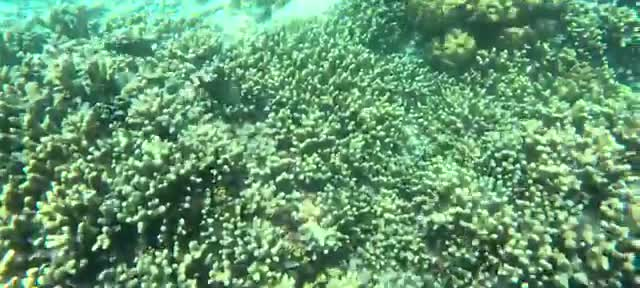
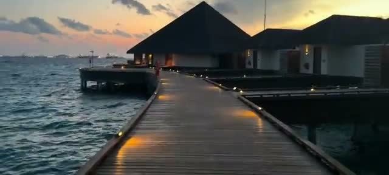

*Visited August 2025 • Feydhoo, Maldives*

You can watch our full hotel tour and experience here:



During my recent trip to the Maldives, I had the pleasure of staying at the **DusitD2 Feydhoo Maldives**, a luxurious resort offering overwater villas, all-inclusive dining, and a range of activities from snorkeling to nightly entertainment. Here's a detailed account of my experience.

## Arrival & Transfer

After landing at the airport, the resort arranged a **seamless transfer via ferry**. The journey across the crystal-clear waters of the Maldives was breathtaking and set the tone for the luxurious experience awaiting us.

- **Airport Arrival:** Smooth and welcoming.
- **Ferry Transfer:** Approximately 25 minutes across the lagoon, offering stunning views of the ocean and nearby islands.

## Check-In & Overwater Villa

The check-in process was effortless, with staff ensuring every detail was attended to. Our overwater villa was nothing short of spectacular:

- **Private deck with direct lagoon access** – perfect for a morning swim.
- **Spacious interiors** with modern amenities and a minimalist, elegant design.
- **Panoramic views** of the turquoise waters and nearby islands.

The villa truly captures the essence of Maldives luxury, combining comfort, privacy, and breathtaking scenery.

## Dining Options

DusitD2 Feydhoo offers a variety of restaurants with diverse cuisines:

1. **Baraveli** – A fine dining experience with a mix of local and international dishes.
2. **Soi Thai** – Authentic Thai cuisine with a vibrant atmosphere.
3. **MIDI Mediterranean** – Fresh Mediterranean flavors with a modern twist.
4. **Cocoon** – Casual dining perfect for lighter meals.
5. **Bo Chinese** – Elegant Chinese dishes in a refined setting.

The all-inclusive package made it easy to sample all the options, each offering exceptional service and quality. This is nothing like Caribbean all-inclusive resort meals - these are high-end dining and service.

## Activities & Experiences

- **Snorkeling:** The reef near the villa was teeming with colorful fish and coral. It’s an excellent spot for both beginners and experienced snorkelers.
- **Pool & Beach:** The resort has a stunning infinity pool overlooking the ocean and a pristine white sand beach.
- **Watersports & Jetskiing:** A variety of water activities are available, ensuring adventure for all ages.
- **Yoga & Tennis:** The resort provides wellness activities to keep you active and relaxed.
- **Nightly Entertainment:** From live music to cultural performances, evenings are lively yet sophisticated.

## Tips & Recommendations

- Even if you're not a fan, consider getting the snorkeling gear at the resort; the underwater life is worth exploring and very accessible
- Enjoy the villa at sunrise for peaceful, private moments.
- Try multiple dining options to get the full culinary experience.

## Final Thoughts

DusitD2 Feydhoo Maldives offers an unforgettable luxury escape. The combination of **overwater villas, pristine beaches, gourmet dining, and personalized service** makes it an ideal destination for families, couples, or anyone looking for a high-end Maldivian experience. While some may prefer the “desert island” isolation, the resort still provides plenty of tranquility amidst its beautiful setting.

If you're dreaming of a Maldives getaway, DusitD2 Feydhoo is a top-tier choice that delivers on both luxury and adventure.

---

*For more luxury travel reviews, follow along on our journey.*
