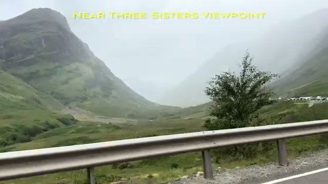
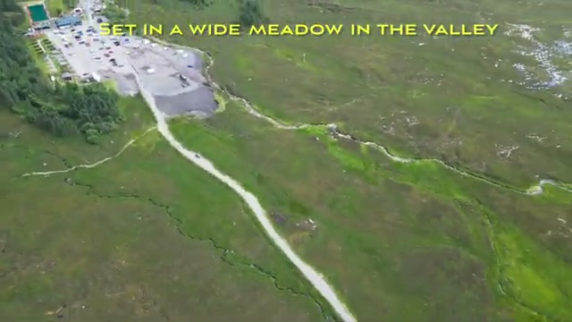
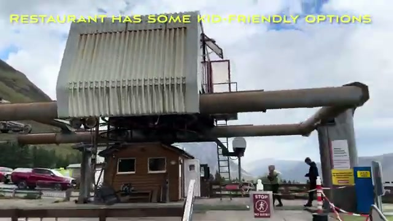
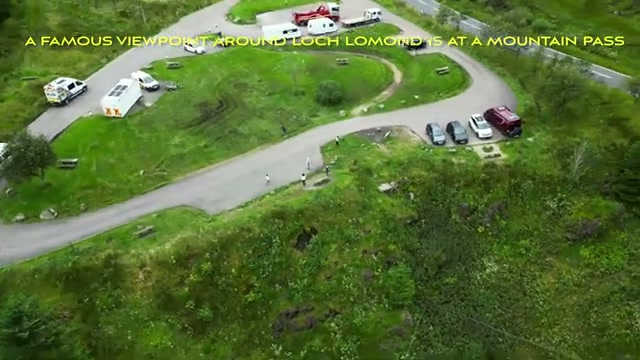
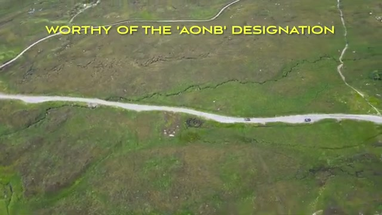



This is a short one — under five minutes — but it's a useful visual reference for anyone planning a Glencoe drive: the route map, the Three Sisters viewpoint, the Rest and Be Thankful pass, and the lochside road south. All the commentary is in burned-in captions, quoted below as they appear in the video.

## The route: north to south through the glen

The video opens with a route map showing the drive direction: "WE DROVE IT NORTH TO SOUTH/WEST TO EAST" — about 23.8 miles / 52 minutes per the on-screen map, tracing the A82 line through the glen and east toward the Loch Lomond area.

## The Three Sisters viewpoint

The first stop is near the Three Sisters viewpoint — the classic Glencoe postcard stop. In the video it's shrouded in mist, which is honestly the standard Glencoe experience: the ridges fade in and out of cloud, and when the light breaks through the green slopes it's worth the wait.

The Three Sisters car park sits "SET IN A WIDE MEADOW IN THE VALLEY" — the drone shot shows the long path leading in, the parking area, and the broad grassy valley floor stretching out below the peaks.

And this is the view that earns the video's "most photographed" claim — the valley opening between the peaks under a brooding sky, no caption, just the glen itself.

## A mountain restaurant with kid-friendly options

There's a stop at a mountain restaurant — the video's caption notes it "HAS SOME KID-FRIENDLY OPTIONS," which is the one practical family detail in the whole video. The building sits at the base of lift infrastructure with parked cars and a small wooden hut in front.

## Open moorland between stops

Between the named stops, the video shows the in-between driving: big open moorland under heavy cloud, purple heather in the foreground, a small settlement in the distance. This is what much of the A82 corridor actually looks like — wide, empty, and moody.

## A famous viewpoint around Loch Lomond, at a mountain pass

East of Glencoe, the route reaches what the video calls "A FAMOUS VIEWPOINT AROUND LOCH LOMOND IS AT A MOUNTAIN PASS" — a drone shot of the looping car park, packed with campervans and cars, set in a fold of green hillside.

## The Rest and Be Thankful viewpoint

The best-known stop on this eastern stretch is the viewpoint the video captions as "KNOWN AS RESTFUL AND BE THANKFUL VIEWPOINT" — the famous hairpin junction on the old military road, captured from the drone with the winding road snaking through the pass.

## The drive back south

The return leg is "A LOVELY DRIVE BACK TO SOUTHERN SCOTLAND/ENGLAND" — a lochside road running right along the water, the classic end-of-day Scottish driving shot with the sun breaking through.

## Worthy of the AONB designation

The video closes on a drone shot of a single mountain road cutting across open moorland with the caption: "WORTHY OF THE 'AONB' DESIGNATION." (Glencoe is actually a National Scenic Area in Scottish terms, but the sentiment is the point — this is one of Britain's most protected and photographed landscapes, and even a four-minute drive-through shows why.)

Thin as it is, the video works as a location checklist: Three Sisters viewpoint and car park, the mountain restaurant stop, the Loch Lomond-side pass viewpoint, Rest and Be Thankful, and the lochside run south. If you're driving the A82, those are your photo stops in order.
