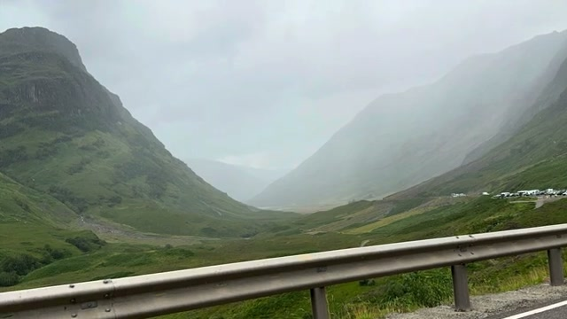
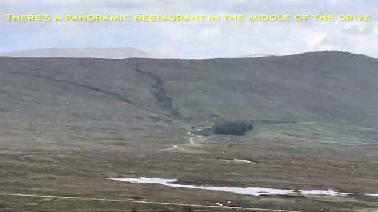
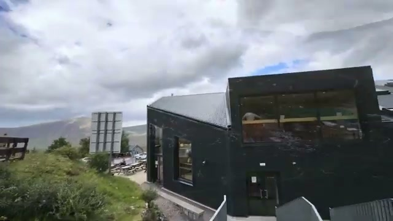
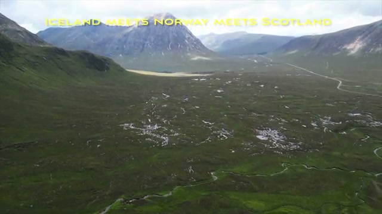
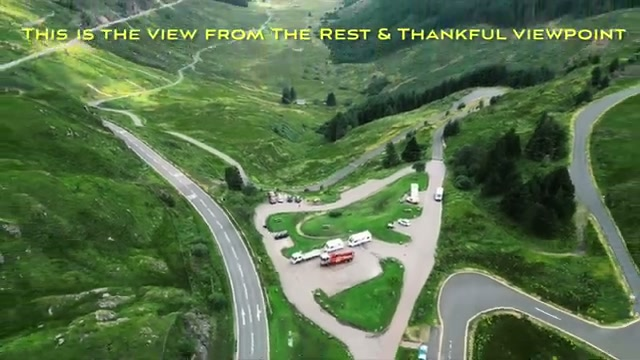



Glencoe is one of the Scottish Highlands' signature drives — a short, ~106-second video from August 2024 that mixes drone footage with roadside stops. The video's own caption sets the tone: "The drive through Glencoe is considered one of Scotland's finest." Here's what the drive looks like.

## The drive through Glencoe

Drone footage opens over the moorland, with the single road winding through green valleys. It's a sparse landscape — few trees, big open skies, and mountains rising on both sides.

## Few trees, green mountains

Pulling over at a roadside stop, the view is misty mountain walls on either side — as the caption puts it, "few trees, green mountains." The guardrail in the foreground is a reminder this is a working road, not a postcard backdrop.

## Streams everywhere you look

Water is the constant companion here. Streams cut through the green hillsides, and the video's caption says it best: "streams everywhere you look."

## The panoramic restaurant mid-drive

About midway along the drive sits a stop with a panoramic restaurant — visible here across moorland dotted with rocks and heather. "Well-named for the views," per the video.

The stop has parking, a couple of buildings, and a chairlift running up the hillside. There's sledding here too, and the chairlift takes you up for higher views — this is Glencoe's ski area, which runs summer activities.

## The view from the Rest & Thankful viewpoint

The video closes with drone footage over a wide Highland valley, captioned "Iceland meets Norway meets Scotland" — and it earns the comparison. The final stop is the Rest & Thankful viewpoint, with the road switchbacking through the valley below and a small parking area for the view.

## Verdict

A short, honest video: Glencoe's drive is all about the landscape — green mountains, streams, big sky — with two practical stops: the panoramic restaurant (plus chairlift and sledding) midway, and the Rest & Thankful viewpoint. If you're driving through the Highlands, both are worth the pause.
