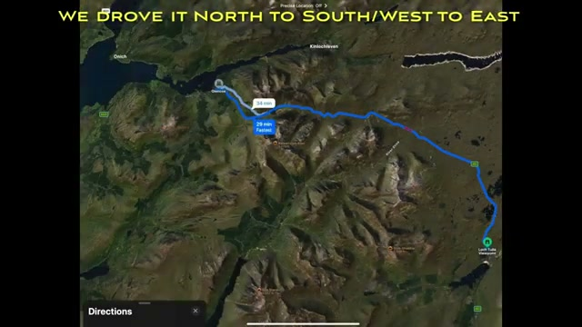
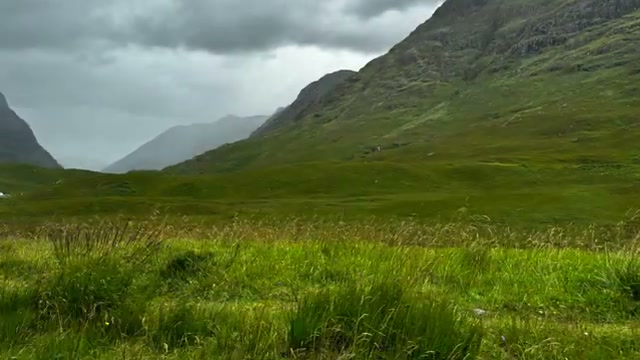
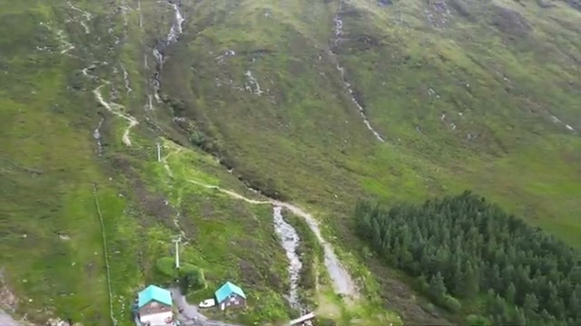
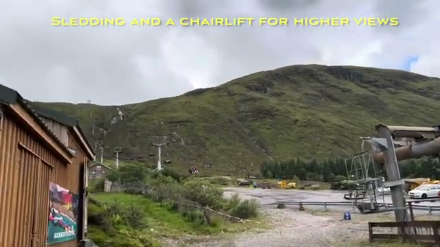
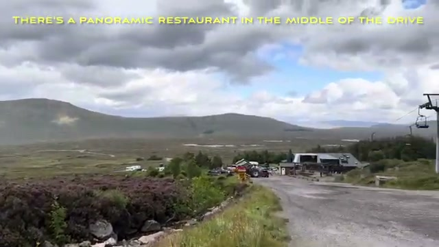
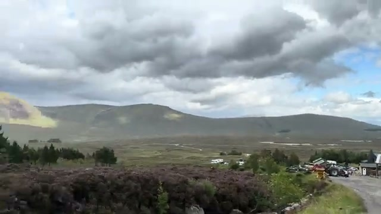
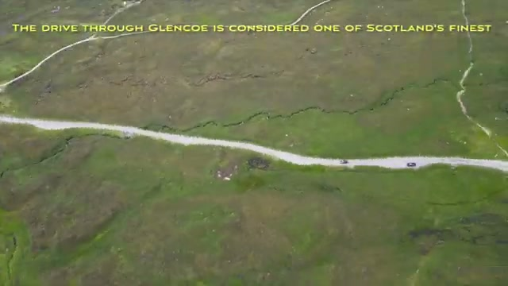
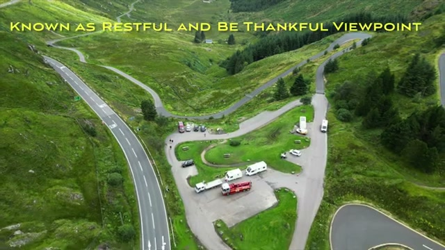
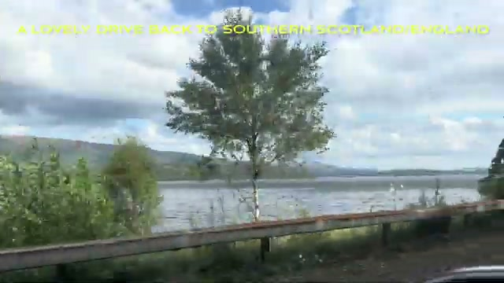





Glencoe is the Scottish Highlands' signature drive, and this post covers it from two angles: a ~4.5-minute captioned tour driving the A82 north to south — route map, the Three Sisters, the Rest and Be Thankful pass, and the lochside run back — plus a 106-second aerial cut heavy on drone footage, whose own caption sets the tone: "The drive through Glencoe is considered one of Scotland's finest." All on-screen captions below are quoted as they appear in the videos.

## The route: north to south through the glen

The longer video opens with a route map showing the drive direction: "WE DROVE IT NORTH TO SOUTH/WEST TO EAST" — about 23.8 miles / 52 minutes per the on-screen map, tracing the A82 line through the glen and east toward the Loch Lomond area.

## The Three Sisters viewpoint

The first stop is near the Three Sisters viewpoint — the classic Glencoe postcard stop. In the video it's shrouded in mist, which is honestly the standard Glencoe experience: the ridges fade in and out of cloud, and when the light breaks through the green slopes it's worth the wait.

The Three Sisters car park sits "SET IN A WIDE MEADOW IN THE VALLEY" — the drone shot shows the long path leading in, the parking area, and the broad grassy valley floor stretching out below the peaks.

And this is the view that earns the "most photographed" claim — the valley opening between the peaks under a brooding sky, no caption, just the glen itself.

## The panoramic restaurant and ski area, midway

About midway along the drive sits a stop with a panoramic restaurant — visible across moorland dotted with rocks and heather. "Well-named for the views," per the shorter video.

The stop has parking, a couple of buildings, and the longer video's caption notes it "HAS SOME KID-FRIENDLY OPTIONS" — the one practical family detail across both videos.

This is Glencoe's ski area: a chairlift runs up the hillside for higher views, and there's sledding here too, with summer activities when the snow is gone.

## Green mountains, streams, and open moorland

Between the named stops, it's all landscape. The shorter video pulls over at a roadside stop: misty mountain walls on either side — "few trees, green mountains" — with a guardrail in the foreground, a reminder this is a working road, not a postcard backdrop.

Water is the constant companion: streams cut through the green hillsides — "streams everywhere you look."

The longer video fills in the in-between driving: big open moorland under heavy cloud, purple heather in the foreground, a small settlement in the distance. This is what much of the A82 corridor actually looks like — wide, empty, and moody.

Drone footage from the shorter cut opens over that same moorland, the single road winding through green valleys — sparse landscape, few trees, big open skies, mountains rising on both sides.

## A famous viewpoint around Loch Lomond, at a mountain pass

East of Glencoe, the route reaches what the video calls "A FAMOUS VIEWPOINT AROUND LOCH LOMOND IS AT A MOUNTAIN PASS" — a drone shot of the looping car park, packed with campervans and cars, set in a fold of green hillside.

## Rest and Be Thankful

The best-known stop on this eastern stretch is the viewpoint the video captions as "KNOWN AS RESTFUL AND BE THANKFUL VIEWPOINT" — the famous hairpin junction on the old military road, captured from the drone with the winding road snaking through the pass.

The shorter video closes here too, with drone footage over a wide Highland valley captioned "Iceland meets Norway meets Scotland" — and it earns the comparison. The final stop is the viewpoint itself, with the road switchbacking through the valley below and a small parking area for the view.

## The drive back south

The return leg is "A LOVELY DRIVE BACK TO SOUTHERN SCOTLAND/ENGLAND" — a lochside road running right along the water, the classic end-of-day Scottish driving shot with the sun breaking through.

## Worthy of the designation

The longer video closes on a drone shot of a single mountain road cutting across open moorland with the caption: "WORTHY OF THE 'AONB' DESIGNATION." (Glencoe is actually a National Scenic Area in Scottish terms, but the sentiment is the point — this is one of Britain's most protected and photographed landscapes, and even a short drive-through shows why.)

## Verdict

Two videos, one checklist: Three Sisters viewpoint and car park, the panoramic restaurant and ski area (chairlift, sledding, kid-friendly options), the Loch Lomond-side pass viewpoint, Rest and Be Thankful, and the lochside run south. If you're driving the A82, those are your photo stops in order — and if you only have a few minutes, the aerial cut proves the landscape does most of the work.
