

Gran Paradiso is a blue ski run just off the Sella Ronda near Plan de Gralba in Val Gardena, in the Italian Dolomites — skied directly beneath the towering rock walls of Sassolungo (Langkofel). This video is the full run: the chairlift ride up, the summit, and the long cruise back down, with a GPS speed and route overlay the whole way.

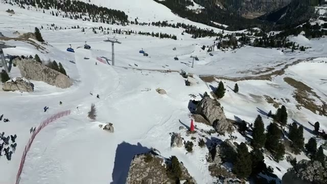

## The chairlift ride up

The day starts at the Gran Paradiso chairlift base station, boarding a covered chair. The lift climbs past rocky outcrops and snow-covered slopes, with the big Dolomite cliffs rising alongside — the scenery starts immediately, not just on the way down.

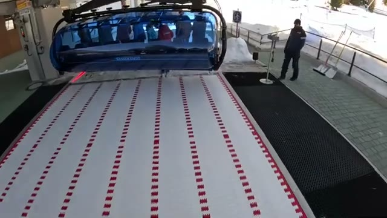

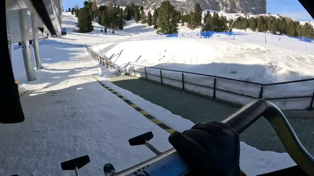

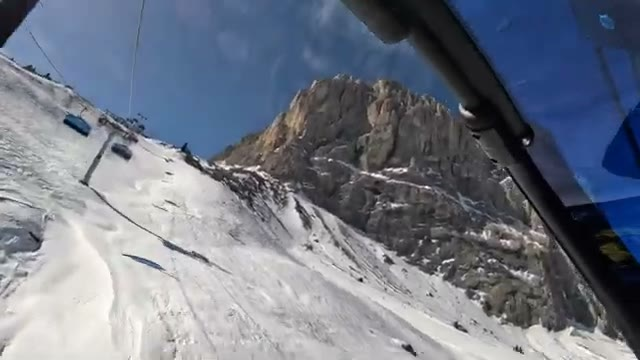

## The summit

The top of the run is a busy spot — the video was filmed on a bluebird day and the summit area is full of skiers getting ready to drop in, with a dramatic rocky peak looming over everyone. If you're coming off the Sella Ronda, Gran Paradiso makes a natural detour: a mellow, scenic run before rejoining the circuit.

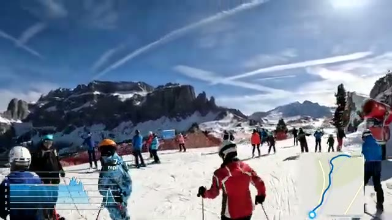

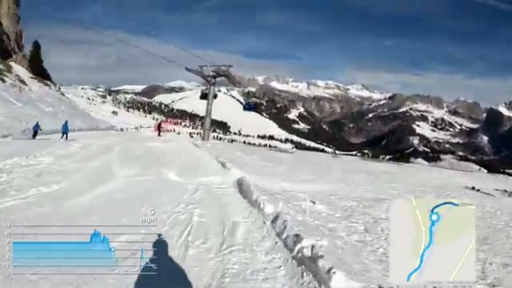

## The descent: a blue run made for cruising

Gran Paradiso is wide, groomed, and gentle — the kind of blue you ski with your poles down and your camera out. The on-screen GPS overlay shows relaxed cruising speeds through most of the run, with the route map tracing a long, easy line down the mountain. The pitch never gets steep, which is exactly why this one is better skied slowly: the views are the point.

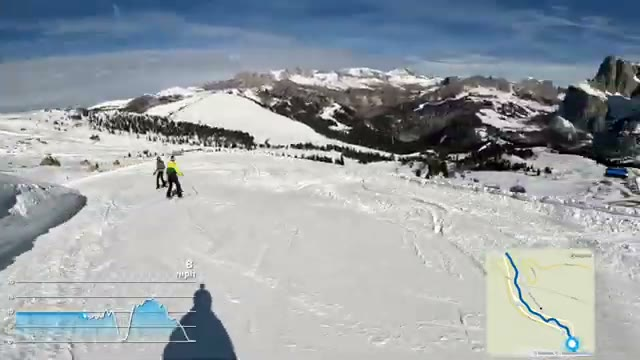

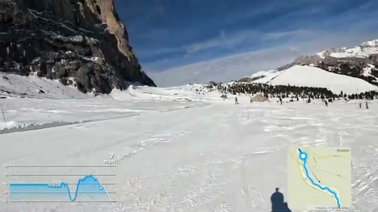

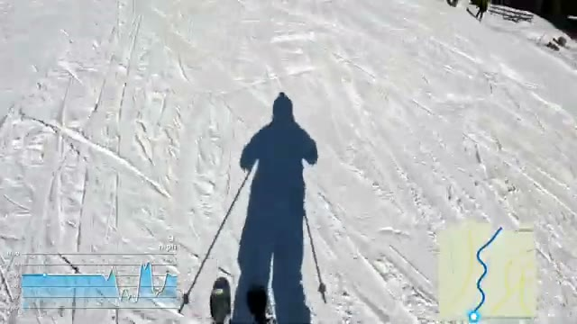

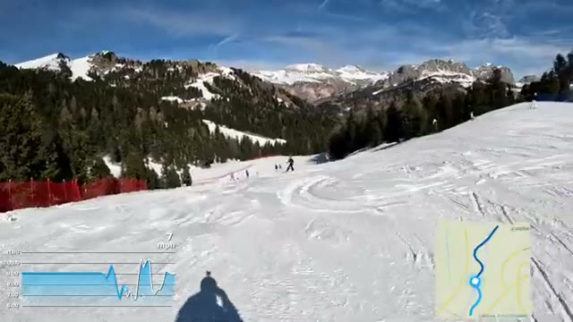

## The scenery along the way

What earns Gran Paradiso its "most scenic blue" claim is how much the landscape changes on the way down: sheer rock towers at the top, a rocky bowl and scattered boulders mid-mountain, then pine forest and distant snow-capped peaks lower down. Looking back up from the lift or across the valley, the lift network and pistes spread out below against the cliffs.

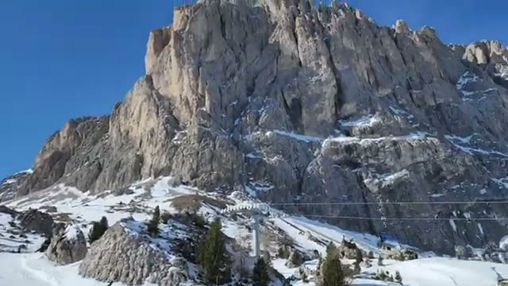

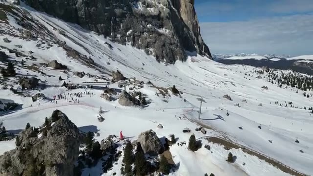

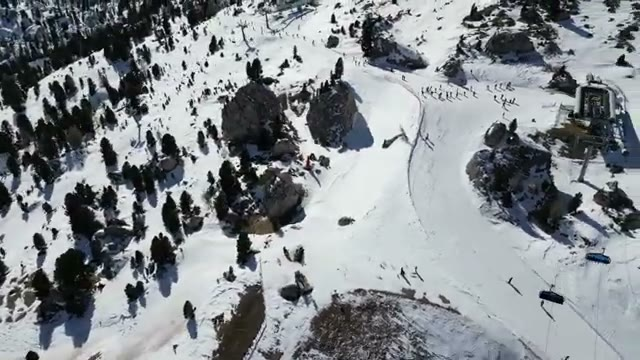

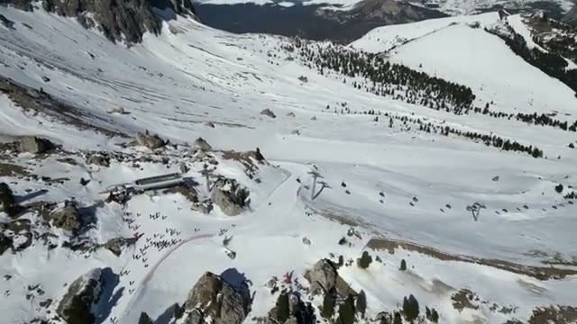

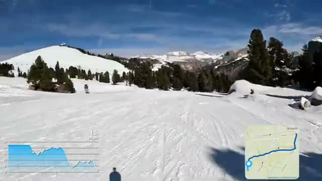

## Wrapping up

The run ends back in a lively base area — crowds of skiers, lift stations, and the usual end-of-run bustle near Plan de Gralba. If you're skiing Val Gardena and the Sella Ronda, don't blow past this one: Gran Paradiso is the blue run to slow down for, ski under the Sassolungo walls, and let the Dolomites do the work.

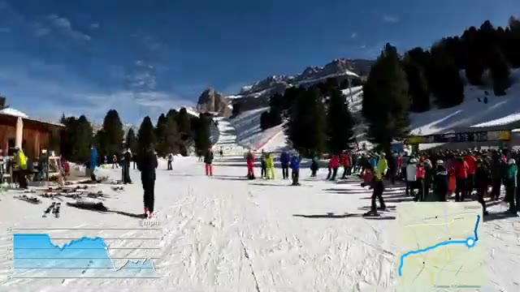

## How to ski it yourself

**Find it off the Sella Ronda.** Gran Paradiso sits just off the circuit near Plan de Gralba, so if you're doing the Sella Ronda it makes a natural detour: drop off the route, ride the covered chair up, ski the long blue back down, and rejoin. Treat it as a scenery break, not a shortcut — it's a long, mellow run, so give it the time it deserves rather than rushing through to get back on the circuit.

**Pick your day by the sky.** This is a scenery run, full stop. On a flat-light whiteout day you would lose everything that makes it worth the detour. Our footage is from a bluebird day, and that is the version of Gran Paradiso you want: the Sassolungo walls, the rocky bowl, the pine forest lower down all need clear air to register. If the forecast is socked in, do your mileage elsewhere and save this one for the clear morning.

**Bring a camera and keep it handy.** The whole argument of this run is poles down, camera out — the video's GPS overlay shows relaxed cruising speeds the entire way down because nobody skis this one in a hurry. The piste is wide and gentle enough that stopping mid-run is easy, so keep the phone in an outside pocket. The top station with the cliffs behind you, the traverse under the rock walls, and the forest cruise lower down each deserve a proper stop.

## Who this run is (and isn't) for

If you can link turns on a groomed blue, you can ski Gran Paradiso. The pitch never gets steep, the piste is wide and groomed, and the footage shows skiers of all abilities dropping in from a busy summit without any drama. For families with kids who are comfortable on blues, it is close to ideal: long enough to feel like a real mountain journey, gentle enough that nobody spends it scared.

It is not for skiers chasing pitch. There is nothing steep here, the video never leaves the groomed line, and on a busy bluebird day the summit and the piste carry real traffic. If your perfect run is an empty steep pitch at opening bell, you will find this one dull. Gran Paradiso is for skiers who stop mid-run just to look at the mountain — and there is no shame in that.

## What we'd change next time

**Ski it earlier.** Our day was bluebird, but the summit was packed when we dropped in — the footage shows a busy top station with skiers everywhere. An earlier lap means fewer people in your line on the way down and cleaner views before the midday crowds build up.

**Commit to the slowness.** The run's best trick is how the landscape keeps changing — sheer rock towers at the top, the boulder-strewn bowl mid-mountain, pines and distant peaks at the bottom — and it is easy to cruise through the transitions without noticing. Next time we would pick three photo stops in advance: the top station with the cliffs behind us, the traverse under the rock walls, and the forest cruise lower down. And we would actually stop.

**Loop it once, then rejoin the circuit.** Gran Paradiso earns its place as a detour, not a repeat lap. One slow scenic run, camera out, poles down, then back onto the Sella Ronda. That is the right dose.
