*Visited September 2026 • Cala Sant Vicenç, Mallorca, Spain*

You can watch our full hotel tour here:



## Overview

We spent **4 nights in Mallorca at the end of our European holiday**, in the first week of September 2026, at **Grupotel Molins on the northwest coast** — a resort set right on Cala Sant Vicenç, one of the island's prettiest bays. The stay's verdict, in the video's own words: a "great combination of beach, sea views, activities and food." The two things to plan around are the car rental pickup and a booking-system snag at check-in — both covered below — but neither took away from the stay itself.

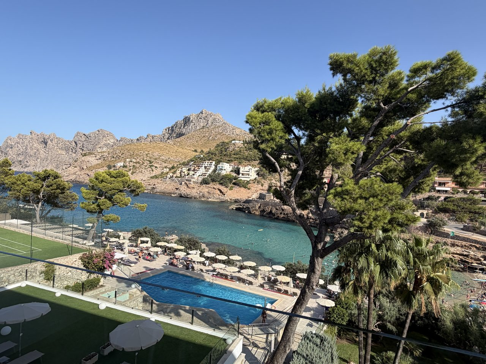

## Getting There: PMI and the Alamo Off-Airport Pickup

We had a **late-night arrival into Palma airport (PMI)**, and the first warning is that **Mallorca airport is massive — lots of walking to exit**. The bigger one is the rental car: we'd **booked the car rental through Costco**, which routes to **Alamo off-airport**, and unfortunately it was chaotic. The pickup is in an off-airport parking lot that is **not very well marked** — you have to find the lot, then ride a van to the off-airport pickup location. Allow extra time and patience for this if you arrive late at night, as we did.

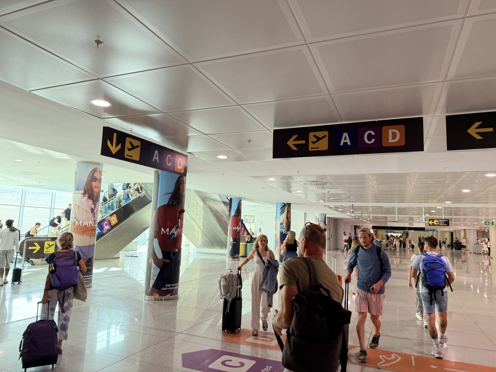

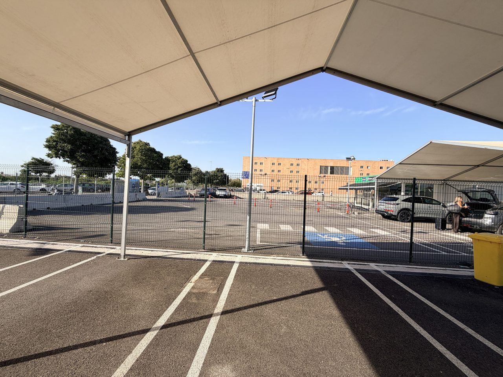

## Check-In: The Priceline 2-Adults-2-Kids Snag

We'd booked the **suite category for the family — 2 adults and 2 kids**, which the suite supports. But **Priceline did not carry the 2-adults-2-kids booking forward**: it was sent to the hotel as **2 adults only**, so we **paid extra once we arrived** at the hotel. It then took **a month after returning** to have that refunded from Priceline (really Booking.com). The hotel did their best — this was not their fault — but it made for an unfortunate check-in experience. If you book a family suite through Priceline, it is worth confirming directly with the hotel that all four guests are on the reservation before you travel. As the video puts it, it took "a month to settle but didn't take away from how nice this place is."

## The Suite: Sea View, Big Balcony, Sofa Beds

Every room at Grupotel Molins is **sea view**, and our suite had a **big balcony** — the view is genuinely "absolutely stunning to wake up to every morning." The suite is set up for a family: **they set up sofa beds in the living area** for the kids, and there were **robes and slippers for all**. In-room, there's **Lavazza coffee and a kettle**, with a **minibar for purchase**, and the **bathroom had all the basic amenities**.

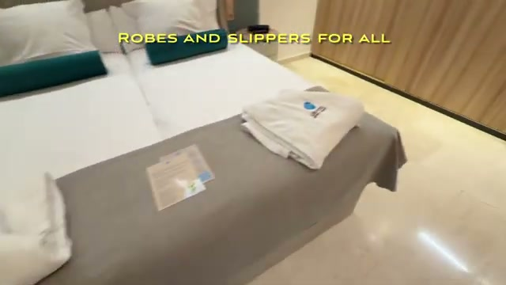

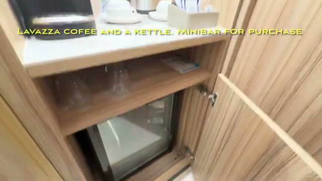

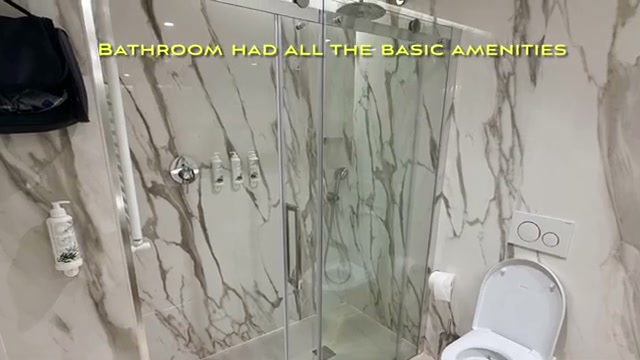

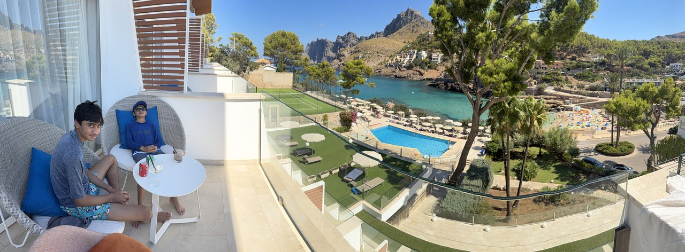

## The Beach: Cala Sant Vicenç

The beach is **across the street, and it is a public beach** — a **stunning sand beach with a gorgeous backdrop**, in a **very calm bay with crystal clear waters**. The kids had a blast every morning; it **gets crowded by 11**, so go early. For us, this is the hotel's biggest draw: Cala Sant Vicenç is an **excellent beach to escape the famous crowds of Mallorca** — sheltered, swimmable, and far quieter than the island's big resort beaches.

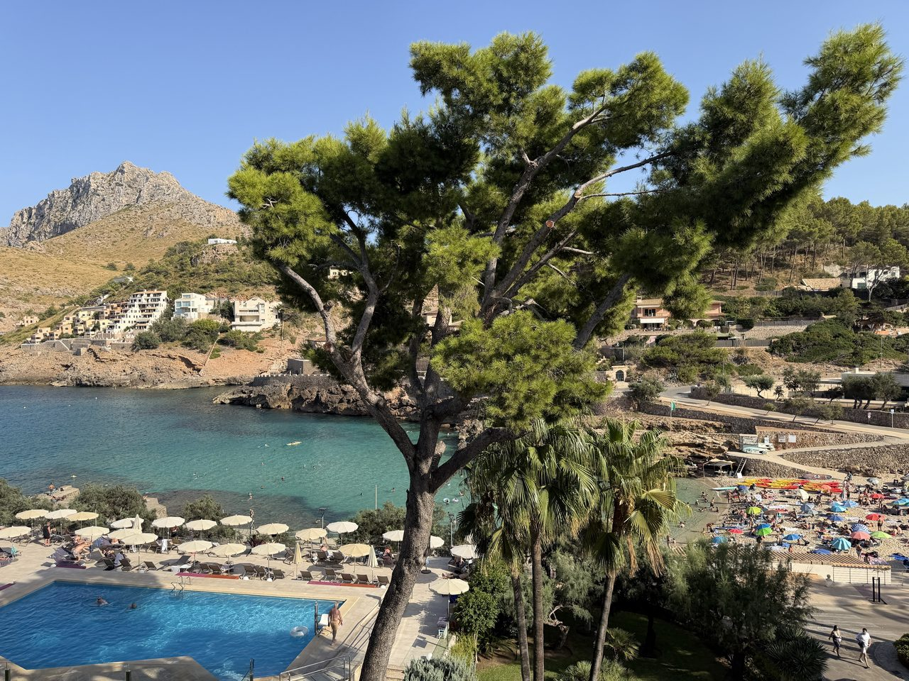

## Pools, Tennis, and the Spa

The outdoor pool **isn't heated, but that's no problem in early September**, and most days we went back for **a dip late afternoon**. **We enjoyed tennis most evenings** — you book the court at reception — and in a first for us, there was even **cricket in Mallorca**, played on the court. They have an **entire indoor spa area** as well, with a **steam room, sauna, and all kinds of sprays and nozzles**.

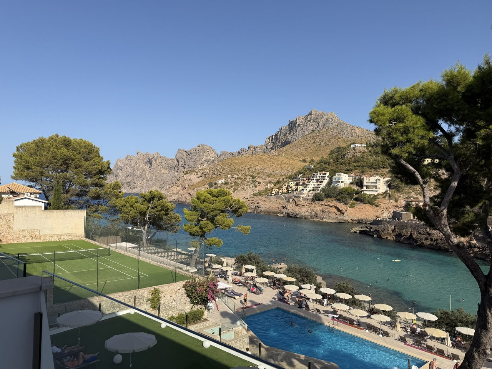

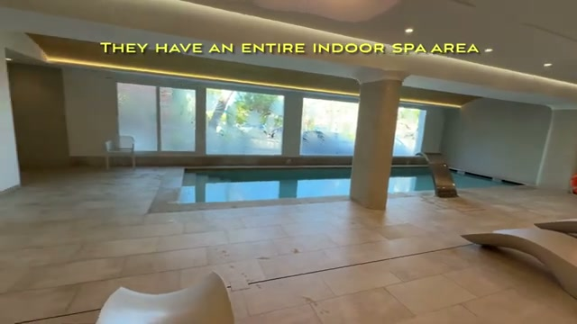

## Food: Half Board

We'd booked **half board, so dinner was included**. Breakfast is a **big spread every morning** — **plenty of fruit, juices and some smoothies**, and **mimosas are always welcome, yogurt and granola too**. Dinner had **different options daily — e.g. Asian one evening** — and the **tofu special was excellent one evening**. There are **lots of desserts, ice cream and toppings**. Two things to know: **drinks are extra — remember to bring the free water from your room**, and the pool bar does a good lunch — we **had lunch at the pool one day**, pizza and sangria.

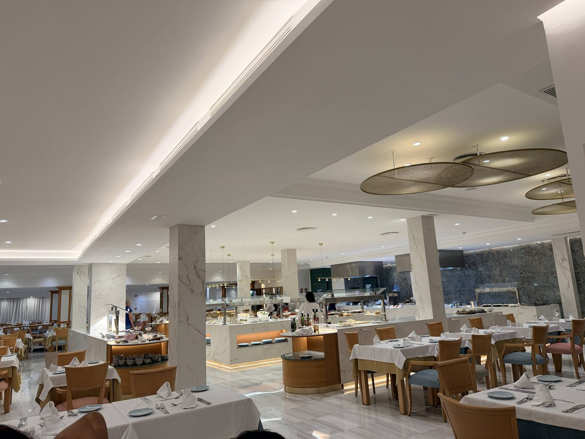

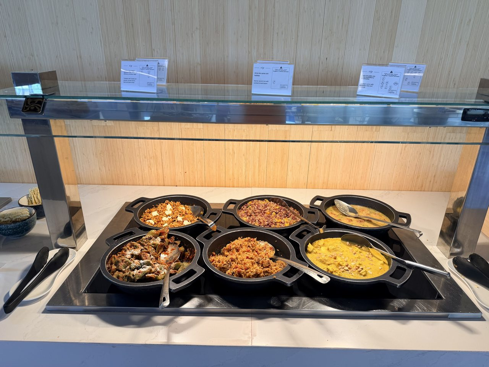

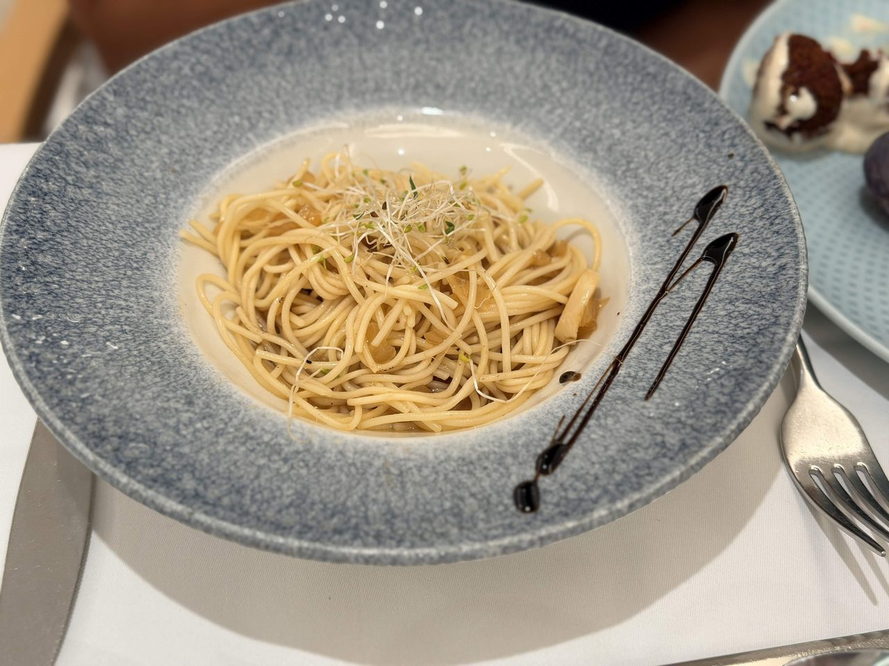

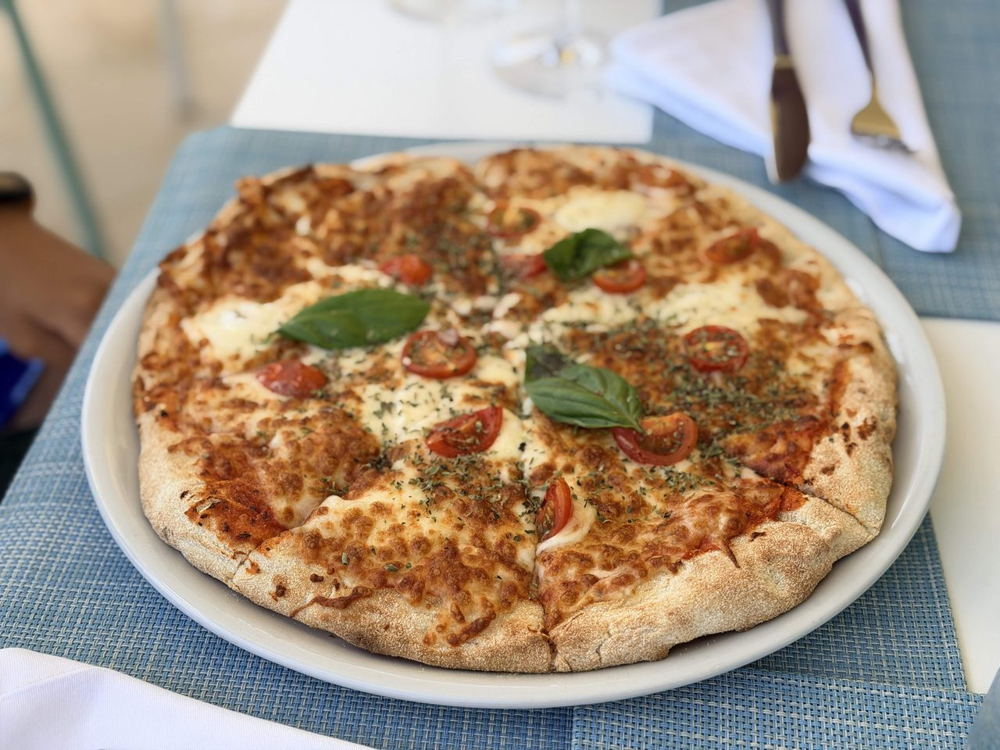

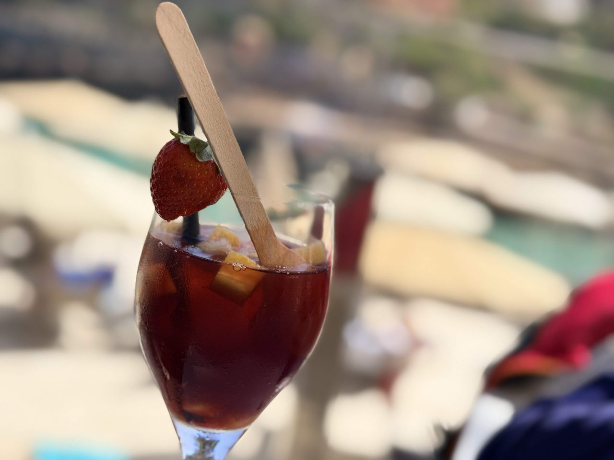

## Who Stays Here

The hotel seems to be a **favorite of Irish retirees** — we saw many very friendly couples over the course of our stay. It gives the place a relaxed, sociable feel, and it is a good fit for families who want a quieter base rather than a party resort.

## The Boat Trip: Skip It

The one excursion we'd skip: a boat trip out on the bay that was, **in hindsight, not worth the money**. The beach, the pool, and the hotel's own activities were the better use of the time.

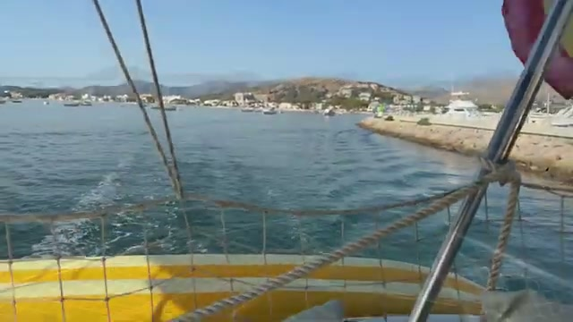

## Verdict

Grupotel Molins is a genuinely good family base on a beautiful, calm bay — the sea-view suite, the beach across the street, tennis, the spa, and solid half-board food add up to a stay we'd happily repeat. In four nights we **didn't bother to go into Palma** at all, which says plenty about how much there is to do right here. Just go in with eyes open on the two snags: the **Alamo off-airport pickup** after a late arrival, and **confirming a 2-adults-2-kids booking directly with the hotel** if it comes through Priceline.
