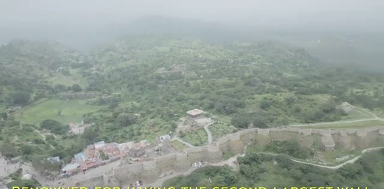
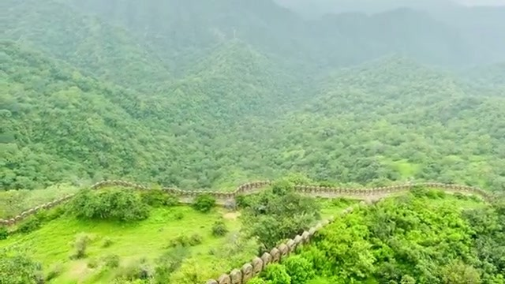
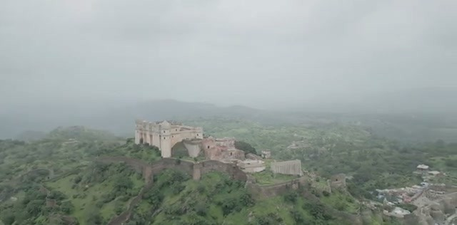
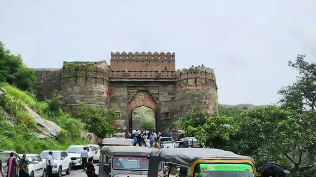
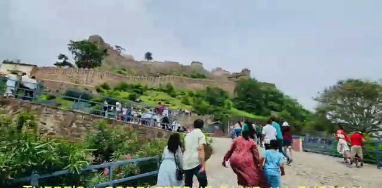
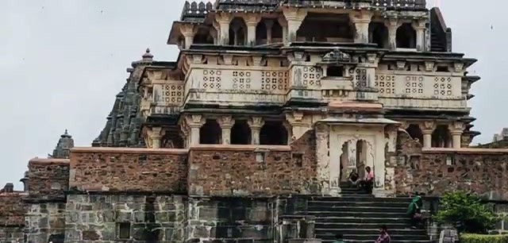
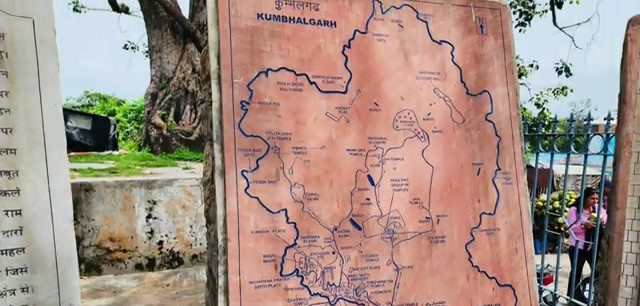
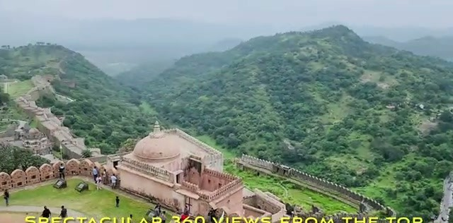
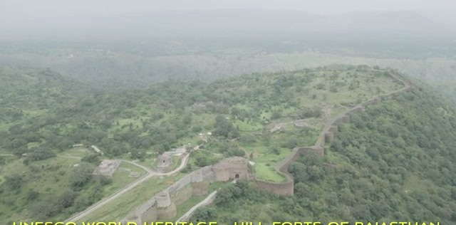



Kumbhalgarh Fort, in the Mewar region of Rajasthan between Udaipur and Jodhpur, is one of the Hill Forts of Rajasthan on the UNESCO World Heritage list — and it's renowned for one superlative in particular: it has the second-longest wall in the world, after China. We drove up from Udaipur to walk it, and it lives up to the billing.

## The second-longest wall after China

The video's caption puts it plainly: the fort is "renowned for having the second-largest wall." Built in the 15th century by Rana Kumbha (the video's caption spells it "Rana Khumbh"), the wall snakes for miles across the Aravalli hills — crenellated bastions running through dense jungle, wide enough in places to imagine elephants crossing it.

Drone shots show the wall at its most dramatic — a long crenellated ribbon winding through the green hills for mile after mile.

The fort's silhouette alone is striking: the pale Badal (Cloud) Palace crowning the highest hill, ringed by the dark line of the wall — "architecture reminiscent of Athens' Acropolis and Dubrovnik's wall," per the video.

## Getting there: the scenic drive from Udaipur

It's a "scenic drive from Udaipur" that "takes approx 3 hrs, with most of it off the highway" — so plan for a full morning behind the wheel. Two practical warnings from the video: "the last mile can have traffic jams" — "on weekends and holidays." Go early on a weekend, or pick a weekday.

## Arrival: the main entrance

The main entrance is a massive stone gateway — twin round bastions flanking a tall arched gate — with cars and auto-rickshaws clustering in front of it. This is where the visit starts.

## The climb: cobblestone ramp and the Ganesh temple

Inside, "there's a cobblestone ramp all the way" — a long, steady uphill walk that other visitors were doing in crowds on our visit. Along the way, stop at the "impressive Ganesh temple at the base" before you commit to the climb.

Tip from the fort's own site map: "for a short trip, stick to the corner with the palace." The complex is huge — if you're tight on time, head straight for the Badal Palace corner rather than trying to cover everything.

## The top: 360-degree views

The payoff at the top is worth the climb: "spectacular 360 views from the top." From the palace terrace you look out over the whole fortified ridge, the wall threading through the hills on both sides, with visitors spread across the courtyard below.

## Wrapping up

Kumbhalgarh pairs well with a Udaipur trip — and if you need a meal afterward, "many resort options in town for a lunch stop." (We tried Kavish — slow service, per the video's own caption.) A UNESCO hill fort with the world's second-longest wall, a 15th-century palace on top, and a proper workout of a climb: well worth the three-hour drive.
