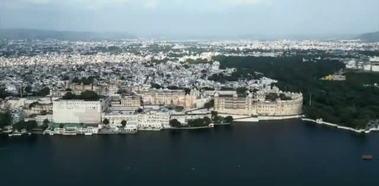
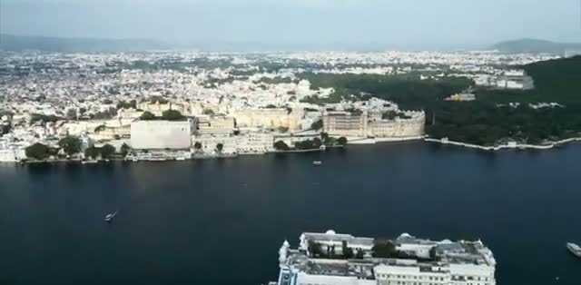
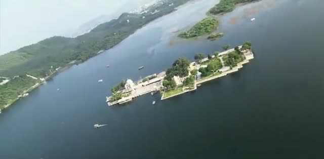
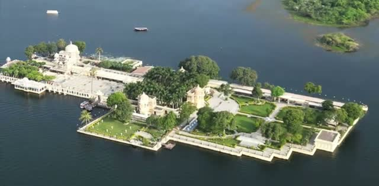
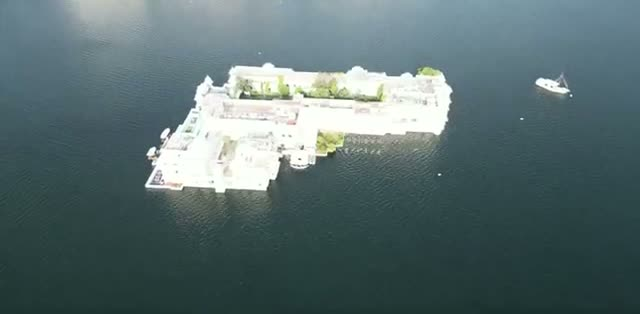
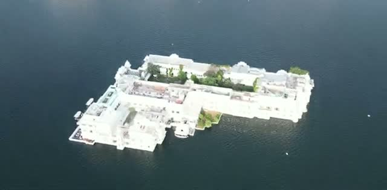
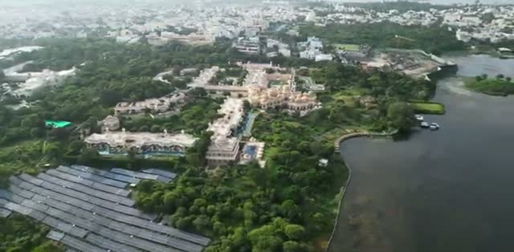
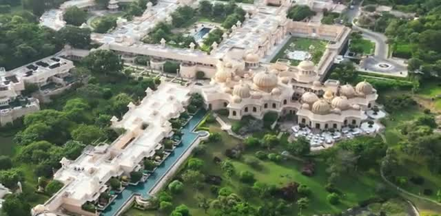
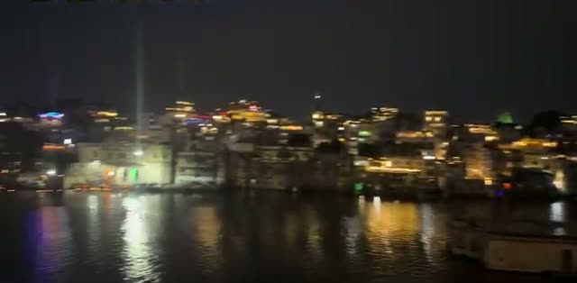



This one's a straight-up aerial treat: a drone circling Udaipur's Lake Pichola, hopping from one lakeside landmark to the next. No narration needed — the architecture does the talking. Here are the highlights we pulled from the flyover.

## City Palace & Shiv Niwas

The flight opens on the east bank of the lake, where the City Palace stretches along the water — a long, tiered facade of arched windows and balconies right at the lake's edge.

Zoom out and the old city packs in behind it, dense and white, with the monsoon-green hills rising on the far side of the lake.

## Jagmandir Palace

Swinging out over the water, the drone reaches the Jagmandir — the island palace sitting mid-lake, all domes and walled terraces ringed by trees.

From closer in you can pick out the domed pavilions, the walled lawns and gardens, and the boats pulled up along the island's landing steps — it's very much a palace you arrive at by water.

## Taj Lake Palace

Then the one everyone comes to see: the Taj Lake Palace, floating white on the blue lake with nothing but water between it and the shore. From a distance it almost looks like a ship at anchor.

The top-down passes are the best part — you can see the palace's inner courtyards and rooftop trees tucked inside the white walls, and a boat moored alongside.

## Oberoi Udai Vilas

Back toward the shore, the drone sweeps over the Oberoi Udai Vilas — a sprawling domed resort set in manicured grounds on the lakeshore, with long reflecting pools and lawns running down toward the water.

The close pass over the palace building shows the signature Rajasthani domes and arcades up close — one of the grandest lakefront silhouettes in Udaipur.

## Lal Ghat at night

The video closes after dark at Lal Ghat — the lit-up waterfront buildings reflected in the lake, with the hills gone dark behind. A fitting end to a flyover that basically reads as a shortlist of where to point your camera in Udaipur.

## Wrapping up

Five landmarks, one lake, five and a half minutes of drone footage — City Palace, Jagmandir, Taj Lake Palace, Oberoi Udai Vilas, and the ghats at night. If you're planning a Udaipur trip, this is the fastest orientation we know of: everything worth seeing sits on or within sight of this one lake.
