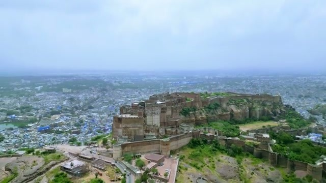
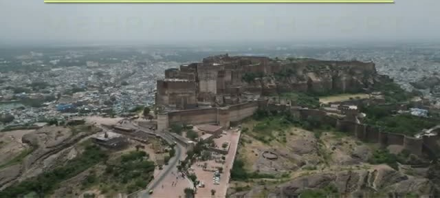
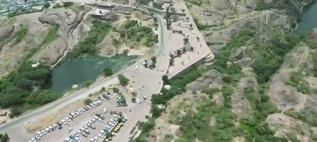
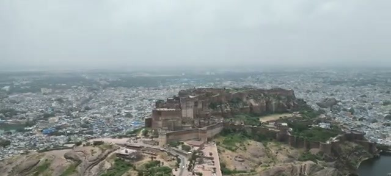
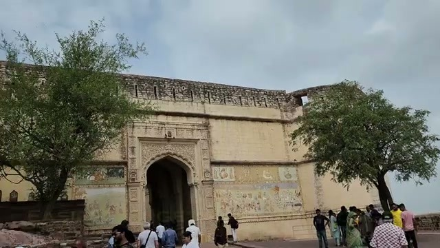
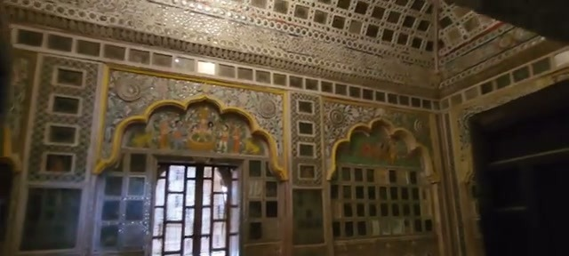
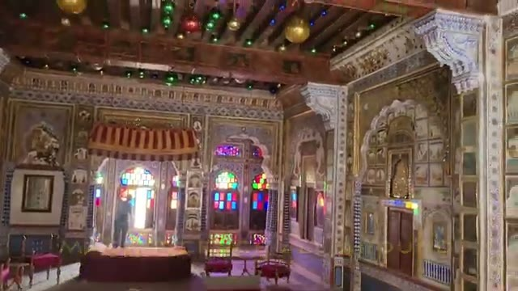
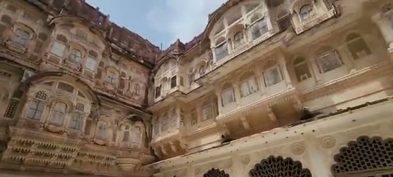



Jodhpur, Rajasthan — the Blue City — sits in the shadow of one of India's great hill forts. Mehrangarh Fort looms on its rocky hill above a sea of blue-painted houses, and as the video's own caption puts it: the fort is on a hill surrounded by the blue city.

## An imposing 15th-century structure

The opening aerial sets the tone — the video calls it "an imposing structure built in the 15th century," and from the drone footage you can see why: thick ramparts gripping the ridgeline, the city spilling out in every direction below.

The approach winds up past the parking areas at the base of the hill — from here the scale of the fortifications really hits you.

## The entrance

Inside, the entrance gate is framed by weathered frescoes, with a steady stream of visitors passing through the arched doorway — the fort is clearly a working attraction, not a quiet ruin.

## Mesmerizing views from the ramparts

Up on the rooftop terrace, old cannons still point out over the plains — and the views live up to the video's caption: "impressive structure with mesmerizing views." On a clear day you can trace the whole city and the surrounding countryside from the parapets.

## Inside the palace: Hall of Mirrors

The interiors are where the fort really shows off. The Hall of Mirrors is a chamber of mirrored panels and intricate inlay framing arched windows and doorways — small by palace standards, but dense with detail.

The palace halls are richly decorated — carved woodwork, painted ceilings, and tall stained-glass windows that throw colored light across the stone floors.

## Alhambra-like architectural intricacy

The palace courtyard is the standout: layered balconies, carved stone screens, and arched colonnades stacked several stories high. The video's comparison says it best — it "reminds one of Granada's Alhambra," and the title calls out the Alhambra-like architectural intricacy outright. If you've been to southern Spain, the echo is unmistakable.

## The Blue City below

From the town, the fort dominates the skyline — a sheer wall of stone rising over the rooftops. And the video's parting note is worth heeding: "Jodhpur's a colorful town with terrific food" — plan to eat well after the climb.

## Wrapping up

Mehrangarh is that rare fort that delivers on both halves of the promise: the imposing 15th-century military architecture on the outside, and genuinely intricate palace interiors — Hall of Mirrors, stained-glass halls, Alhambra-echoing courtyards — on the inside. Give it half a day, wear good walking shoes, and save your appetite for Jodhpur afterward.
