

Neos is an Italian budget airline — and as the video puts it, they don't have a business class. What they have instead is "Premium": effectively a premium-economy cabin. We flew it from Milan Malpensa Terminal 1 to New York JFK Terminal 1 on a Boeing 787, and here's what the experience was actually like.

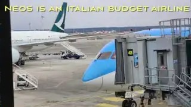

## What "Premium" gets you on the ground

At MXP, Premium includes fast track through security and lounge access. One thing to know: for USA-bound gates there's only one lounge option, and it was very crowded on a Saturday.

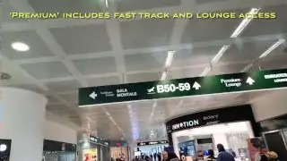

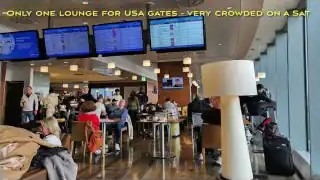

Also note the lounge is *after* exit passport control, so budget your time: leave room for passport control and don't get stuck shopping in duty free beforehand.

Boarding comes with priority for Premium/Group 1 (gate B55 on our flight). Boarding itself wasn't perfectly smooth — we were stuck on the jet bridge for a bit while the queue moved.

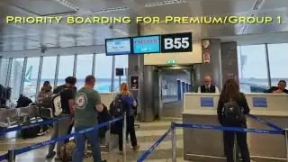

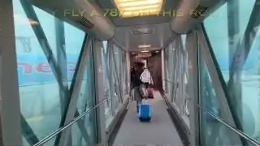

## The 787 premium cabin: 2-3-2, legroom, and a screen surprise

The aircraft is a Boeing 787, and the Premium cabin is laid out 2-3-2. First impressions were good — there's lots of legroom.

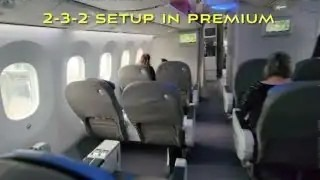

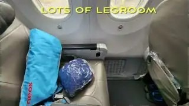

One quirk: there are no seatback monitors. The entertainment screens pull out of the armrests instead. They hand out cheap disposable earbuds — nothing fancy, but they do the job. There's also a small, basic amenity kit. And the best perk of the whole flight: free Wi-Fi included for the entire flight, via a voucher card handed out on board.

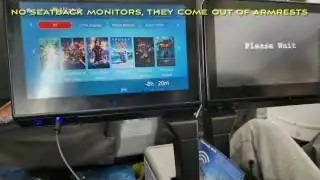

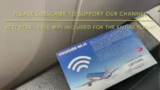

## Food and drink: honest verdicts

Drinks started before takeoff with prosecco or orange juice. One caveat for the long haul: no complimentary soda — just juices and wines.

The meal service began with a salmon starter, though there were no options for vegetarians or kids. For the entree, the chicken option was served (they had pasta for the vegetarians).

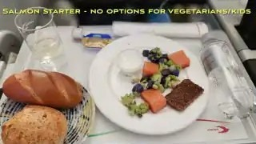

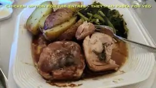

A cheese platter followed, and then the verdict the video doesn't sugarcoat: dessert was the only good part of the meal. Coffee came after dessert — served with creamer, not fresh milk. A small snack was served before landing.

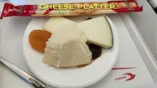

## Seat comfort: levers, leg rest, real recline

The seats have levers for both recline and the leg rest, and the recline is genuinely decent — a good amount to actually get some rest on the overnight crossing.

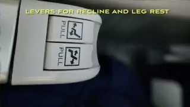

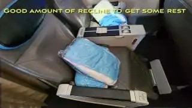

## Bottom line

On-time arrival into JFK, and the video's verdict: "I'd fly them again at premium economy prices." That sums it up — Neos Premium isn't business class and doesn't pretend to be, but as a premium-economy product with lounge access, free Wi-Fi, and a comfortable seat, it's a fair deal at the right price.

## Our verdict: who this cabin is for (and who should skip it)

This is a cabin you book with your eyes open. Neos Premium is a budget airline's answer to premium economy, and it delivers on the things that matter most on a long Atlantic crossing — space, sleep, and small comforts — while falling short on the things that make people write flowery reviews about business class.

**Fly it if** you want a noticeably better seat than economy on the Malpensa–JFK run without paying for a lie-flat cabin. The 2-3-2 layout, generous legroom, and genuinely decent recline with a proper leg rest make this a seat you can actually rest in, not just endure. The leg rest is the unsung hero here: combined with the recline, it turns eight-plus hours from a sitting marathon into something survivable — and even pleasant.

The free Wi-Fi for the entire flight is the standout perk, full stop. It's handed out on board as a voucher card, and on a long haul with kids or work to catch up on, connectivity you don't have to buy changes the shape of the flight. Earbuds and an armrest screen are fine for passing time, but free internet is the thing you'll still remember at JFK.

**Skip it if** you're a vegetarian or traveling with kids and expect meal flexibility — there were no options for the salmon starter. Skip it if you need a lie-flat seat or a real meal service: this is premium economy with a smile, not business class, and the food on our flight didn't clear the bar a premium fare usually implies. And skip it if the price creeps up toward real business-class money — the video's own verdict said it best: "I'd fly them again at premium economy prices." The qualifier is doing all the work in that sentence. At a true premium-economy fare, this is a fair deal with lounge access, free Wi-Fi, and a comfortable seat.

As a family traveler, the natural pick in this cabin is one of the side pairs — window and aisle, parent and child, nobody climbing over anyone. But that's a seating perk, not a service one: plan the food situation yourself (more on that below).

## What we'd do differently

**Respect the passport-control bottleneck.** At Malpensa T1, the lounge sits *after* exit passport control, so the order is: fast track security, duty free, passport control, then lounge. Next time we'd either skip the duty-free stroll entirely or build in real buffer — on our Saturday flight the only lounge for USA gates was packed, and a crowded lounge you rush through is barely a lounge at all.

**Bring our own earbuds and entertainment backup.** The cheap disposable earbuds they hand out do the job, but on a flight this long your own earbuds or headphones are a genuine upgrade. Same thinking applies to the armrest pull-out screens: they're fine for a few hours, but if the entertainment library doesn't suit you, your own tablet loaded with downloads is cheap insurance.

**Eat before boarding, or bring a real snack.** The honest report card from our flight: prosecco or orange juice before takeoff, a salmon starter (with no vegetarian or kids' option), a chicken entree (pasta for vegetarians), a cheese platter — and dessert, which was the only good part of the meal. Coffee with creamer, not fresh milk, and a small snack before landing. That's not a meal service you plan your day around. A proper meal at the airport or a decent sandwich packed in your carry-on turns the whole flight experience around.

**Plan your drinks.** There's no complimentary soda — only juices and wines. If you're a soda-on-the-plane person, grab one in the terminal before you board.

## Practical tips

- **Saturday is the day to avoid, if you can.** The single lounge for all USA-bound gates was very crowded on a Saturday. Same fast track, same lounge, midweek — a much calmer experience.
- **Time your lounge visit after passport control.** Fast track gets you through security quickly, but the lounge is past exit passport control. Don't linger in duty free and end up sprinting to the gate.
- **Guard your Wi-Fi voucher.** The free Wi-Fi comes as a voucher card handed out on board and covers the whole flight. Tuck it somewhere you won't lose it between meal services.
- **Seat strategy in 2-3-2.** Couples, or a parent with a child: take a side pair — window and aisle. Solo travelers: avoid the middle seat of the center three if you have the choice. The recline and leg-rest levers are easy to use, and the recline is genuinely enough to nap — which is what matters on this crossing.
- **Priority boarding works, mostly.** Premium boards as Group 1 (gate B55 on our flight), but we still stood waiting on the jet bridge while the queue ahead cleared. No need to rush into line the moment boarding starts.
- **The amenity kit is small and basic** — bring anything you actually rely on for a long flight.
- **Set expectations on the food.** You're here for the seat, the space, the leg rest, and the free Wi-Fi — not the meal. With that mindset, Neos Premium is exactly what it promises: an honest premium-economy seat at a fair price, with an on-time arrival into JFK to finish it off.
