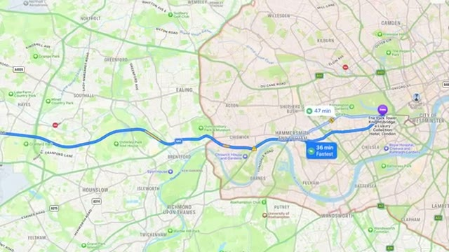
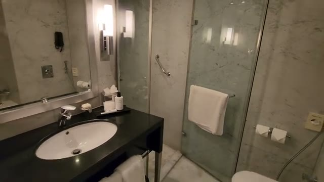
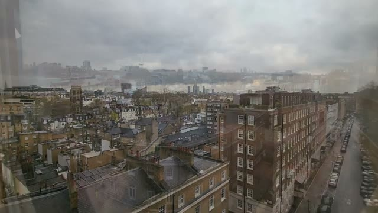
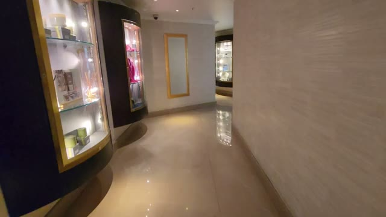



The Park Tower Knightsbridge is a Marriott Luxury Collection hotel in London's Knightsbridge — minutes from Harrods and Harvey Nichols. That's a heavyweight address. But as this short stay shows, the experience inside the room didn't quite live up to the "Luxury Collection" branding. Here's what the video found.

## Location: the strong point

Location is the hotel's best argument. It's right in Knightsbridge — minutes on foot from Harrods and Harvey Nichols — and there's a back exit that lets you cut across to Hyde Park (the walk to the park takes about six minutes; you can also go through the lobby to reach it).

## The "Executive" room

The video's room was booked as an "Executive" room — in air quotes. Executive rooms are on floors 6–12, and the tour covers a spacious-enough layout: a king bed with a padded headboard wall, a sofa seating area by the window, a work desk, and a minibar cabinet.

## Bathroom: bathtub plus shower

The bathroom has a marble-finish bathtub, a separate glass-enclosed shower, a sink with a large mirror, and — credit where due — the hotel has moved to refillable toiletry bottles rather than single-use plastics.

## The honest criticisms

Here's where the "not-so-luxury" in the title comes from — three small but telling misses:

- **Only one British-style outlet by the bedside.** Charging two phones overnight means a fight.
- **No coffee maker or pods.** Just a water heater with instant coffee packets — well below what you'd expect at a Luxury Collection price point.
- **No outlets on the desk either.** Trying to work at the desk with a laptop becomes a cable scavenger hunt.

These are exactly the details a true luxury hotel gets right.

## The views save it

The room's redeeming feature: genuinely good views. Higher floors look out over London's rooftops — better than the average London hotel — and there's a nice sunrise over the city if you're awake for it.

## Public spaces

The lobby areas include a lounge with club chairs and soft lighting, retail display cabinets along the hallways, and corridors that range from warm wood-paneled to quite dark.

## Verdict

The Park Tower Knightsbridge gets the essentials of location right — Knightsbridge, Harrods, Hyde Park, all within easy reach — and the upper-floor views are genuinely good. But for a hotel wearing the Marriott Luxury Collection badge, the room details underwhelm: one bedside outlet, no coffee maker, no desk outlets. Book it for the address and the view; don't come expecting a true luxury in-room experience.

## Our verdict: who should stay here — and who should stay away

Let's be blunt about who this hotel actually suits, because the Luxury Collection badge on the door is doing a lot of heavy lifting that the room inside doesn't support.

**Stay here if** you want a Knightsbridge address above all else. The location is genuinely the product: Harrods and Harvey Nichols within easy walking distance, a back exit that puts you in Hyde Park in about six minutes, and an upper-floor window with a real view of London rooftops and a proper sunrise. If your days are spent out in the city — museums, shopping, the park — and the room is just where you sleep, the Park Tower does the job fine. A short business stay where you're in meetings all day and asleep all night? You'd never notice most of the misses.

**Stay away if** the room is the point of the trip. Two people charging two phones overnight with a single bedside outlet is not a minor inconvenience, it's a nightly negotiation — and someone loses. If you need to work from the room, the desk with no outlets turns your laptop into a battery-clock race against the nearest wall socket. If your morning starts with a real cup of coffee, the water heater plus instant packets will offend you every single day; this is the detail that most exposes the gap between the badge and the reality. And if you're booking because "Luxury Collection" made you expect a luxury hotel, reset that expectation before you arrive or you'll spend the stay cataloguing everything the price didn't buy.

The honest framing: this is a well-located hotel with good views that carries a luxury label it hasn't earned in the room. Book it with that framing and you won't be disappointed. Book it expecting luxury and you'll write exactly this review.

## What we'd do differently

The biggest lesson from this stay is about the "Executive" label. The video's room was booked as an Executive room — floors 6–12 — and that's exactly where the one-outlet bedside, the no-outlet desk, and the instant-coffee setup were found. So the Executive tier buys you altitude and the views that come with it, but it doesn't buy you a better-kitted room. If you're choosing between room types, don't pay a premium for "Executive" expecting the amenities to improve — the misses are baked in at that tier, not reserved for the cheapest rooms.

What actually matters is the floor, not the room category. The views are the one thing this hotel does well — upper-floor windows over London's rooftops, better than the average London hotel — so if you stay here, push for high. A high room with the view is the whole argument for this hotel; a low room without it is just an overpriced Knightsbridge base.

And if you must stay: pack for the power situation instead of fighting it. One British-style outlet by the bed and none at the desk means you either bring a compact UK power strip (or a multi-USB wall charger) or you spend the stay unplugging the bedside lamp to charge your phone. That's not a luxury-hotel accessory list — that's a budget-travel survival kit — but it's what the room requires.

Would we book a different hotel in the area? If the selling points you care about are Knightsbridge and Hyde Park access, the honest move is to compare this against other hotels in the same neighborhood on the same nights — because the location is the Park Tower's entire case, and plenty of other addresses in Knightsbridge and nearby Mayfair sit on the same map. Pay the Luxury Collection rate only if the view and the address are worth it to you with the room's shortcomings fully priced in.

## Practical tips the listing won't tell you

- **The drive from Heathrow is about 36 minutes.** That's the video's actual door-to-door time, so plan your airport transfer and your arrival-day expectations around it — not a central-London fantasy of ten minutes.
- **Use the back exit.** The shortcut to Hyde Park skips the lobby and puts you on the park side in about six minutes. It's the best physical feature of the hotel that has nothing to do with the room.
- **Charge your gear at night like you mean it.** One bedside outlet, no desk outlets: bring a UK adapter with multiple USB ports or a small power strip, or one phone simply won't charge overnight. Test the outlet before lights-out so you're not discovering the shortage at midnight.
- **Coffee people, manage expectations.** There is no coffee maker and no pods — it's a water heater and instant coffee packets. If that ruins your morning, the nearest fix is outside the hotel, not inside it.
- **Don't plan serious desk work.** No outlets at the desk means the laptop goes wherever the nearest socket is. If work is part of the trip, sort out your charging setup on arrival, not at deadline hour.
- **Corridors vary.** Some are warm wood-paneled, some are quite dark — don't read the hallway as a preview of the room or the lobby lounge, which is a separate, properly done space with club chairs and soft lighting.
- **The bathroom is fine.** Marble-finish bathtub, separate glass shower, large mirror — and refillable toiletry bottles instead of single-use plastics. It's the one part of the in-room experience that doesn't undercut the branding.
- **Book the view, not the label.** Ask for a high floor and face outward. The sunrise over the rooftops is real, and it's the memory this hotel actually delivers. Everything else about the stay is just Knightsbridge logistics.
