

The Quiraing is Isle of Skye's most famous hike — that's the video's own opening claim, and the footage makes a decent case for it. It's a ridge and cliff walk on the north of Skye, above Portree, with views out to the sea. The full out-and-back runs about 7km, and this short video walks the highlights in under three minutes.

## Skye's most famous hike, above Portree

The Quiraing sits on the north of Skye, above Portree. The opening shots show why it's famous: sheer cliffs wrapped in low cloud, green slopes falling away below, and the sea glinting in the distance on the clear stretches.

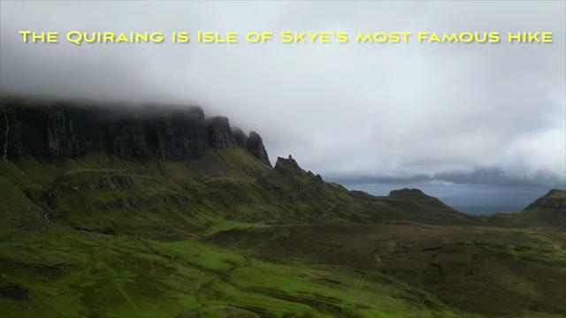

## The trailhead: a gravel path with signposts

The hike starts on a gravel path marked by wooden signposts, with an information board near the start. A few hikers head up ahead — it's a well-trodden route, not a scramble.

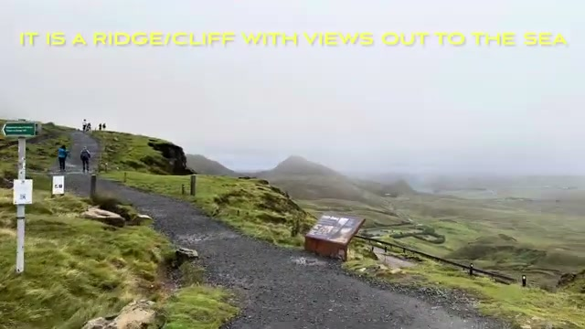

## A ridge and cliff with views out to the sea

The video's own caption puts it simply: "it is a ridge/cliff with views out to the sea." The path runs along a fence line on grassy ground, with the coastline and open water visible through the haze to the side.

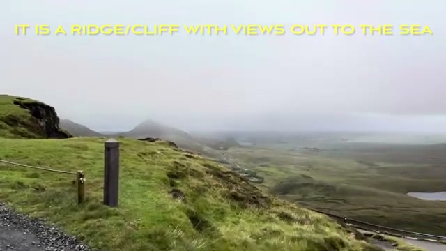

## Scenic vistas with rugged rock formations

This is the stretch the video keeps coming back to — a jagged, needle-like rock formation rising out of the green hillside, with small lochs sitting in the valley floor below. It's the most dramatic ground on the route.

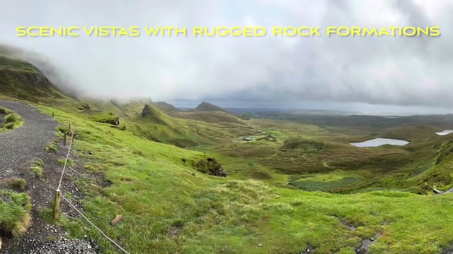

## A pretty ribbon of road down the ridge

Looking down from the ridge, the road unspools as a pale ribbon across the hillside between the lochs — "a pretty ribbon of road down the ridge," as the caption says. It's a good reminder of how compact this landscape is: road, ridge, and rock formations all stacked into one view.

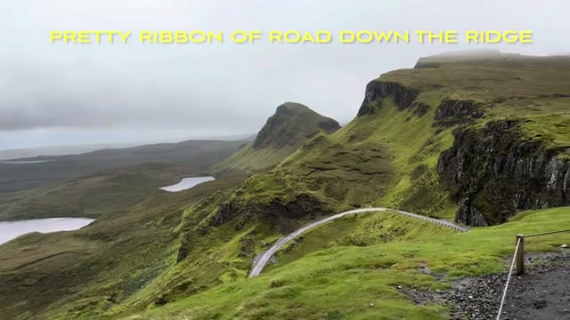

## About 7km out and back

The full out-and-back is approximately 7km, per the video. The framing here catches the rock pinnacle, the falling ridge, and the winding road below in a single panorama — the classic Quiraing shot.

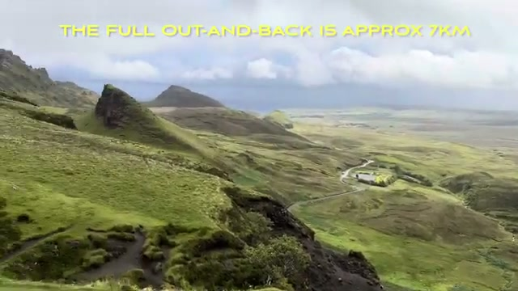

## It can get wet and messy — dress appropriately

The practical advice is honest: this trail gets wet and muddy, so dress appropriately. The footage shows a group picking their way over a boggy, rocky section — waterproof boots and a willingness to get messy are part of the deal on Skye.

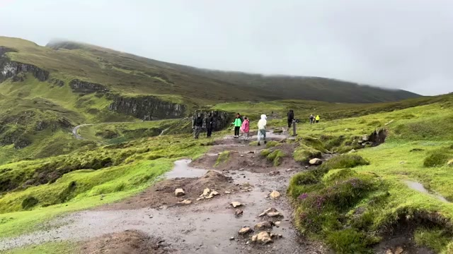

## An Iceland-like Highlands landscape

The video describes the scenery as typical Scottish Highlands landscape, Iceland-like — and the comparison lands. Treeless green ridges, mist rolling over sharp rock, water pooling in every hollow: it looks a lot like the Reykjanes peninsula with grass.

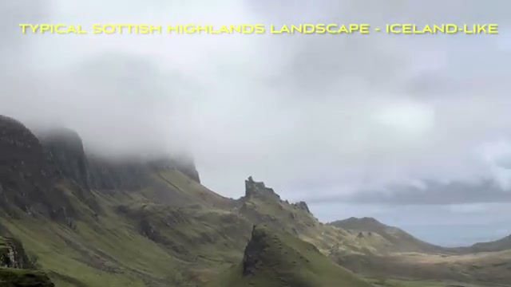

## A small snack cart at the parking lot

Back at the car park, there's a small snack cart — hot drinks and snacks within easy reach of the trailhead. For a hike this short and this scenic, that's a civilized touch.

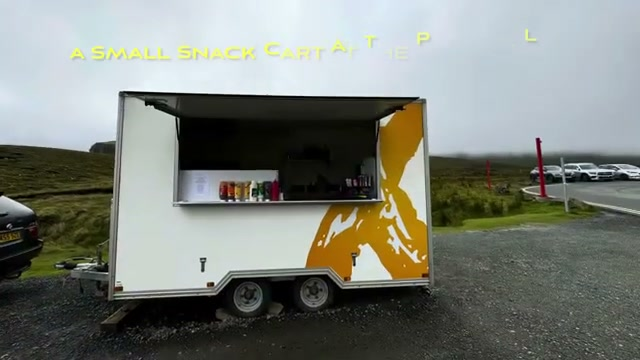

## Verdict

The Quiraing packs a lot into a short walk: cloud-wrapped cliffs, a jagged rock formation, sea views, lochs, and a ribbon of road that ties it all together. At about 7km out and back, it's the rare famous hike that doesn't demand a full day — just waterproof footwear and an eye on the weather. If you're on the Isle of Skye and the cloud lifts even briefly, this is the walk to be on.

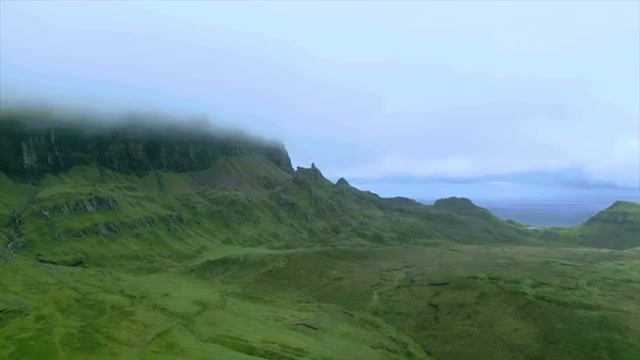

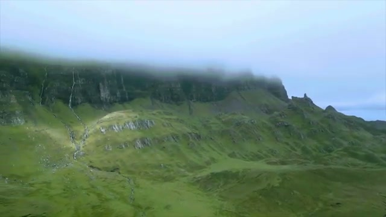
