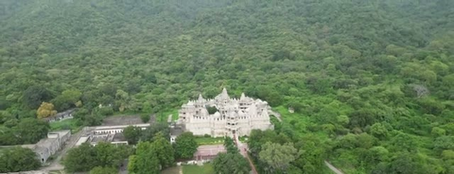
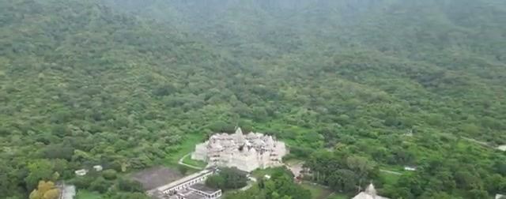
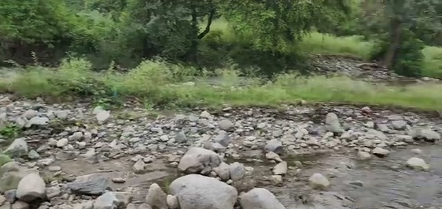
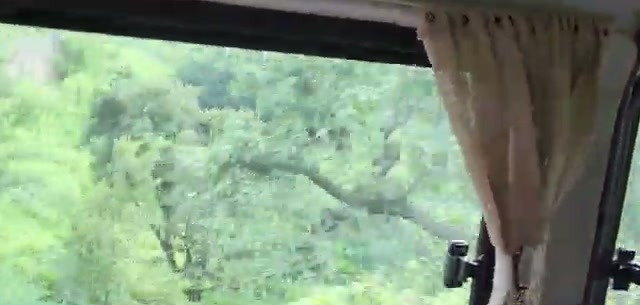
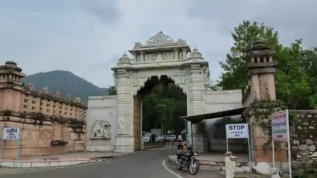
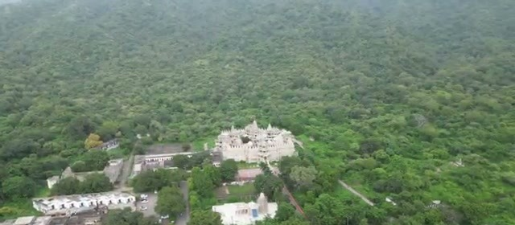
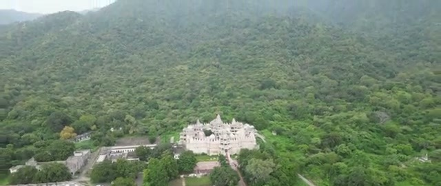
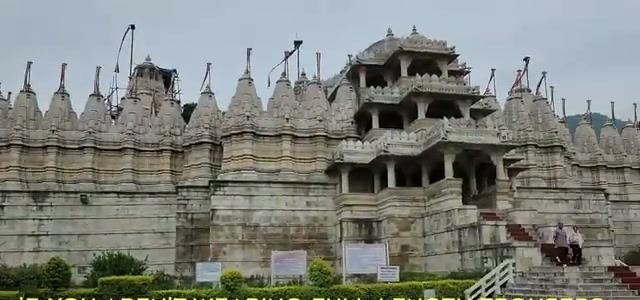
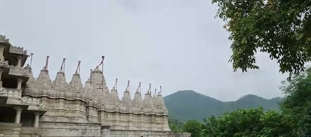
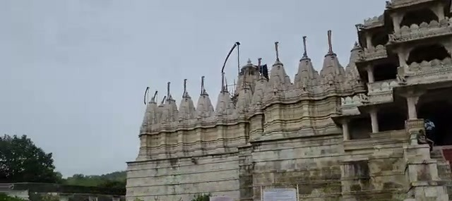



The Ranakpur Jain Temple sits in the Aravali Mountains of Rajasthan — "located in Marwar across the Aravalis from Mewar," as the video's description puts it. It's a 15th-century temple, and it's one of those places that pairs well with a Kumbhalgarh Fort trip: the video calls it "an hour's scenic drive from Kumbhalgarh Fort," and we did the two together.

One honest note before we go further: no cameras are allowed inside the temple, so this is an outside-and-setting visit — the approach, the aerial views, and the marble exterior. The famous 1,444 marble pillars stay a number in the captions here, not something we can show you; that's a view you have to earn in person.

## The setting: forest, hills, and a river

The temple sits in what the video simply calls a "gorgeous forest setting" — a clearing of white marble in an expanse of green Aravali hills.

It's "located on the banks of the Magai River" — the rocky riverbed runs right by the complex.

## Getting there

The drive in is part of the experience: about an hour's scenic drive from Kumbhalgarh Fort, through green monsoon hills. (Ours was a rainy one — the window stayed streaked most of the way.)

You arrive through a carved stone entrance gate —

— and from the air, the whole complex reads as a white-marble island in the forest, ringed by the temple's support buildings.

## The temple: white marble and 1,444 pillars

The headline facts, straight from the video's captions: the temple is a 15th-century structure, "commissioned by Rana Kumbha," built of "locally sourced white marble," and — the number everyone quotes — "there are 1444 marble pillars" inside.

Up close, the exterior is a dense forest of carved shikhara spires — the marble is weathered in places, but the carving is everywhere you look.

The main entrance faces a courtyard where visitors gather — and where the dress code applies (see below).

## Know before you go

Two practical rules from the video, both stated plainly in its captions:

- **Dress code:** "If you aren't wearing full-length trousers... they'll lend you some." Plan accordingly — full-length trousers or be prepared to borrow.
- **No cameras inside:** "No cameras allowed inside." The 1,444 pillars are a look-with-your-eyes experience, and honestly, that's part of the appeal.

## Wrapping up

Ranakpur is a short, easy add-on to a Kumbhalgarh day — an hour's scenic drive each way for a 15th-century white-marble temple in a stunning forest setting. Just leave the camera bag at the gate (figuratively — you'll want it for the exterior), wear full-length trousers, and go see the pillars the old-fashioned way.
