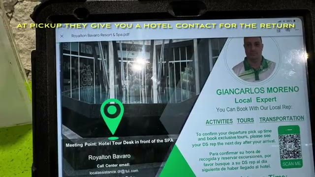
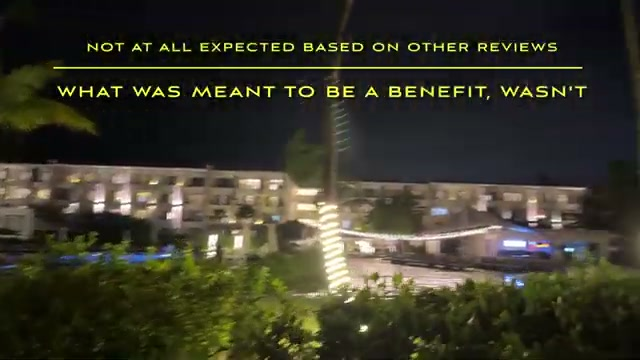
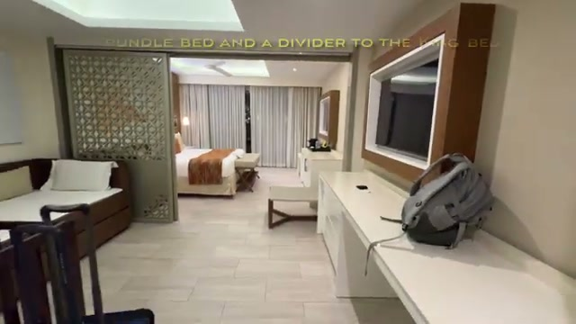
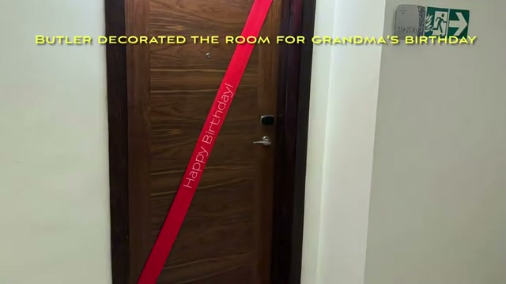
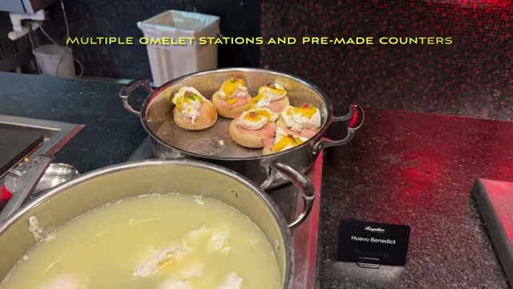
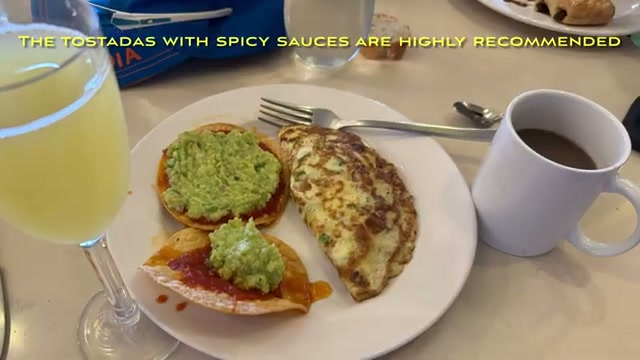
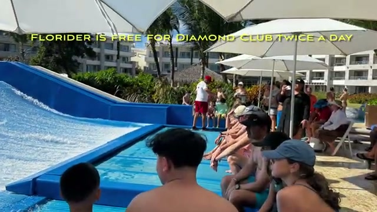
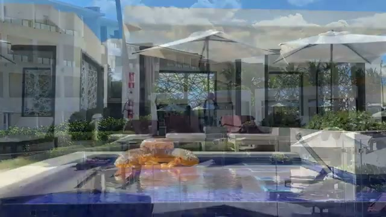
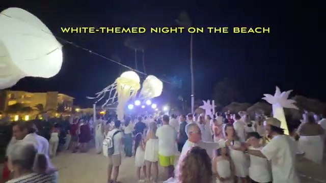
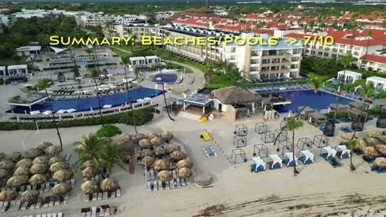



We visited **Royalton Bavaro Punta Cana** over **Christmas 2025**, one of the busiest times of the year. This review covers everything from arrival experience to dining, beaches, activities, and whether **Diamond Club** is worth it.

Royalton Bavaro shares facilities with **Royalton Splash** and **Royalton Punta Cana**, which adds both variety and crowding depending on the time of year.

## Arrival Experience (Christmas Eve)

We flew **JetBlue from JFK Terminal 5** on a busy Christmas Eve and arrived late in the evening.

- Airport and transfer process was smooth overall
- Long immigration lines at PUJ
- Resort arrival was crowded due to holiday rush

**Tip:** At pickup they give you a hotel contact for the return — keep that number handy.

## Check-In (Diamond Club)

- Transported via golf cart to Diamond Club reception
- Check-in on Christmas Eve was **chaotic and disorganized**
- Only one person checking in — minimal staffing
- Long waits despite premium tier

As the video puts it: *"Not at all expected based on other reviews — what was meant to be a benefit, wasn't."* Diamond Club helps, but peak holiday timing matters more.

## Room: Family Ocean View Suite

- Spacious layout suitable for families — trundle bed plus a divider to the king bed
- Separate tub and shower with opaque dividers
- Mini-fridge with soda, juice, and beer; minibar snacks and coffee
- Bedside outlets and USB chargers
- Decent ocean view

One quirk worth knowing: the air conditioning was **impossible to control — freeze or turn off**.

**Highlight:** Our butler decorated the room for grandma's birthday, which was a thoughtful and memorable touch.

## Weather & First Impressions

- Some rainy mornings during the stay
- The ocean view was still beautiful regardless

## Christmas Day at the Resort

- Santa made an appearance in the lobby
- Festive decorations and themed desserts
- Strong holiday atmosphere throughout the property

## Dining Review

### Oceanside (Diamond Club Breakfast)

- Exclusive to Diamond Club
- Small with few options — not impressive
- We actually preferred it for **lunch rather than breakfast**
- **Pizza tip:** Only good when fresh — otherwise skip. One spot is literally called Pizza Grill but never has any pizza.

### Gourmet Marche (Main Buffet)

Best overall dining option at the resort.

- Large selection with multiple stations
- Multiple omelette stations and pre-made counters
- Fresh pastries and lots of variety
- The tostadas are a must-try with the spicy sauces

**Dinner highlights:**

- Pasta and grill stations
- Nightly themed nights — one night was Asian & Indian, another was Mexican
- Special Christmas desserts

### Other Dining Options

**Diamond Club Lounge**

- Light snacks and drinks throughout the day
- Not a full meal replacement

**Poolside Grill**

- Most consistent lunch spot
- Taco salad and buffalo wings were solid

**Food Trucks**

- Two options on property
- Good for quick bites

**Lazy River Grill**

- Small setup
- No pizza available here

**Coffee Shop (Main Lobby)**

- Great for coffee and desserts
- Plenty of sweet treats, plus ice cream

### Specialty Restaurants

**Grazie Italian**

- Reservation arranged by butler
- Surprisingly good pizzas

**Zen Teppanyaki**

- Long wait before food
- Excellent, entertaining chef — participation required
- **Best dinner experience of the trip**

### Room Service

- Included with stay
- **Extremely slow delivery times**

## Beaches

- Noticeable seaweed during our stay
- Water itself was clear
- Neighboring Royalton Punta Cana beach showed erosion

**Important:** Beach chairs were claimed early — often by **8 AM**. And if you walk north half a mile up the beach, conditions change — worth exploring.

Despite drawbacks, we still enjoyed beach time.

## Pools & Activities

### Main Pool

- Aqua Zumba most days
- One day they even had a swimming troupe
- Lively atmosphere

### Lazy River

- Relaxing experience
- Bring your own float for the best experience

### FlowRider Surfing

- Free for Diamond Club guests
- Limited time slots:
  - 9:00–10:00 AM
  - 2:00–3:00 PM

## Cabana Experience

We booked a **poolside cabana for one day**:

- Included dedicated butler service
- Food and drinks delivered
- Access tied to a 90-minute presentation

Worth it if you value comfort and convenience.

## Additional Activities

- Mini golf — a challenging course but good family fun (book via kids club)
- Tennis and pickleball courts
- Free entry to **Royalton Splash Water Park** for Diamond Club guests

**Shuttle schedule:**

- 10:00 AM (recommended)
- 1:00 PM

## Entertainment

- Nightly shows near Gourmet Marche, including a white-themed night on the beach
- Consistently engaging and well-produced

One of the strongest aspects of the resort.

## Final Ratings

| Category | Rating |
| --- | --- |
| Beaches & Pools | 7.5/10 |
| Dining | 6.5/10 |
| Entertainment | 9/10 |

## Final Thoughts

**What we liked:**

- Excellent entertainment
- Large variety of activities
- Strong buffet (Gourmet Marche)
- Family-friendly environment

**What could be better:**

- Check-in experience during peak times
- Inconsistent food quality outside buffet
- Beach maintenance (seaweed)
- Slow room service

## Is Diamond Club Worth It?

**Yes, but with conditions:**

Worth it for:

- Butler service
- Exclusive areas
- FlowRider access
- Easier reservations
- Free entry to Royalton Splash Water Park

Less impactful during:

- Peak holiday crowds (like Christmas)

## Who Should Stay Here?

- Families looking for an active all-inclusive resort
- Travelers who prioritize entertainment and activities
- Marriott Bonvoy loyalists

## Have Questions?

Drop them in the comments on our YouTube channel!

*Watch the full video tour: [Royalton Bavaro Punta Cana Luxury All Inclusive — Diamond Club](https://youtu.be/xOq5-LuCFC4)*

## Our Verdict

Royalton Bavaro is a family resort first and everything else second. If your ideal trip is a loud, activity-packed week where the kids are busy from morning to night and there's a show or a game going on every evening, this place delivers — entertainment was the single strongest part of our stay. The variety is real too: sharing facilities with Royalton Splash and Royalton Punta Cana means a lazy river, a water park, mini golf, tennis, pickleball, food trucks, and a half-dozen restaurants to rotate through on site.

But it's not the resort for everyone. Couples looking for a quiet, romantic escape should look elsewhere — the main pool is lively by design, the property sprawls across three shared resorts, and Christmas week felt like a small city at full occupancy. If you're a food-first traveler, the dining score (6.5/10) tells the story: the buffet is genuinely good, but the specialty restaurants are inconsistent. And if your dream vacation is drifting down to the beach at 10 AM to find a chair waiting for you, reset that expectation — chairs were claimed by 8 AM, and seaweed washes in and out. The beach is fine, not flawless.

Who it's built for: families with kids and teens who'll use the Splash water park access, the FlowRider, the lazy river, and the evening shows; Marriott Bonvoy members who want an all-inclusive that keeps points in play; and travelers who'd rather have entertainment and plenty to do than a pristine beach.

One honest note on Diamond Club: during Christmas week, the premium tier got noticeably blunted. Check-in was chaotic with a single staffer on Christmas Eve, the exclusive Oceanside breakfast was underwhelming, and crowds diluted the "exclusive areas" feeling. The parts that held up — the butler, FlowRider access, easier specialty reservations, free Splash entry — were the genuinely useful ones. Buy Diamond Club for the perks, not the vibe.

## What We'd Do Differently

**Put the butler to work on day one.** We learned too late how much a proactive butler smooths out this resort — reservations, the birthday room decor for grandma, the cabana setup. On day one, hand yours a list: which specialty restaurants you want, which nights, and whether the cabana day is happening. Don't wait for the service to find you.

**Book Zen teppanyaki early in the stay.** It was our best dinner of the trip — an excellent, entertaining chef — but there's a long wait before the food starts. Ask the butler to reserve it for your first or second night, eat a light snack beforehand, and treat the whole evening as the show, not just the meal.

**Skip Oceanside for breakfast; go straight to Gourmet Marche.** The Diamond Club-exclusive breakfast was small and underwhelming, and the buffet outperformed it at every meal. We ended up preferring Oceanside for lunch. Follow the strength: Gourmet Marche for breakfast — omelette stations, pastries — and the tostadas with the spicy sauces at least once.

**Win the chair race or skip it.** Want a beach chair in a good spot? Be out before 8 AM — or don't fight it and walk north half a mile up the beach, where conditions change and the crowd thins. Both strategies worked; showing up at 10 hoping for the best doesn't.

**Take the 9 AM FlowRider slot.** The free-for-Diamond-Club sessions run 9:00–10:00 AM and 2:00–3:00 PM. The morning slot is cooler and leaves the afternoon open. Same logic for the Splash water park shuttle: the resort recommends the 10 AM bus, and they're right.

**Bring a float for the lazy river.** It's relaxing either way, but a proper float turns it into one of the best hours of the trip. The single cheapest upgrade of the whole vacation.

**Don't rely on room service for anything time-sensitive.** It's included, but delivery was extremely slow. Hungry and impatient? The poolside grill or a food truck beats waiting.

**Pack for the AC quirk.** Our room's air conditioning was impossible to control — full freeze or off. Pack a layer; the thermostat won't negotiate.

## Practical Tips

**Booking and Diamond Club.** Worth it for the butler service, FlowRider access, easier restaurant reservations, and free entry to Royalton Splash Water Park — less worth it during peak holiday weeks, when crowds blunt the premium feel. If you're paying the upcharge specifically for Christmas or spring break, know you're buying perks, not peace. In the off-season with a regular room, you'll likely get most of the experience.

**Dining reservations.** Have the butler arrange specialty restaurants as early as possible — Grazie and Zen both needed reservations, and slots go during busy weeks. Pizza at Grazie was surprisingly good, which is useful intelligence where the pizza situation is unreliable elsewhere (one venue is literally called Pizza Grill and never has any pizza; fresh or skip). Room service is a last resort, not a plan.

**Christmas-week crowds.** Everything here scales with occupancy: the shared facilities across three Royaltons are a feature in the off-season and a crowd in December. Check-in was understaffed on Christmas Eve, and immigration at Punta Cana was slow on a busy evening arrival. Build slack into day one, keep the hotel contact number they hand you at pickup, and assume the first evening is logistics, not vacation. The upside was real: Santa in the lobby, themed desserts, festive decorations. The crowds came with a payoff.

**Beach strategy.** Seaweed is a when-not-if situation on this coast. The water itself was clear during our stay, and conditions changed noticeably just a half-mile walk north. Treat the beach as one option among many rather than the centerpiece, and you won't be disappointed.

**The cabana decision.** We booked a poolside cabana for one day — dedicated butler service, food and drinks delivered, real comfort. Worth it for a home base on your beach day. Know going in that access was tied to a 90-minute presentation, so factor the sales pitch into the price of the experience.

