# Santa Claus Express: Helsinki to Rovaniemi Overnight En-Suite Sleeper Train



Rovaniemi in Lapland, Finland, is famous as the home of Santa — and these days it is also known for glass igloo hotels. Instead of flying from Helsinki, you can ride the train: the Santa Claus Express, an overnight sleeper all the way toward the Arctic Circle.

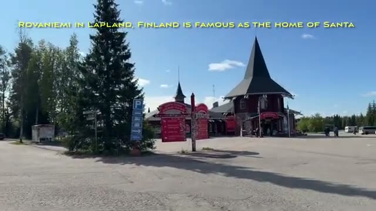

## Two Santa Express trains, one late-night departure

They have two "Santa Express" trains running the Lapland overnight routes. We took the late night one — the 11pm departure from Helsinki.

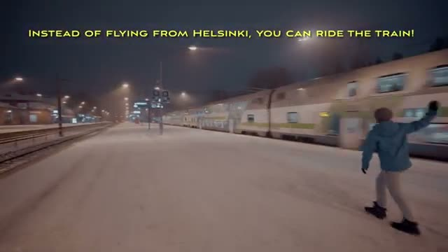

The route runs Helsinki to Rovaniemi, calling at Tampere, Seinäjoki, Oulu and Kemi along the way.

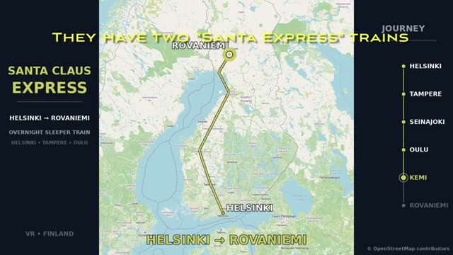

## The upper en-suite cabin: 188 EUR total

We booked upper en-suite cabins — 188 EUR total. They aren't a substitute for hotel rooms, but they're a hit with kids.

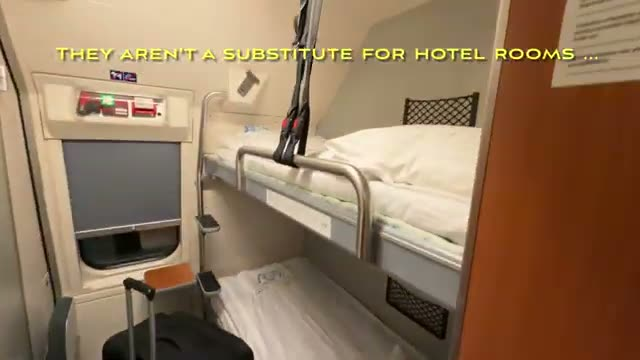

## A real (tiny) bathroom

There's a tiny bathroom with actual flowing water — and the mirror swings aside if you want to shower.

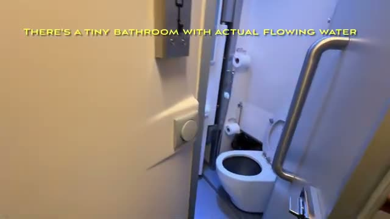

## Sleeping through the night

Blinds will ensure you aren't awake at 4am. And due to the angle to Oulu, sunrise is actually on the left.

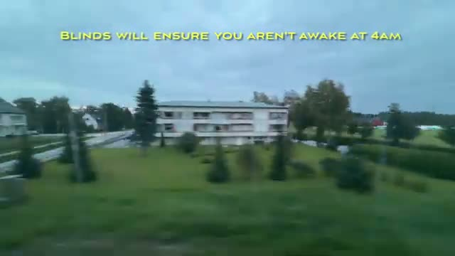

## The restaurant car

The train has a restaurant car: coffee, drinks, juices, croissants — but no breakfast sandwiches.

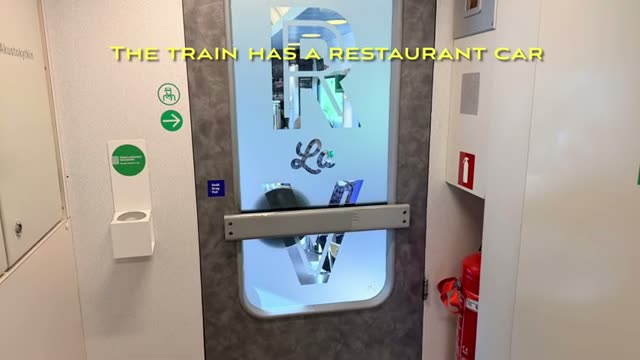

## Crossing the Kemijoki

Finland is mostly flat — after Kemi we cross the Kemijoki river.

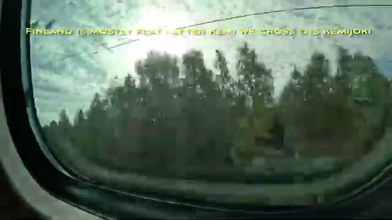

## On-time arrival in Rovaniemi

On-time, non-fussy arrival in Rovaniemi — and the train station houses rental car companies. We booked an automatic wagon with Alamo.

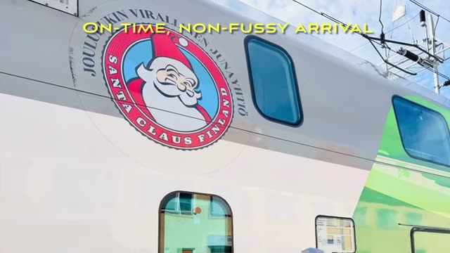

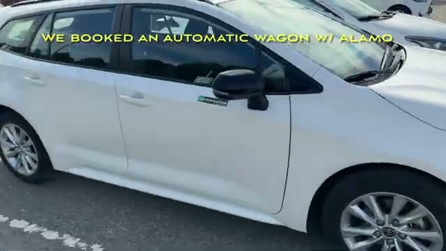

## To the Arctic Circle and Apukka Resort

After a brief stop at the Angry Birds playground, we were off to the Arctic Circle — empty on a late August weekday afternoon. Lunch at the pizza place at one end of the village, and then 15 mins further to the fabulous Apukka Resort.

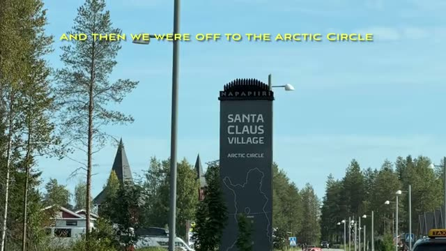

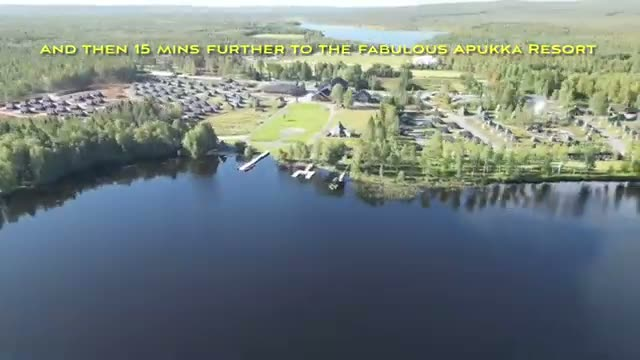

---

Not a hotel room, but a memorable way to fall asleep in Helsinki and wake up in Lapland.
