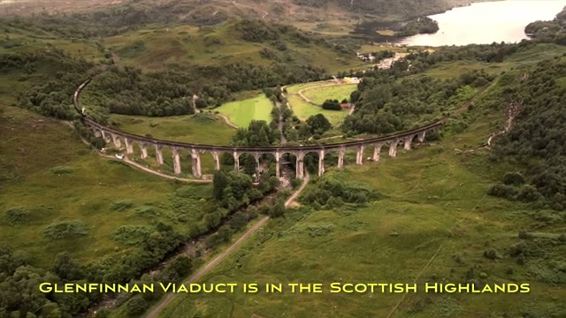
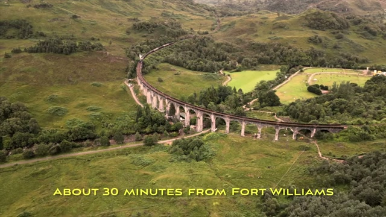
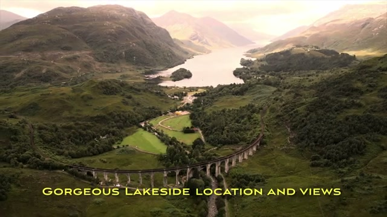
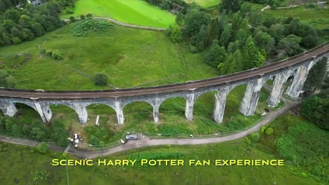
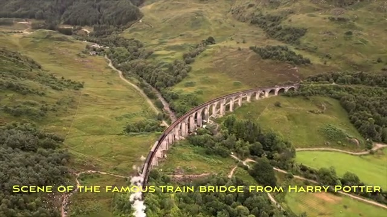
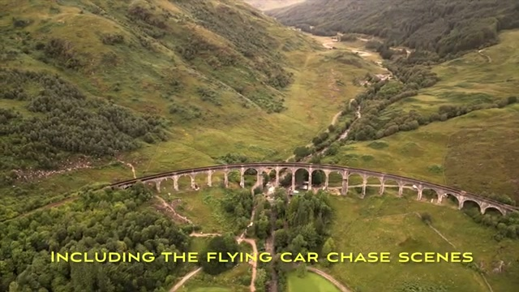
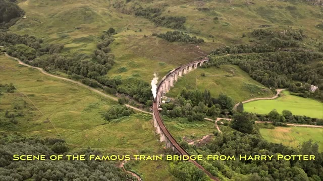
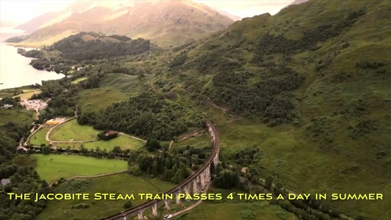
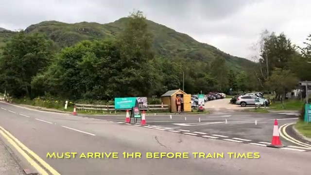
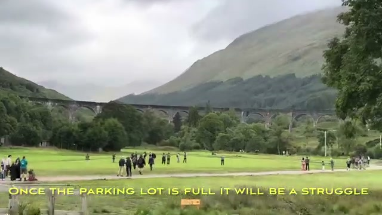



This short video is all about one moment: the Jacobite steam train — better known as the Hogwarts Express — crossing Glenfinnan Viaduct in the Scottish Highlands. There's no narration; the video is drone aerials and ground clips set to the ambient sound of the train, with short yellow captions carrying the facts. Here's what it shows.

## The viaduct from above

Most of the footage is drone work circling the viaduct — the long stone-arched railway bridge curving through a green Highland valley. From the air you can see how the line sweeps across the glen, with hills rising on both sides.

The viaduct sits in a gorgeous lakeside setting, with the loch and the surrounding mountains filling out the background of the wider shots.

A closer pass shows the individual arches and the track running along the top of the bridge.

## The Harry Potter connection

This is the famous train bridge from Harry Potter — the bridge the Hogwarts Express crosses in the films. The video notes this was the location of several famous scenes, including the flying car chase scenes from *Harry Potter and the Chamber of Secrets*.

## Watching the Jacobite steam train cross

The money shot: the Jacobite steam train crossing the viaduct, visible here as a plume of white steam rising above the far end of the bridge as the train works its way across. Per the video's captions, the Jacobite passes four times a day in summer — those are the windows to plan around.

## Tips if you go

The video's captions double as a practical checklist. Glenfinnan is about 30 minutes from Fort William. Arrive an hour before the train times — the video warns that once the parking lot is full, "it will be a struggle."

Crowds gather on the meadow facing the viaduct for each crossing. The video's advice on where to stand: watch from the meadow or up the hill.

## Verdict

A short, sweet watch for Harry Potter fans and steam-train romantics alike — Glenfinnan Viaduct is every bit as dramatic as the films make it look, and the video's one big takeaway is logistical: the Jacobite only crosses a few times a day in summer, so check the times, arrive early, and claim your spot on the meadow or the hill before the parking fills up.
