

The video title says it plainly: a Grand Tour of the Scottish Highlands, offered as an alternative to the NC500, with music and no commentary. It's a 10-minute dashcam drive with a drone shot thrown in, and the route is spelled out on screen in yellow road labels — A9, A836, A838, over Kylesku Bridge, then the A894 and A835, before the video leaves the Grand Tour route on the A832. Here's what the drive looks like, in the order it was filmed.

## The A9: a rural start

The drive begins on the A9 through open countryside — hedgerows, a lone tree dominating the roadside, and a van lumbering ahead under a grey sky.

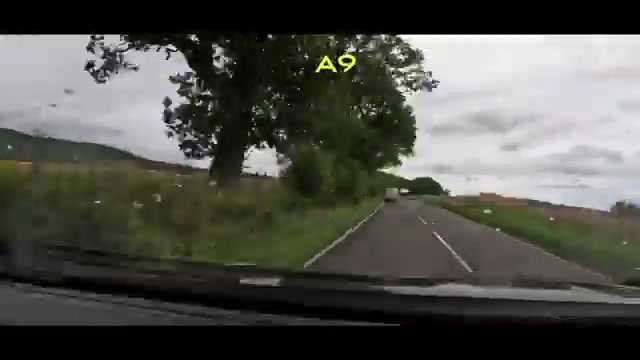

## The A836: into the trees

The A836 runs narrower and leafier, threading through woodland with cars visible ahead — the kind of road where you drive slowly and don't mind it.

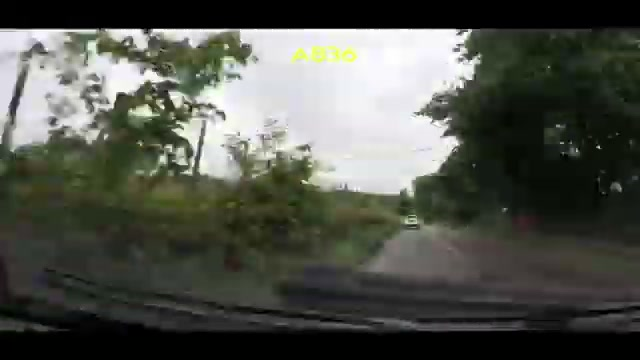

Some sections add a guardrail, with dense trees pressing in from both sides of the road.

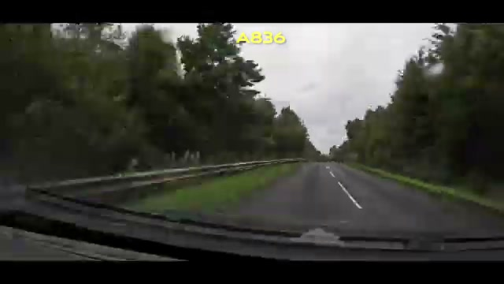

## The A838: open moorland and rain

The A838 opens everything up — big empty moorland rolling to the horizon under a heavy grey sky, the road running straight through it.

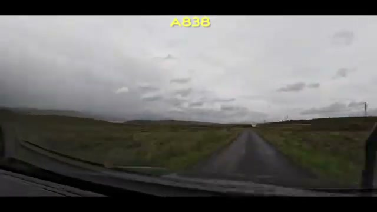

Not every stretch is exposed. Parts of the A838 drop back into forest, a narrow lane walled in by trees.

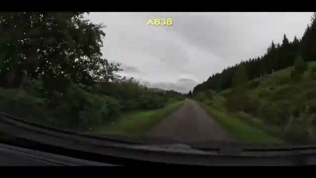

And this is the Highlands, so rain arrives mid-drive — water spots on the windshield, the road cutting through a broad green valley between hills.

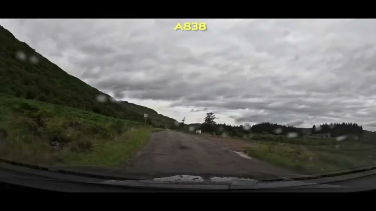

## Kylesku Bridge: the highlight

The standout moment is an aerial shot of Kylesku Bridge — the elegant curved concrete bridge arcing across a sea loch, with mountains rising on the far shore. It gets its own on-screen label in the video, and it's the single most cinematic frame of the drive.

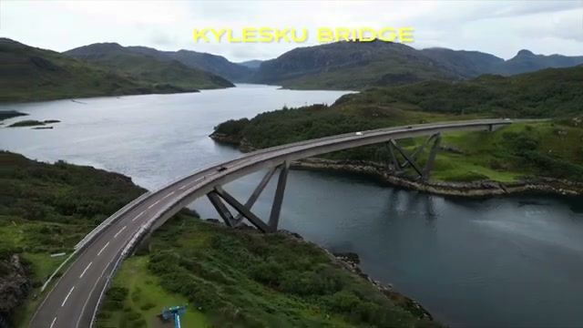

## The A894: through the mountain pass

Back on the dashcam, the A894 runs through a rugged mountain pass — steep rocky slopes closing in on the left as the road pushes north.

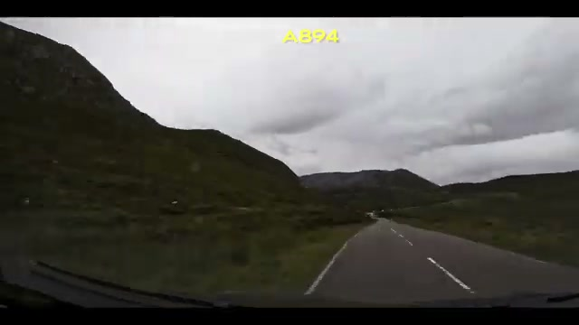

## The A835: moody Highland skies

The A835 brings the classic Highland mood: a tree-lined road under towering dark clouds that look ready to break at any moment.

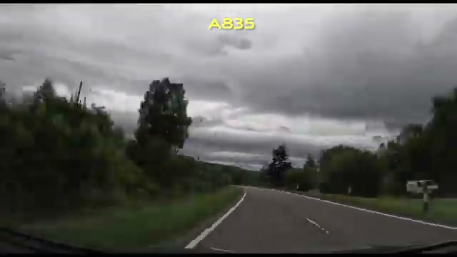

## Leaving the route on the A832

Near the end, the on-screen label changes: "OFF THE GRAND TOUR ROUTE NOW - A832." The Grand Tour loop ends, and the drive continues through tall conifers on the A832, following a car ahead into the trees.

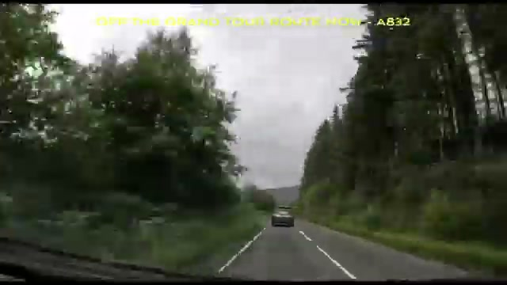

The final frames are pure woodland road — dense forest on the left, an SUV ahead, and the light fading.

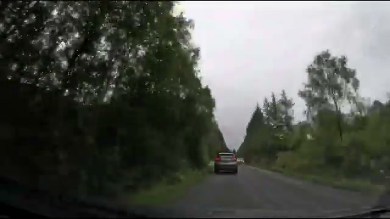

## Verdict

This is a route video, not a destination video — the whole point is the string of A-roads and the landscape they cross. The route as shown on screen runs A9 → A836 → A838 → Kylesku Bridge → A894 → A835, then leaves the Grand Tour loop for the A832. Expect narrow woodland lanes, wide empty moorland, a rainy interlude, one genuinely dramatic bridge from above, and moody skies throughout. If the NC500's 500-mile commitment is more than you want, a loop like this one shows what the same far-northwest scenery looks like in a compact, music-only package.
