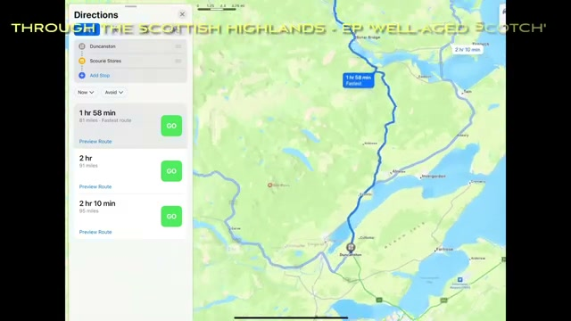
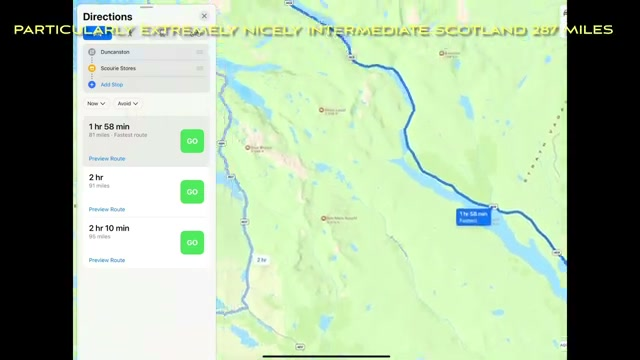
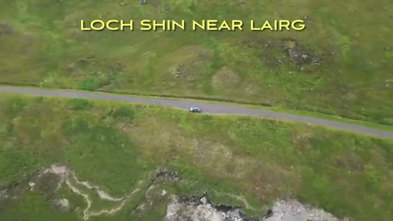
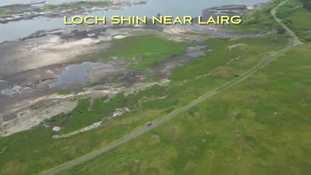
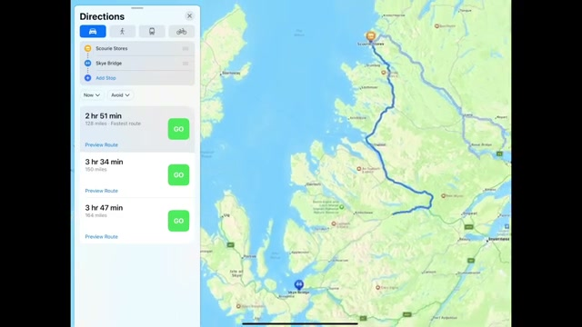
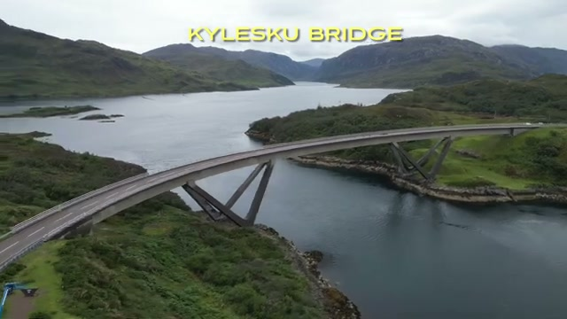
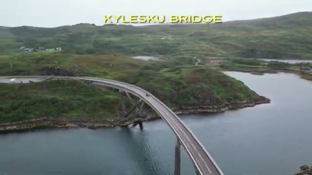
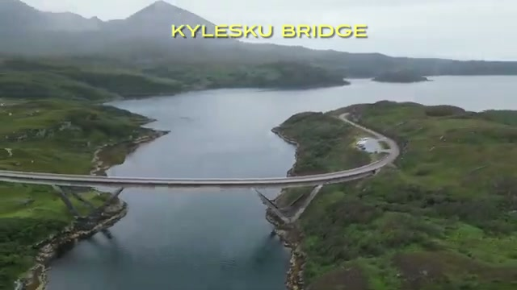
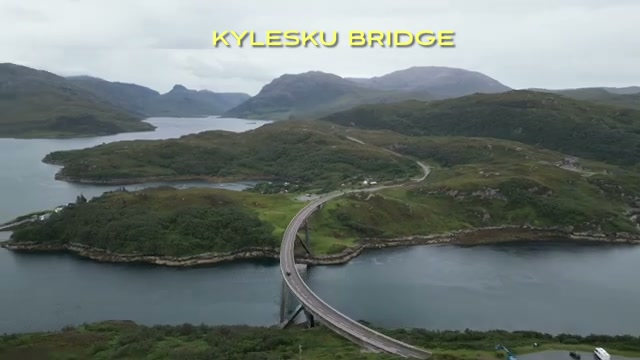
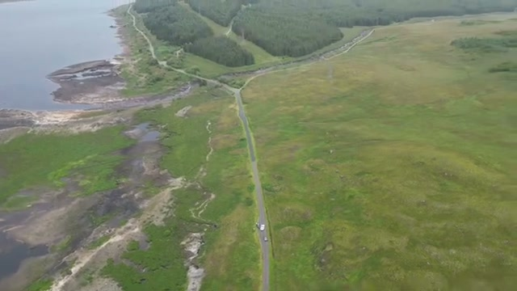



This is a short one — about two minutes of drone footage from the Scottish Highlands, cut to follow the route of the "Well-Aged Scotch" episode on the way to the NC500. Two locations get the aerial treatment: the moorland roads around Loch Shin near Lairg, and the Kylesku Bridge. Here's what the video shows.

## The route: "Through the Scottish Highlands — Ep 'Well-Aged Scotch'"

The video opens on a map screen with the episode title card: "THROUGH THE SCOTTISH HIGHLANDS - EP 'WELL-AGED SCOTCH'". The first leg plotted on the map shows a fastest route of 1 hr 58 min over 81 miles.

## "Particularly extremely nicely intermediate Scotland"

The next map segment carries the video's most memorable caption: "PARTICULARLY EXTREMELY NICELY INTERMEDIATE SCOTLAND 287 MILES" — and the map shows the leg threading along the coast past the lochs of the northwest.

## Loch Shin near Lairg

The first drone segment is captioned "LOCH SHIN NEAR LAIRG" — long top-down shots of a single-track road running through green moorland, with a car making its way along it. Classic empty-Highlands driving: one road, no traffic, moor in every direction.

The drone then follows the road as it runs along the Loch Shin shoreline — wide banks of shallow water on one side, rough green pasture on the other.

## Next leg: toward Skye Bridge

Back to the map for the second leg — this one plotted toward Skye Bridge, with the fastest route shown at 2 hr 51 min over 150 miles. That's the push onto the NC500 proper.

## Kylesku Bridge

The second and longer drone segment is captioned "KYLESKU BRIDGE" — the sweeping curved bridge over the water, shot from several angles. The drone traces the bridge's curve, climbs for the top-down view, and pulls wide to frame it against the misty mountains.

The segment closes on the road curving away from the bridge along the loch — the kind of road that makes the NC500 what it is.

## Verdict

Two minutes, two stops, and it works as a taster: the empty moorland roads around Loch Shin and the drama of the Kylesku Bridge are exactly why the far northwest of Scotland is the NC500's signature stretch. If this short has you wanting more, the full-length scenic drives from the same trip cover the ground in detail.

