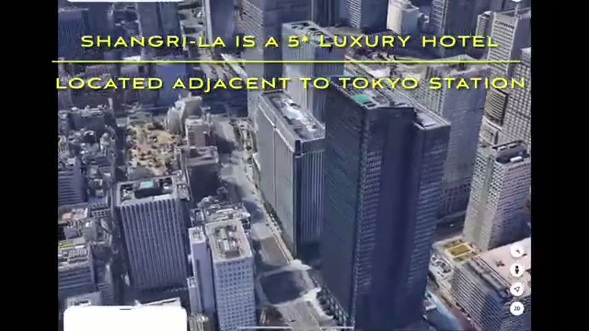
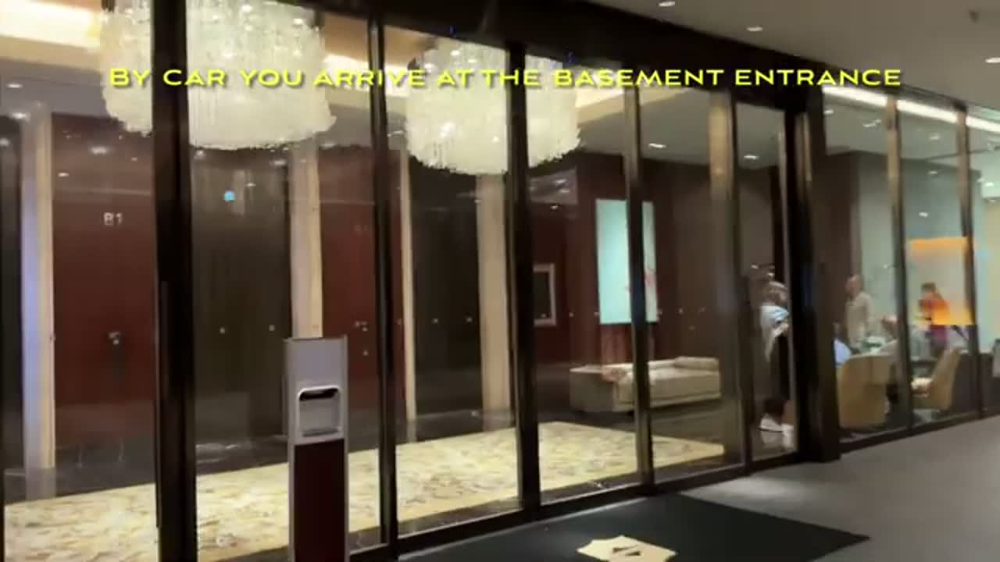
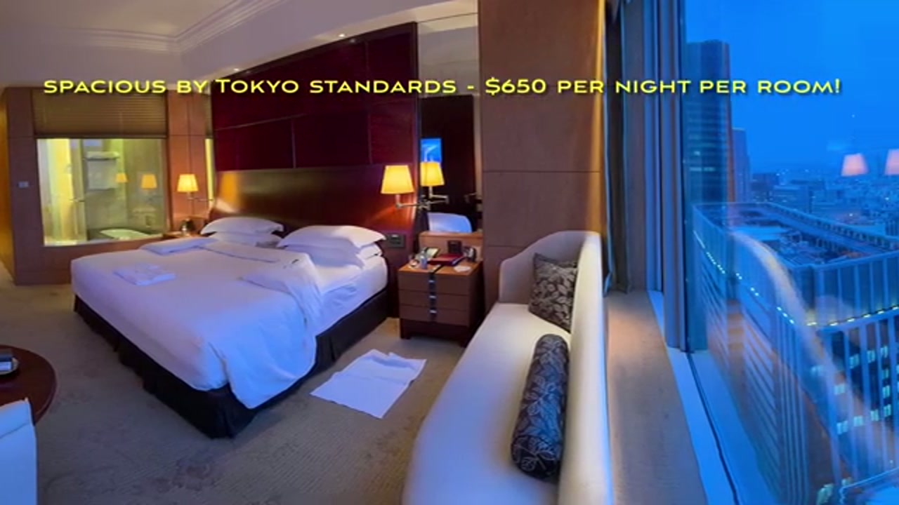
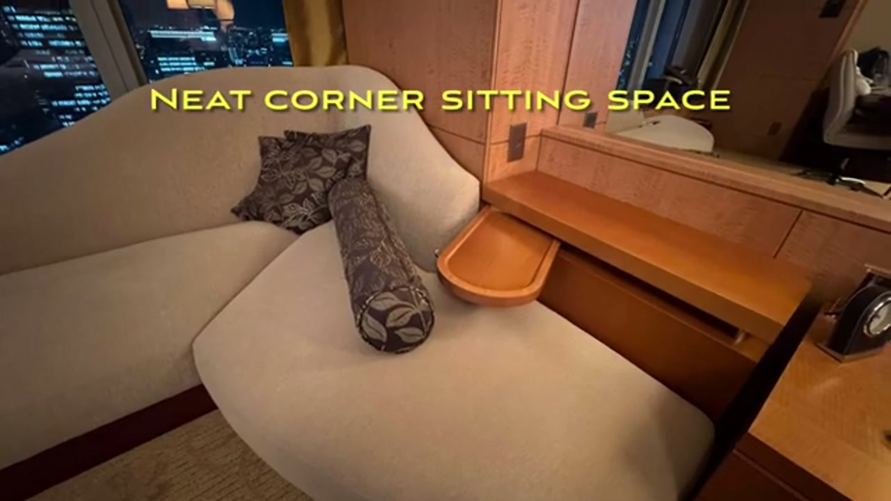
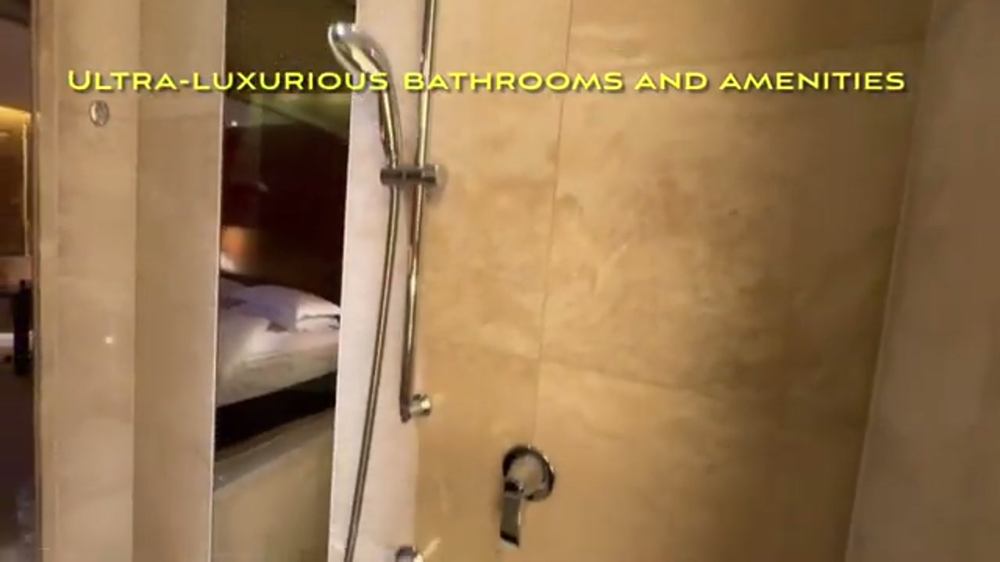
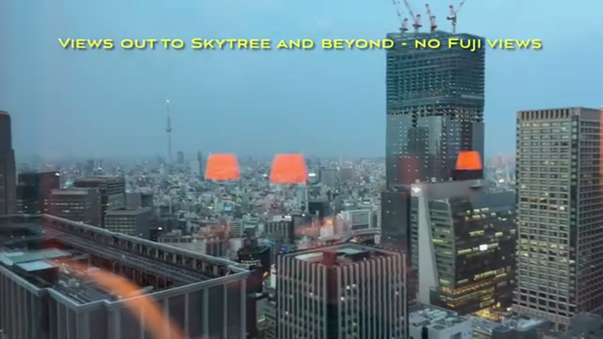
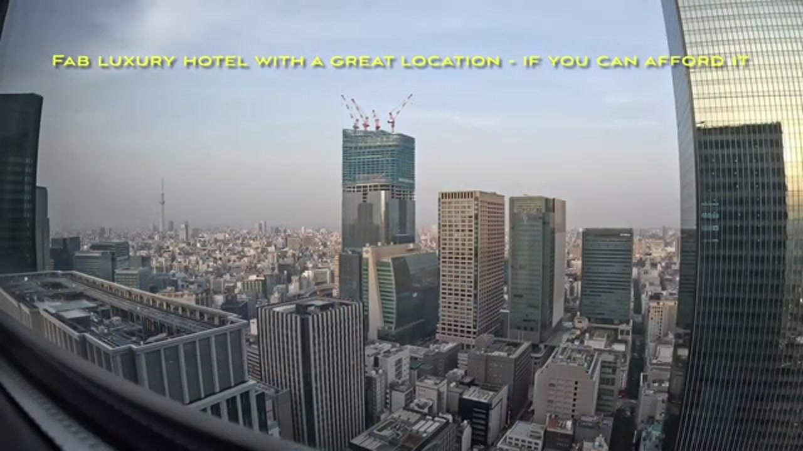
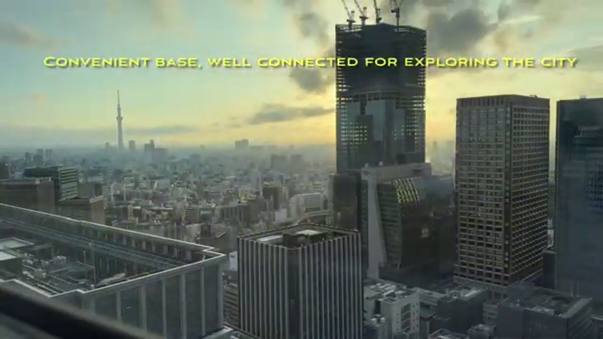

*Visited May 2025 • Tokyo, Japan*

You can watch our full hotel tour here:



## Overview

Shangri-La Tokyo is a 5-star luxury hotel in a high-rise **adjacent to Tokyo Station** — about as central as a Tokyo base gets. We booked **two Deluxe King rooms**, and the stay's verdict, in the video's own words, is a "fab luxury hotel with a great location — if you can afford it," and a "convenient base, well connected for exploring the city."

## Arrival

By car, you arrive at the **basement entrance** — worth knowing before you pull up, since the grand front-door arrival this is not. Once inside, the hotel feels every bit the luxury property its five stars promise.

## The Rooms: Spacious by Tokyo Standards

The Deluxe King rooms are **spacious by Tokyo standards**, which in this city is high praise — Tokyo hotel rooms are famously compact, and these are not. Each room has a **neat corner sitting space**, a proper place to sit and take in the view rather than just a bed and a desk.

A small, memorable touch: a **savory, crunchy rice-puff welcome snack** waiting in the room.

## Bathrooms: Ultra-Luxurious

The bathrooms live up to the room rate, with **ultra-luxurious bathrooms and amenities** — marble, a deep soaking tub, and the kind of finishing you expect at this price point.

## The Views: Skytree, Not Fuji

Up high, the views run **out to the Skytree and beyond** — a sweeping Tokyo skyline, day and night. One honest caveat from the video: **no Fuji views** from here, so don't book expecting Mount Fuji on the horizon.

## Price and Verdict

The rooms ran **$650 per night per room** at the time of our stay (May 2025) — prices will have moved since, so check current rates before you plan around that figure. At that price this is unapologetically a splurge, not a value pick.

The case for it is the combination: a genuinely luxurious room, bathrooms to match, and a location next to Tokyo Station that makes the whole city easy — a convenient, well-connected base, if the rate fits your budget.
