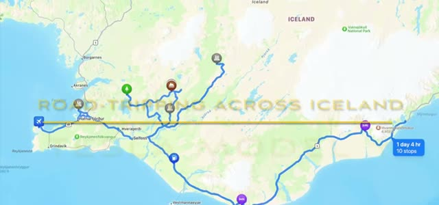
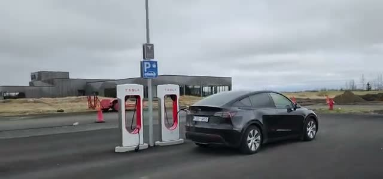
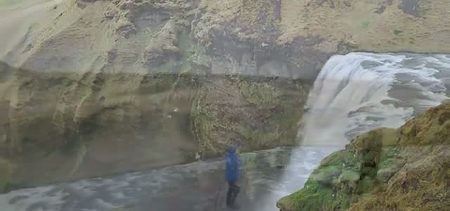
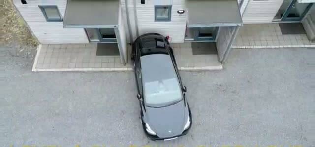
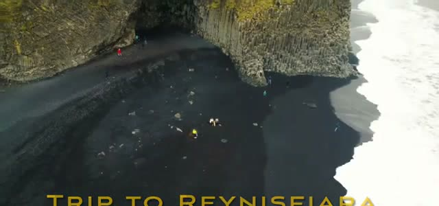
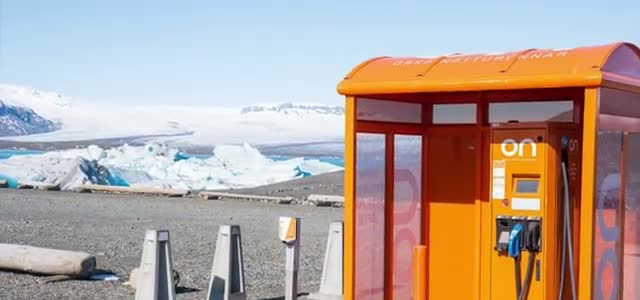
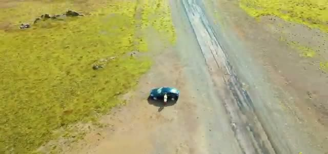
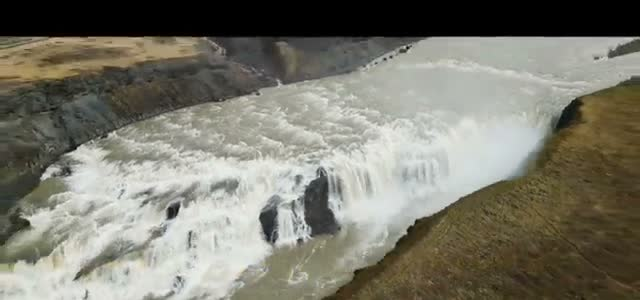
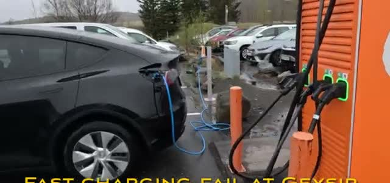
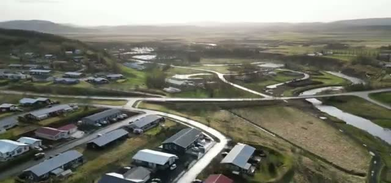



We rented a Tesla Model Y from Europcar for a scenic road trip across Iceland — Ring Road driving, waterfalls, black-sand beaches, and a crash course in keeping an EV charged where the weather changes every twenty minutes. The route covered the south coast and back, roughly a day and four hours of driving with ten stops. Here's the trip, charger by charger.

## The rental: a black Model Y from Europcar

The trip starts at the Europcar lot — a black Tesla Model Y, which would be home for the next several days. "We rented the Tesla from Europcar" is the whole premise of the video: an EV, not a gas SUV, for a full Iceland road trip.

## Tesla Superchargers all along the Ring Road

The first charging lesson lands early: there are Superchargers all along the Ring Road. The video's first stop is a Supercharger at a gas station in Hvolsvöllur, with the Model Y plugged in and topping up while the trip gets underway. If you're driving a Tesla in Iceland, the backbone of your charging plan is already built.

## A pizza stop worth the caption

Not everything is about electrons. The video calls out an "Excellent pizza here!" at Björk Restaurant & Bar — the kind of roadside food stop that earns its own caption. Then it's back on the road: "Continuing on to Seljalandsfoss."

## Seljalandsfoss

Next stop: Seljalandsfoss, the waterfall you can walk behind. Even in moody weather it's one of the south coast's essential stops, and it sits right on the driving route.

## Level 1 charging overnight

The slow-charging strategy: plug the Model Y into a regular outlet at the overnight stay and let Level 1 charging do its thing while you sleep. The drone shot shows the car parked outside the lodging, cable in, for the night. It's slow — but when the car sits for eight-plus hours, slow is fine.

## Reynisfjara black sand beach

Daylight hours are for sightseeing. The trip continues to Reynisfjara, the famous black-sand beach near Vik with its basalt columns and pounding surf — one of the most photographed spots on the south coast.

## ON chargers at the tourist stops

Iceland's other charging network is ON — the bright orange fast chargers that show up at gas stations and, notably, at many tourist places. This one sits with a glacier lagoon full of icebergs behind it. Two practical tips from the video: there are ON charging stations at many tourist places, and it's highly recommended to install the ON charging app before you need it.

## Detour on Rt 208/209 on the way back

On the return leg, the route takes a detour on Rt 208/209 — gravel highland-edge roads through wide-open mossy terrain, the Model Y raising dust on the dirt. This is the scenic, slow part of the trip: empty roads, big landscapes, and the car well outside the paved Ring Road.

## Gullfoss, then a charging fail at Geysir

The Golden Circle leg includes a stop at the magnificent Gullfoss — the great two-tiered waterfall, seen here from the drone. But the charging story takes a turn at Geysir: "Fast charging fail at Geysir." The Model Y is plugged into the orange ON charger and it simply doesn't work — the one real charging failure of the trip.

The fallback: "Level 1 slowww overnight charging in the cold." Back to the wall outlet, overnight, in a small town — slow charging in cold weather, but it gets the job done.

## Back in Reykjavík: Hallgrímskirkja

The trip wraps up in Reykjavík with a stop at the "epic church in the center of town" — Hallgrímskirkja, its basalt-column-inspired tower unmistakable against the sky.

## Returning the car

The Model Y goes back to the Europcar lot near the airport — a short walk or shuttle back to the terminal, and the trip is done.

## Verdict: EV road-tripping in Iceland works

Charging a Tesla across Iceland turned out to be very doable: Superchargers line the Ring Road, ON's orange chargers cover the tourist stops (install the ON app), and Level 1 overnight charging fills the gaps — even if it's slowwww in the cold. The one honest blemish: a fast-charging fail at Geysir, a reminder to always have a backup plan. Rent the EV, plan around the chargers, and the south coast is yours.

## Our verdict: who should rent the Model Y in Iceland

**Rent the Model Y if:** your Iceland plan looks like ours — the south coast and the Ring Road, sightseeing stops every hour or two, and nights at a lodging with a parking spot. This is where the car shines. Superchargers already line the Ring Road, the ON network's orange fast chargers sit at exactly the tourist stops you'd visit anyway (glacier lagoon included), and overnight Level 1 charging quietly tops the car off while you sleep. If your driving days are shaped by waterfalls and beaches rather than by the clock, the charging never feels like a chore — it just happens in the background while you're doing the fun stuff.

**Think twice if:** your itinerary goes deep into the highlands. Our gravel detour was Rt 208/209 — scenic, dusty, well outside the pavement — and the Model Y handled it fine. But that's the *edge* of the highlands, not the interior F-roads, and a long-range touring EV is not a highland river-crossing rig. Don't extrapolate from our trip to a Landmannalaugar crossing. Also think twice if you're on a ruthless schedule: the Geysir charger failing taught us that one dead fast charger can rearrange an afternoon. EV road-tripping in Iceland rewards travelers who can absorb a detour, not travelers counting minutes.

**The honest middle:** if you're a nervous first-time EV renter, this is actually a great place to start. The country's small, the charger backbone is genuinely good, and the fallback — a plain wall outlet overnight — really does work, even in the cold. It was slowww, per the caption, but slow plus eight hours of sleep equals a workable battery in the morning.

## What we'd do differently

**Install the ON app before leaving the airport.** The video's advice was "highly recommended to install the ON charging app before you need it" — we'd make it step one, standing in the Europcar lot, before the car even moves. When a charger works matters less than being ready the moment you arrive at one.

**Never plan a stop around a single charger.** The Geysir fail was the trip's one real blemish, and the lesson is simple: treat every fast-charge stop as a bonus, never as the load-bearing wall of the day's plan. Pair charging with something you'd do anyway — lunch, a waterfall, a viewpoint. Björk Restaurant & Bar was the model: excellent pizza, and the car can wait. Geysir could have been that stop too, had the charger cooperated.

**Ask about the outlet when you book the lodging.** Level 1 overnight charging was the unsung hero of this trip — the drone shot of the car plugged in for the night, and the "slowww overnight charging in the cold" fallback that saved the Geysir day. On a future trip we'd confirm with each host at booking time that there's an accessible outlet where the car parks, and plug in the moment we arrive rather than after dinner. In cold weather, every extra hour on the cable counts.

**Do the gravel detour — just budget the time.** Rt 208/209 was one of the best parts of the trip: empty roads, mossy plains, dust behind the car. We'd do it again, but we'd give it a full unhurried half-day and keep speeds modest. Gravel in Iceland is beautiful and punishing in equal measure, and the only schedule that survives it is a loose one.

## Practical tips: booking, charging, and the fine print

**Booking the car.** Rent as early as your dates firm up — EVs are popular with Ring Road drivers and the lot is finite. At pickup, photograph everything, note the starting charge level, and find the charge port and cable before you leave the lot. At return, our experience was easy: the Europcar lot sits near the airport with a short walk or shuttle back to the terminal, so budget that final top-up (or the return-charge-level requirement) into your last driving day, not your departure morning.

**The three-layer charging plan.** This is the whole strategy, and it worked: (1) Tesla Superchargers along the Ring Road as the backbone — first stop Hvolsvöllur was at a gas station, so coffee and restrooms come built in; (2) ON fast chargers at tourist stops, with the app installed and an account set up before you need it; (3) Level 1 overnight charging at the lodging as the slow, reliable base layer. No single layer is the whole plan, and that's the point — when layer two failed at Geysir, layer three carried the night.

**Charging in the cold.** Overnight Level 1 in cold weather is genuinely slow — the "slowww" in the caption is doing real work. Plug in as early in the evening as you can, and don't expect miracles: the car gains range while you sleep, but at a trickle. If you're traveling in the colder months, treat every range estimate with a margin and favor the faster chargers during the day.

**Gravel roads and the fine print.** We took a Model Y onto gravel on Rt 208/209 and loved it — but read your Europcar rental terms before you follow our tire tracks. Iceland rental agreements are famous for their gravel, sand, and ash fine print, and what's fine for the car mechanically may not be fine for your damage coverage. Know where you stand before the dust starts flying, keep speeds down on loose surfaces, and remember that Iceland's most common rental souvenir is a chipped windshield.

**Insurance, briefly.** We can't price your trip for you, but the one line of advice we'd give any renter: understand the gravel-road and undercarriage exclusions in whatever coverage you take, because the Ring Road is paved and wonderful while the best detours — ours included — are not.
